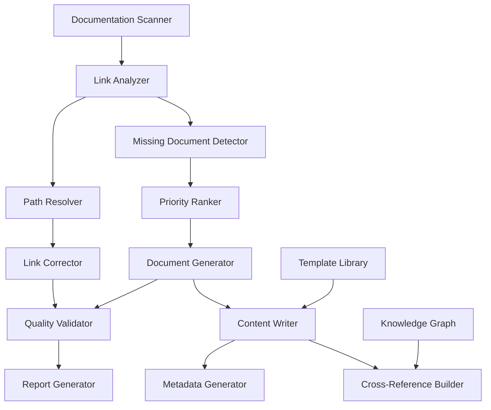

# Design Document: Embedded Documentation Link Fix and Content Creation

## Overview

This design document outlines the architecture and implementation approach for fixing broken links in the embedded systems documentation knowledge base and creating comprehensive, high-quality technical documents for all missing content. The solution consists of three main phases: link analysis and correction, document creation, and quality validation.

The system will process approximately 14 missing documents, fix dozens of broken links, and ensure all content meets quality standards with minimum 1500 lines of rich technical content per document.

## Architecture

### System Components



### Component Descriptions

1. **Documentation Scanner**: Recursively scans all markdown files in the knowledge base
2. **Link Analyzer**: Parses markdown files and extracts all internal links
3. **Path Resolver**: Calculates correct relative paths between documents
4. **Link Corrector**: Updates markdown files with corrected links
5. **Missing Document Detector**: Identifies documents that are referenced but don't exist
6. **Priority Ranker**: Assigns priority to missing documents based on multiple factors
7. **Document Generator**: Orchestrates the creation of new documents
8. **Content Writer**: Generates comprehensive technical content
9. **Metadata Generator**: Creates proper frontmatter for documents
10. **Cross-Reference Builder**: Establishes bidirectional links between related documents
11. **Quality Validator**: Ensures all documents meet quality standards
12. **Report Generator**: Produces detailed reports of all operations
13. **Template Library**: Stores document templates for different content types
14. **Knowledge Graph**: Maintains relationships between documents

## Components and Interfaces

### Link Analysis Module

```python
class LinkAnalyzer:
    """Analyzes markdown files for link validity"""
    
    def scan_directory(self, root_path: str) -> List[DocumentInfo]:
        """Recursively scan directory for markdown files"""
        pass
    
    def extract_links(self, file_path: str) -> List[Link]:
        """Extract all markdown links from a file"""
        pass
    
    def validate_link(self, link: Link, source_file: str) -> LinkStatus:
        """Check if a link is valid"""
        pass
    
    def categorize_links(self, links: List[Link]) -> Dict[str, List[Link]]:
        """Categorize links as valid, broken, or missing"""
        pass

class PathResolver:
    """Resolves correct paths between documents"""
    
    def calculate_relative_path(self, from_file: str, to_file: str) -> str:
        """Calculate correct relative path"""
        pass
    
    def normalize_path(self, path: str) -> str:
        """Normalize path separators and format"""
        pass
    
    def find_target_file(self, filename: str, search_dirs: List[str]) -> Optional[str]:
        """Find actual location of target file"""
        pass

class LinkCorrector:
    """Corrects broken links in markdown files"""
    
    def fix_link(self, file_path: str, old_link: str, new_link: str) -> bool:
        """Replace broken link with correct link"""
        pass
    
    def batch_fix_links(self, corrections: List[LinkCorrection]) -> FixReport:
        """Apply multiple link corrections"""
        pass
    
    def preserve_formatting(self, content: str, replacements: List[Tuple]) -> str:
        """Maintain markdown formatting during replacement"""
        pass
```

### Document Creation Module

```python
class DocumentGenerator:
    """Generates new technical documents"""
    
    def __init__(self, template_library: TemplateLibrary):
        self.templates = template_library
        self.content_writer = ContentWriter()
        self.metadata_gen = MetadataGenerator()
    
    def create_document(self, spec: DocumentSpec) -> Document:
        """Create a complete document from specification"""
        pass
    
    def select_template(self, category: str, difficulty: str) -> Template:
        """Select appropriate template for document type"""
        pass
    
    def generate_content(self, spec: DocumentSpec, template: Template) -> str:
        """Generate document content"""
        pass
    
    def add_metadata(self, content: str, metadata: Dict) -> str:
        """Add frontmatter to document"""
        pass

class ContentWriter:
    """Writes technical content for documents"""
    
    def write_introduction(self, topic: str, context: str) -> str:
        """Write introduction section"""
        pass
    
    def write_prerequisites(self, dependencies: List[str]) -> str:
        """Write prerequisites section"""
        pass
    
    def write_core_concepts(self, topic: str, depth: str) -> str:
        """Write core concepts section"""
        pass
    
    def write_practical_implementation(self, topic: str, examples: List[str]) -> str:
        """Write practical implementation section"""
        pass
    
    def write_code_examples(self, language: str, examples: List[CodeExample]) -> str:
        """Write code examples with explanations"""
        pass
    
    def write_troubleshooting(self, common_issues: List[Issue]) -> str:
        """Write troubleshooting section"""
        pass
    
    def write_best_practices(self, practices: List[Practice]) -> str:
        """Write best practices section"""
        pass
    
    def write_references(self, sources: List[Reference]) -> str:
        """Write references section"""
        pass

class MetadataGenerator:
    """Generates document metadata"""
    
    def generate_frontmatter(self, doc_info: DocumentInfo) -> Dict:
        """Generate complete frontmatter"""
        pass
    
    def extract_tags(self, content: str, category: str) -> List[str]:
        """Extract relevant tags from content"""
        pass
    
    def identify_prerequisites(self, topic: str, knowledge_graph: KnowledgeGraph) -> List[str]:
        """Identify prerequisite documents"""
        pass
    
    def identify_related_content(self, topic: str, knowledge_graph: KnowledgeGraph) -> List[str]:
        """Identify related documents"""
        pass
```

### Quality Validation Module

```python
class QualityValidator:
    """Validates document quality"""
    
    def validate_document(self, doc_path: str) -> ValidationReport:
        """Comprehensive document validation"""
        pass
    
    def check_line_count(self, content: str) -> bool:
        """Verify minimum line count (1500)"""
        pass
    
    def check_structure(self, content: str) -> StructureReport:
        """Verify required sections present"""
        pass
    
    def check_metadata(self, frontmatter: Dict) -> MetadataReport:
        """Verify metadata completeness"""
        pass
    
    def check_links(self, content: str, doc_path: str) -> LinkReport:
        """Verify all links are valid"""
        pass
    
    def check_code_syntax(self, code_blocks: List[CodeBlock]) -> SyntaxReport:
        """Verify code examples are syntactically valid"""
        pass
    
    def generate_quality_score(self, reports: List[Report]) -> float:
        """Calculate overall quality score"""
        pass
```

## Data Models

### Link Data Model

```python
@dataclass
class Link:
    """Represents a markdown link"""
    text: str                    # Link display text
    url: str                     # Link URL/path
    line_number: int            # Line number in source file
    is_internal: bool           # Internal vs external link
    is_anchor: bool             # Anchor link (#heading)
    
@dataclass
class LinkStatus:
    """Status of a link"""
    link: Link
    is_valid: bool
    error_type: Optional[str]   # 'missing_file', 'wrong_path', 'broken_anchor'
    suggested_fix: Optional[str]
    
@dataclass
class LinkCorrection:
    """Represents a link correction"""
    file_path: str
    line_number: int
    old_link: str
    new_link: str
    reason: str
```

### Document Data Model

```python
@dataclass
class DocumentSpec:
    """Specification for document creation"""
    file_path: str
    title: str
    category: str
    difficulty: str              # 'beginner', 'intermediate', 'advanced'
    description: str
    prerequisites: List[str]
    related_topics: List[str]
    tags: List[str]
    min_lines: int = 1500
    
@dataclass
class DocumentInfo:
    """Information about a document"""
    file_path: str
    title: str
    metadata: Dict
    content: str
    line_count: int
    links: List[Link]
    
@dataclass
class Template:
    """Document template"""
    name: str
    category: str
    difficulty: str
    sections: List[str]
    structure: str
```

### Validation Data Model

```python
@dataclass
class ValidationReport:
    """Document validation report"""
    document_path: str
    is_valid: bool
    line_count: int
    quality_score: float
    issues: List[ValidationIssue]
    warnings: List[str]
    
@dataclass
class ValidationIssue:
    """Specific validation issue"""
    severity: str               # 'error', 'warning', 'info'
    category: str               # 'structure', 'metadata', 'links', 'code'
    message: str
    line_number: Optional[int]
    suggested_fix: Optional[str]
```

## Correctness Properties

*A property is a characteristic or behavior that should hold true across all valid executions of a system—essentially, a formal statement about what the system should do. Properties serve as the bridge between human-readable specifications and machine-verifiable correctness guarantees.*

### Property 1: Link Path Correctness
*For any* two documents in the knowledge base, when a relative path is calculated from document A to document B, navigating that path from A's location should arrive at B's actual location.

**Validates: Requirements 1.2**

### Property 2: Link Preservation
*For any* link correction operation, the link display text should remain unchanged while only the URL portion is modified.

**Validates: Requirements 1.7**

### Property 3: Bidirectional Cross-References
*For any* document A that links to document B in its "Related Topics" section, document B should link back to document A in its "Related Topics" section.

**Validates: Requirements 5.2, 5.6**

### Property 4: Minimum Content Length
*For any* newly created document, the line count should be greater than or equal to 1500 lines.

**Validates: Requirements 3.1**

### Property 5: Metadata Completeness
*For any* document in the knowledge base, the frontmatter should contain all required fields: title, description, category, difficulty, tags, prerequisites, and related_contents.

**Validates: Requirements 9.2**

### Property 6: Link Validity
*For any* internal link in any document, the target file should exist at the specified path.

**Validates: Requirements 1.6, 6.4**

### Property 7: Prerequisite Ordering
*For any* document with difficulty level "intermediate" or "advanced", all prerequisite documents should have equal or lower difficulty levels.

**Validates: Requirements 2.5**

### Property 8: Code Syntax Validity
*For any* code block in any document with a specified language, the code should be syntactically valid for that language.

**Validates: Requirements 6.3**

### Property 9: Anchor Link Validity
*For any* anchor link (#heading) in any document, the target heading should exist in the target document.

**Validates: Requirements 8.5**

### Property 10: Path Normalization Idempotence
*For any* file path, normalizing it multiple times should produce the same result as normalizing it once.

**Validates: Requirements 1.2**

### Property 11: Document Structure Consistency
*For any* two documents in the same category and difficulty level, they should contain the same set of major section headings.

**Validates: Requirements 4.2**

### Property 12: Tag Taxonomy Compliance
*For any* document, all tags should belong to the established tag taxonomy.

**Validates: Requirements 9.6**

## Error Handling

### Link Correction Errors

1. **File Not Found**: When target file doesn't exist, add to missing documents list
2. **Ambiguous Path**: When multiple files match, prompt for manual resolution
3. **Circular References**: Detect and report circular link chains
4. **Permission Errors**: Handle read-only files gracefully
5. **Encoding Errors**: Handle various text encodings properly

### Document Creation Errors

1. **Template Not Found**: Fall back to generic template
2. **Insufficient Context**: Request additional information for content generation
3. **Duplicate File**: Check for existing file before creation
4. **Invalid Metadata**: Validate and correct metadata before writing
5. **Disk Space**: Check available space before creating large documents

### Validation Errors

1. **Malformed Markdown**: Report syntax errors with line numbers
2. **Invalid Frontmatter**: Report YAML parsing errors
3. **Broken Code Examples**: Report syntax errors in code blocks
4. **Missing Sections**: Report which required sections are missing
5. **Quality Threshold**: Report when quality score is below threshold

## Testing Strategy

### Unit Testing

Test individual components in isolation:

- **Link Analyzer**: Test link extraction from various markdown formats
- **Path Resolver**: Test relative path calculation with edge cases
- **Content Writer**: Test section generation for different topics
- **Metadata Generator**: Test frontmatter generation with various inputs
- **Quality Validator**: Test validation rules individually

### Property-Based Testing

Implement property tests for universal correctness:

- **Property 1 (Link Path Correctness)**: Generate random document pairs and verify path calculation
- **Property 3 (Bidirectional Cross-References)**: Generate random document graphs and verify bidirectionality
- **Property 4 (Minimum Content Length)**: Generate documents and verify line count
- **Property 6 (Link Validity)**: Generate random links and verify targets exist
- **Property 10 (Path Normalization Idempotence)**: Generate random paths and verify normalization

### Integration Testing

Test component interactions:

- **Link Correction Pipeline**: Test full flow from scanning to correction
- **Document Creation Pipeline**: Test full flow from spec to validated document
- **Cross-Reference Updates**: Test that creating new documents updates related documents
- **Batch Operations**: Test creating multiple documents maintains consistency

### Quality Assurance

- **Manual Review**: Sample review of generated documents for quality
- **Peer Review**: Technical review of complex topics
- **User Testing**: Verify documents are understandable and useful
- **Regression Testing**: Ensure fixes don't break existing valid links

## Implementation Phases

### Phase 1: Link Analysis and Correction (Week 1)

1. Implement Documentation Scanner
2. Implement Link Analyzer
3. Implement Path Resolver
4. Implement Link Corrector
5. Run analysis on entire knowledge base
6. Generate link correction report
7. Apply link corrections
8. Validate all links are fixed

### Phase 2: Document Creation Infrastructure (Week 1-2)

1. Design document templates for each category
2. Implement Template Library
3. Implement Document Generator
4. Implement Metadata Generator
5. Implement Content Writer framework
6. Test document generation with sample topics

### Phase 3: High-Priority Document Creation (Week 2-3)

Create documents in priority order:

1. lwIP协议栈移植 (lwIP Stack Porting)
2. Modbus TCP实现 (Modbus TCP Implementation)
3. 开关电源设计 (Switching Power Supply Design)
4. SD卡文件系统 (SD Card Filesystem)

Each document should:
- Have 1500+ lines of content
- Include comprehensive technical details
- Include practical code examples
- Include diagrams and illustrations
- Have complete metadata
- Pass all quality validations

### Phase 4: Medium-Priority Document Creation (Week 3-4)

Create remaining medium-priority documents:

5. AT命令集应用 (AT Commands Application)
6. RTC实时时钟应用 (RTC Real-Time Clock Application)
7. CANopen协议实现 (CANopen Protocol Implementation)
8. J1939协议应用 (J1939 Protocol Application)
9. 电流采样与保护 (Current Sensing and Protection)
10. TFT显示屏驱动 (TFT Display Driver)

### Phase 5: Completion and Quality Assurance (Week 4-5)

1. Create remaining lower-priority documents
2. Implement Cross-Reference Builder
3. Update all related documents with bidirectional links
4. Run comprehensive quality validation
5. Generate final reports
6. Conduct manual review of sample documents
7. Fix any identified issues

### Phase 6: Automation and Maintenance (Week 5)

1. Create automated link validation script
2. Create document quality checker script
3. Document the maintenance procedures
4. Create CI/CD integration for link validation
5. Create documentation contribution guidelines

## Document Content Structure

Each document should follow this structure:

### Standard Template

```markdown
---
title: "Document Title"
description: "Brief description of the topic"
category: "category-name"
difficulty: "beginner|intermediate|advanced"
tags:
  - tag1
  - tag2
  - tag3
prerequisites:
  - "path/to/prerequisite1.md"
  - "path/to/prerequisite2.md"
related_contents:
  - "path/to/related1.md"
  - "path/to/related2.md"
---

# Document Title

## 学习信息

**难度级别**: Beginner/Intermediate/Advanced
**预计学习时间**: X 小时
**前置知识**: 
- Prerequisite 1
- Prerequisite 2

## 目录

[Auto-generated for documents > 500 lines]

## 1. 简介

### 1.1 什么是 [Topic]
### 1.2 为什么重要
### 1.3 应用场景
### 1.4 本文内容概览

## 2. 基础概念

### 2.1 核心概念
### 2.2 相关术语
### 2.3 理论基础
### 2.4 工作原理

## 3. 技术细节

### 3.1 架构设计
### 3.2 关键组件
### 3.3 实现机制
### 3.4 性能特性

## 4. 实践指南

### 4.1 环境准备
### 4.2 基础实现
### 4.3 代码示例
### 4.4 配置说明

## 5. 高级主题

### 5.1 优化技巧
### 5.2 高级特性
### 5.3 复杂场景
### 5.4 性能调优

## 6. 实战项目

### 6.1 项目需求
### 6.2 设计方案
### 6.3 完整实现
### 6.4 测试验证

## 7. 故障排除

### 7.1 常见问题
### 7.2 调试技巧
### 7.3 错误处理
### 7.4 解决方案

## 8. 最佳实践

### 8.1 设计原则
### 8.2 编码规范
### 8.3 性能优化
### 8.4 安全考虑

## 9. 工具与资源

### 9.1 开发工具
### 9.2 调试工具
### 9.3 测试工具
### 9.4 参考资源

## 10. 总结

### 10.1 关键要点
### 10.2 学习路径
### 10.3 下一步学习

## 参考资料

1. Reference 1
2. Reference 2
3. Reference 3

## 相关主题

- [Related Topic 1](path/to/related1.md)
- [Related Topic 2](path/to/related2.md)
```

## Quality Metrics

### Document Quality Metrics

- **Line Count**: Minimum 1500 lines
- **Code Examples**: Minimum 5 complete examples
- **Diagrams**: Minimum 2 visual aids
- **References**: Minimum 5 authoritative sources
- **Sections**: All required sections present
- **Links**: 100% valid internal links
- **Metadata**: 100% complete frontmatter

### Project Success Metrics

- **Link Fix Rate**: 100% of broken links corrected
- **Document Completion**: 100% of high-priority documents created
- **Quality Score**: Average quality score > 90%
- **Validation Pass Rate**: 100% of documents pass validation
- **Cross-Reference Coverage**: 100% of documents have bidirectional links

## Technical Considerations

### Performance

- **Batch Processing**: Process multiple files in parallel
- **Caching**: Cache file system operations
- **Incremental Updates**: Only process changed files
- **Memory Management**: Stream large files instead of loading entirely

### Scalability

- **Modular Design**: Components can be used independently
- **Extensible Templates**: Easy to add new document types
- **Plugin Architecture**: Support for custom validators and generators
- **API Design**: Clean interfaces for future enhancements

### Maintainability

- **Clear Documentation**: All components well-documented
- **Type Hints**: Full type annotations for Python code
- **Error Messages**: Descriptive error messages with remediation guidance
- **Logging**: Comprehensive logging for debugging
- **Testing**: High test coverage for reliability

## Conclusion

This design provides a comprehensive solution for fixing broken links and creating high-quality technical documentation. The modular architecture allows for independent development and testing of components, while the property-based testing ensures correctness across all operations. The phased implementation approach allows for incremental delivery of value, with high-priority documents created first.
