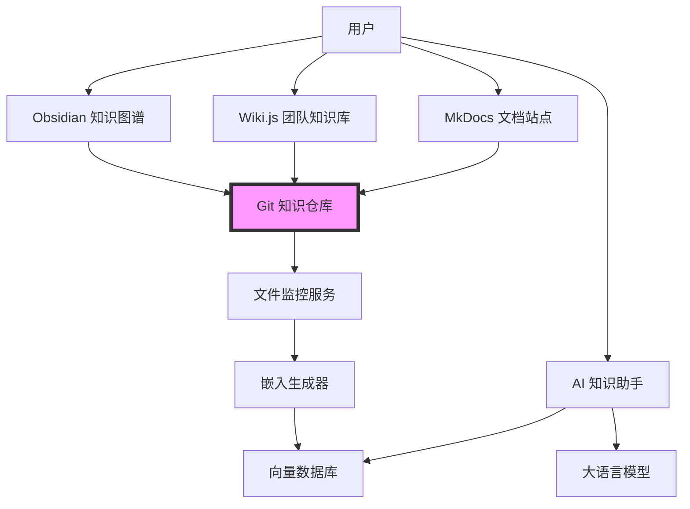
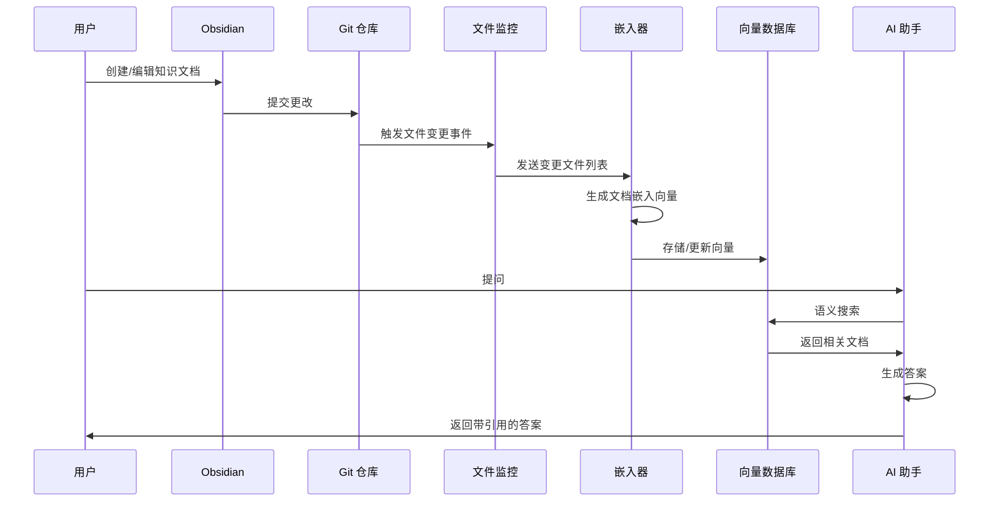
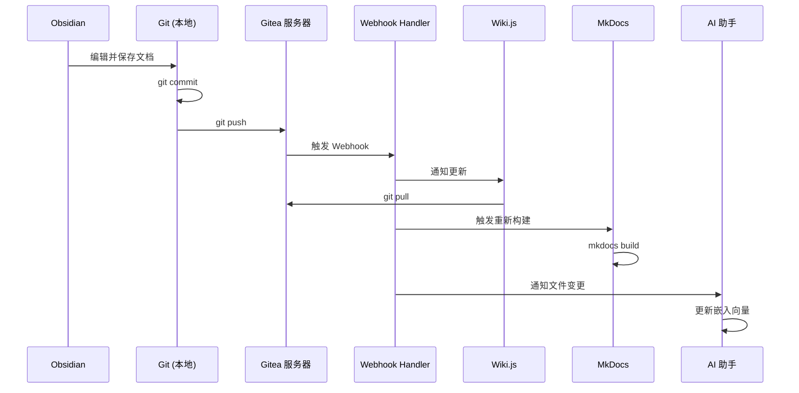
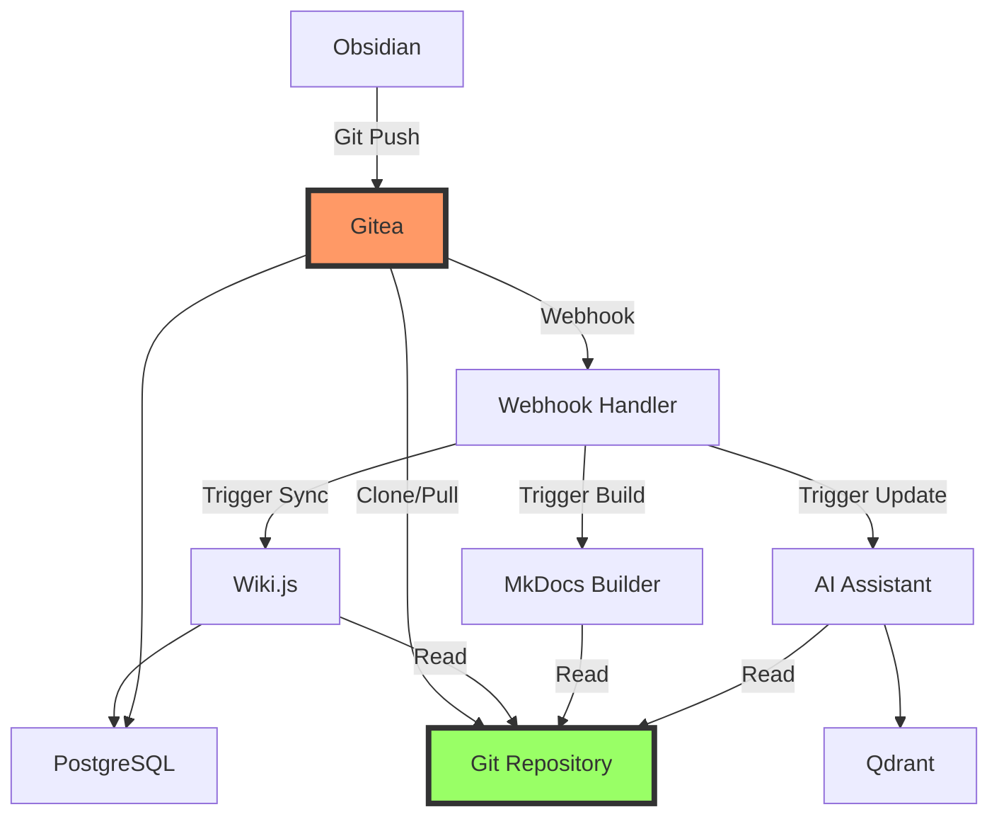

# 设计文档

## 概述

工程师知识系统是一个集成化的个人知识管理平台，通过统一的 Git 仓库连接多个专业工具（Obsidian、Wiki.js、MkDocs）和 AI 助手。系统采用五层知识层次结构，从基础理论到个人洞察，支持知识的捕获、组织、连接和智能检索。

核心设计理念：
- **单一数据源**：所有工具共享同一个 Git 仓库
- **渐进式工作流**：从个人笔记到团队文档到公开发布
- **知识图谱化**：通过双向链接构建概念网络
- **AI 增强**：基于 RAG 的智能问答和知识检索

## 架构

### 系统架构图



### 数据流架构



## 组件和接口

### 1. Git 知识仓库（核心数据层）

**职责**：作为所有知识内容的单一数据源和版本控制系统


**目录结构**（简化版 - 统一到 knowledge/）：
```
knowledge-system/
├── knowledge/              # 统一的知识内容目录
│   ├── 01-foundations/    # 基础层
│   │   ├── operating-system/
│   │   ├── network/
│   │   ├── algorithm/
│   │   └── database/
│   ├── 02-technologies/   # 技术层
│   │   ├── embedded/
│   │   │   ├── mcu/
│   │   │   ├── rtos/
│   │   │   ├── driver/
│   │   │   └── protocol/
│   │   ├── ai/
│   │   └── cloud/
│   ├── 03-architecture/   # 架构层
│   │   ├── embedded-system/
│   │   ├── distributed-system/
│   │   └── platform/
│   ├── 04-projects/       # 项目层
│   │   ├── smart-ring/
│   │   └── anti-snore-pillow/
│   ├── 05-insights/       # 洞察层
│   │   ├── engineering/
│   │   ├── career/
│   │   └── technology-trend/
│   ├── _wiki/             # Wiki 专用内容（可选）
│   │   ├── company/
│   │   ├── product/
│   │   └── development/
│   └── _site/             # MkDocs 配置
│       └── mkdocs.yml
├── .obsidian/             # Obsidian 配置
├── .gitea/                # Gitea Webhooks 配置
│   └── workflows/
│       └── sync.yml
├── scripts/               # 自动化脚本
│   ├── init.sh
│   └── webhook-handler.sh
├── docker-compose.yml     # Docker 编排
├── .env.example
└── .gitignore
```

**设计理念**：
- **单一知识目录**：所有内容统一在 `knowledge/` 下
- **Obsidian Vault = knowledge/**：直接打开整个 knowledge 目录
- **Wiki.js 同步 knowledge/**：通过 Git 自动同步
- **MkDocs 读取 knowledge/**：配置指向 knowledge 目录
- **AI 索引 knowledge/**：只需索引一个目录

**内容组织策略**：

**统一目录方案**（推荐）：

所有知识内容统一存储在 `knowledge/` 目录下：

1. **Obsidian**：
   - Vault 路径：`knowledge-system/knowledge/`
   - 可以访问所有五层内容
   - 使用双向链接连接概念

2. **Wiki.js**：
   - Git Storage 指向：`knowledge-system/` 仓库
   - 显示路径：`knowledge/` 目录
   - 自动同步 Git 更新

3. **MkDocs**：
   - 配置 `docs_dir: ../knowledge` 
   - 或使用符号链接：`ln -s ../knowledge docs`
   - 构建时读取 knowledge 目录

4. **AI 助手**：
   - 监控路径：`knowledge/`
   - 索引所有 Markdown 文件
   - 自动更新嵌入向量

**优势**：
- ✅ 单一数据源，无需同步
- ✅ 简化目录结构
- ✅ 避免内容重复
- ✅ 统一的版本控制
- ✅ 降低维护复杂度

**推荐工作流**：
1. 在 Obsidian 中创建和编辑内容（`knowledge/` 目录）
2. Git commit 并 push 到 Gitea 服务器
3. Gitea Webhook 自动触发同步
4. Wiki.js 自动拉取更新
5. MkDocs 自动重新构建
6. AI 助手自动更新嵌入向量

### Git 自动同步架构

#### Git 服务器选择

**推荐：Gitea**

**优势**：
- 轻量级（Go 编写，单二进制文件）
- 完全自托管，数据掌控
- 支持 Webhooks 和 CI/CD
- 类 GitHub 界面，易用
- 资源占用低

**替代方案**：
- GitHub：云托管，免费私有仓库
- GitLab：功能强大，但资源占用较高
- Gogs：更轻量，但功能较少

#### 自动同步流程




**接口**：
- Git 标准协议（HTTP/SSH）
- 文件系统接口（本地访问）

### 2. Obsidian 知识图谱层

**职责**：个人知识创建、编辑和可视化知识图谱

**技术选型**：
- Obsidian Desktop/Mobile App
- Vault 路径：`knowledge-system/knowledge/`（整个 knowledge 目录）

**核心功能**：
- Markdown 编辑器
- `[[双向链接]]` 语法支持
- 图谱视图（Graph View）
- 标签系统
- 本地搜索

**Git 集成**：
- 插件：Obsidian Git（自动提交和同步）
- 配置自动提交间隔（如每 10 分钟）
- 支持 push 到 Gitea 服务器

**配置**：
```yaml
# .obsidian/app.json
{
  "vimMode": false,
  "showLineNumber": true,
  "strictLineBreaks": false,
  "defaultViewMode": "source"
}
```

**Obsidian Git 插件配置**：
```json
{
  "commitMessage": "vault backup: {{date}}",
  "autoSaveInterval": 10,
  "autoPullInterval": 10,
  "autoPullOnBoot": true,
  "disablePush": false,
  "pullBeforePush": true
}
```

**插件推荐**：
- Obsidian Git：自动 Git 同步
- Dataview：数据查询和展示
- Templater：模板自动化
- Calendar：日记和时间线

### 3. Gitea Git 服务器

**职责**：中央 Git 仓库服务器，触发自动化工作流

**技术选型**：
- Gitea 1.20+
- 数据库：SQLite（轻量）或 PostgreSQL（生产）
- 存储：本地文件系统或对象存储

**核心功能**：
- Git 仓库托管
- Webhooks 支持
- Actions（CI/CD）
- Web 界面管理

**Webhook 配置**：
```json
{
  "url": "http://webhook-handler:9000/hooks/knowledge-sync",
  "content_type": "json",
  "secret": "your_webhook_secret",
  "events": ["push"]
}
```

**Gitea Actions 工作流**（`.gitea/workflows/sync.yml`）：
```yaml
name: Knowledge Sync
on:
  push:
    branches: [main]
    paths:
      - 'knowledge/**'

jobs:
  sync:
    runs-on: ubuntu-latest
    steps:
      - name: Trigger Wiki Sync
        run: |
          curl -X POST http://wiki:3000/api/sync \
            -H "Authorization: Bearer ${{ secrets.WIKI_TOKEN }}"
      
      - name: Trigger MkDocs Build
        run: |
          curl -X POST http://mkdocs-builder:8080/build
      
      - name: Trigger AI Embedding Update
        run: |
          curl -X POST http://ai-assistant:8000/api/update-embeddings
```

### 4. Wiki.js 团队知识库

**职责**：团队协作文档平台，支持 Web 编辑和权限管理

**技术选型**：
- Wiki.js 2.5+
- 数据库：PostgreSQL
- 存储后端：Git Storage Module


**Git 同步配置**：
```yaml
# Wiki.js Storage 配置
storage:
  git:
    type: git
    repo: /data/knowledge-system
    branch: main
    sshPrivateKeyPath: /etc/wiki/.ssh/id_rsa
    syncInterval: PT5M  # 每5分钟同步
    defaultEmail: wiki@example.com
    defaultName: Wiki.js
```

**接口**：
- REST API：用于程序化访问
- GraphQL API：用于复杂查询
- Web UI：用户界面

### 4. MkDocs 文档站点生成器

**职责**：将 Markdown 文档转换为静态网站，用于公开发布

**技术选型**：
- MkDocs 1.5+
- 主题：Material for MkDocs
- 插件：search, minify, git-revision-date

**配置示例**：
```yaml
# site/mkdocs.yml
site_name: 工程师知识库
site_url: https://knowledge.example.com
repo_url: https://github.com/username/knowledge-system

theme:
  name: material
  language: zh
  palette:
    - scheme: default
      primary: indigo
      accent: indigo
      toggle:
        icon: material/brightness-7
        name: 切换到深色模式
    - scheme: slate
      primary: indigo
      accent: indigo
      toggle:
        icon: material/brightness-4
        name: 切换到浅色模式
  features:
    - navigation.tabs
    - navigation.sections
    - navigation.top
    - search.suggest
    - search.highlight
    - content.code.copy

plugins:
  - search
  - git-revision-date-localized
  - minify:
      minify_html: true

markdown_extensions:
  - pymdownx.highlight
  - pymdownx.superfences
  - pymdownx.tabbed
  - admonition
  - toc:
      permalink: true

nav:
  - 首页: index.md
  - 嵌入式:
      - 概述: embedded/index.md
      - MCU: embedded/mcu.md
      - RTOS: embedded/rtos.md
  - 架构:
      - 概述: architecture/index.md
      - 分布式系统: architecture/distributed.md
  - AI:
      - 概述: ai/index.md
```

**构建流程**：
```bash
cd site
mkdocs build  # 生成静态文件到 site/
mkdocs serve  # 本地预览
```


### 5. AI 知识助手（RAG 系统）

**职责**：基于知识库内容提供智能问答和语义搜索

**架构组件**：

#### 5.1 文件监控服务（File Watcher）
- 技术：Python watchdog 库
- 功能：监控 Git 仓库文件变更
- 触发：文件创建、修改、删除事件

#### 5.2 嵌入生成器（Embedding Generator）
- 技术：sentence-transformers
- 模型：`paraphrase-multilingual-MiniLM-L12-v2`（支持中文）
- 功能：将 Markdown 文档转换为向量表示

**文档处理流程**：
```python
# 伪代码
def process_document(file_path):
    # 1. 读取 Markdown 文件
    content = read_markdown(file_path)
    
    # 2. 分块（Chunking）
    chunks = split_into_chunks(content, chunk_size=512, overlap=50)
    
    # 3. 生成嵌入向量
    embeddings = model.encode(chunks)
    
    # 4. 存储到向量数据库
    for chunk, embedding in zip(chunks, embeddings):
        vector_db.upsert(
            id=generate_id(file_path, chunk_index),
            vector=embedding,
            metadata={
                'file_path': file_path,
                'content': chunk,
                'layer': extract_layer(file_path),
                'timestamp': now()
            }
        )
```

#### 5.3 向量数据库
- 技术选型：**Qdrant**
- 选择理由：
  - 开源且性能优秀（Rust 实现）
  - 支持丰富的元数据过滤
  - Docker 部署简单
  - 适合自托管场景

**Qdrant 配置**：
```yaml
# docker-compose.yml 中的配置
qdrant:
  image: qdrant/qdrant:latest
  ports:
    - "6333:6333"
  volumes:
    - ./qdrant_storage:/qdrant/storage
```

**Collection 结构**：
```python
collection_config = {
    "vectors": {
        "size": 384,  # MiniLM 模型维度
        "distance": "Cosine"
    }
}
```


#### 5.4 RAG 查询引擎
- 技术：LangChain + OpenAI API（或本地 LLM）
- 功能：检索相关文档并生成答案

**查询流程**：
```python
# 伪代码
def query_knowledge(question: str) -> str:
    # 1. 将问题转换为向量
    question_embedding = model.encode(question)
    
    # 2. 向量搜索
    results = vector_db.search(
        vector=question_embedding,
        limit=5,
        score_threshold=0.7
    )
    
    # 3. 构建上下文
    context = "\n\n".join([
        f"来源：{r.metadata['file_path']}\n{r.metadata['content']}"
        for r in results
    ])
    
    # 4. 生成答案
    prompt = f"""基于以下知识库内容回答问题。

知识库内容：
{context}

问题：{question}

请提供详细答案，并引用来源文件。"""
    
    answer = llm.generate(prompt)
    return answer
```

**API 接口**：
```python
# FastAPI 端点
@app.post("/api/query")
async def query(request: QueryRequest):
    return {
        "answer": query_knowledge(request.question),
        "sources": get_sources(request.question)
    }
```

## 数据模型

### 知识文档模型

```python
class KnowledgeDocument:
    """知识文档的标准结构"""
    
    # 元数据
    file_path: str          # 文件路径
    title: str              # 文档标题
    layer: KnowledgeLayer   # 所属层次
    tags: List[str]         # 标签列表
    created_at: datetime    # 创建时间
    updated_at: datetime    # 更新时间
    
    # 内容
    content: str            # Markdown 内容
    links: List[str]        # 双向链接列表
    
    # 向量化
    chunks: List[Chunk]     # 文档分块
    embeddings: List[Vector] # 嵌入向量
```

### 知识层次枚举

```python
class KnowledgeLayer(Enum):
    """五层知识结构"""
    FOUNDATIONS = "01-foundations"    # 基础层
    TECHNOLOGIES = "02-technologies"  # 技术层
    ARCHITECTURE = "03-architecture"  # 架构层
    PROJECTS = "04-projects"          # 项目层
    INSIGHTS = "05-insights"          # 洞察层
```

### 向量存储模型

```python
class VectorRecord:
    """向量数据库记录"""
    
    id: str                 # 唯一标识
    vector: List[float]     # 嵌入向量
    metadata: {
        'file_path': str,
        'content': str,
        'layer': str,
        'chunk_index': int,
        'timestamp': datetime
    }
```


## 正确性属性

*属性是系统在所有有效执行中应该保持为真的特征或行为——本质上是关于系统应该做什么的形式化陈述。属性作为人类可读规范和机器可验证正确性保证之间的桥梁。*


### 属性 1：目录结构完整性

*对于任何* 初始化的知识系统仓库，所有必需的目录结构（五层知识层次、wiki、site、obsidian 配置目录）都应该存在且层次正确。

**验证：需求 1.1, 1.2, 1.3, 2.1, 2.2, 2.3, 2.4, 2.5, 4.3, 5.2**

### 属性 2：初始化幂等性

*对于任何* 知识系统仓库，多次运行初始化脚本应该产生相同的目录结构，不会创建重复或损坏现有内容。

**验证：需求 1.4**

### 属性 3：Markdown 格式一致性

*对于任何* 知识仓库中的文档文件，所有文件都应该使用 `.md` 扩展名（Markdown 格式）。

**验证：需求 1.5**

### 属性 4：Git 同步一致性

*对于任何* 在 Git 仓库中添加或修改的文档，该文档应该在配置的同步间隔后在 Wiki.js 中可见。

**验证：需求 4.1, 4.4, 8.2, 8.3**

### 属性 5：MkDocs 构建完整性

*对于任何* `site/docs/` 目录中的 Markdown 文件，执行 `mkdocs build` 后应该在输出目录中生成对应的 HTML 文件。

**验证：需求 5.1, 5.4**

### 属性 6：嵌入向量生成

*对于任何* 添加到知识仓库的新文档或修改的文档，应该在向量数据库中生成并存储对应的嵌入向量。

**验证：需求 6.2, 8.4**

### 属性 7：向量存储与检索往返

*对于任何* 插入到向量数据库的嵌入向量，应该能够通过相似度搜索检索到该向量及其关联的元数据。

**验证：需求 6.3**

### 属性 8：RAG 查询响应完整性

*对于任何* 用户查询，AI 助手的响应应该包含生成的答案和至少一个源文档引用（如果向量数据库中有相关内容）。

**验证：需求 6.4, 6.5**

### 属性 9：Git 版本历史保留

*对于任何* 对知识仓库的修改，Git 应该保留完整的提交历史，包括作者、时间戳和变更内容。

**验证：需求 7.4**

### 属性 10：大规模文档构建成功

*对于任何* 包含数千个 Markdown 文件的 `site/docs/` 目录，MkDocs 构建应该成功完成而不会失败或崩溃。

**验证：需求 9.4**

### 属性 11：Docker 服务启动完整性

*对于任何* Docker Compose 配置，执行 `docker-compose up` 后，所有定义的服务（Wiki.js、Qdrant、AI 助手）都应该处于运行状态。

**验证：需求 10.3**

### 属性 12：Docker 数据持久化

*对于任何* 使用 Docker 卷存储的数据，容器重启后数据应该保持不变。

**验证：需求 10.4**

### 属性 13：环境配置覆盖

*对于任何* 通过环境变量提供的配置值，该值应该覆盖默认配置并在服务中生效。

**验证：需求 10.6**


## 错误处理

### 1. Git 操作错误

**场景**：Git 同步失败、冲突、权限问题

**处理策略**：
- 检测冲突并通知用户
- 提供冲突解决指导
- 记录详细错误日志
- 实现重试机制（指数退避）

```python
def sync_with_retry(repo_path, max_retries=3):
    for attempt in range(max_retries):
        try:
            git.pull(repo_path)
            return True
        except GitConflictError as e:
            logger.error(f"Git conflict: {e}")
            notify_user("请解决 Git 冲突后重试")
            return False
        except GitPermissionError as e:
            logger.error(f"Permission denied: {e}")
            return False
        except Exception as e:
            if attempt < max_retries - 1:
                time.sleep(2 ** attempt)
            else:
                logger.error(f"Sync failed after {max_retries} attempts")
                return False
```

### 2. 向量数据库错误

**场景**：连接失败、存储空间不足、查询超时

**处理策略**：
- 健康检查端点
- 连接池管理
- 查询超时设置
- 降级策略（回退到关键词搜索）

```python
def query_with_fallback(question: str):
    try:
        # 尝试向量搜索
        results = vector_db.search(question, timeout=5)
        return results
    except TimeoutError:
        logger.warning("Vector search timeout, falling back to keyword search")
        return keyword_search(question)
    except ConnectionError:
        logger.error("Vector DB unavailable")
        return {"error": "搜索服务暂时不可用"}
```

### 3. 嵌入生成错误

**场景**：模型加载失败、内存不足、文档格式错误

**处理策略**：
- 批处理限制
- 内存监控
- 跳过无效文档并记录
- 异步处理队列

```python
def process_documents_safely(file_paths: List[str]):
    failed = []
    for file_path in file_paths:
        try:
            content = read_file(file_path)
            if len(content) > MAX_CONTENT_SIZE:
                logger.warning(f"File too large: {file_path}")
                continue
            
            embeddings = generate_embeddings(content)
            store_embeddings(file_path, embeddings)
        except Exception as e:
            logger.error(f"Failed to process {file_path}: {e}")
            failed.append(file_path)
    
    if failed:
        logger.info(f"Failed files: {failed}")
    return failed
```

### 4. Wiki.js 同步错误

**场景**：API 不可用、认证失败、同步冲突

**处理策略**：
- API 健康检查
- 认证令牌刷新
- 同步状态追踪
- 手动同步触发器

### 5. MkDocs 构建错误

**场景**：配置错误、插件缺失、Markdown 语法错误

**处理策略**：
- 构建前配置验证
- 详细的构建日志
- 部分构建支持（跳过错误文件）
- 构建失败通知

```python
def build_docs_safely():
    try:
        validate_mkdocs_config()
        result = subprocess.run(
            ["mkdocs", "build"],
            capture_output=True,
            text=True,
            timeout=300
        )
        if result.returncode != 0:
            logger.error(f"Build failed: {result.stderr}")
            return False
        return True
    except subprocess.TimeoutExpired:
        logger.error("Build timeout")
        return False
```


## 测试策略

### 双重测试方法

本系统采用单元测试和基于属性的测试相结合的综合测试策略：

- **单元测试**：验证特定示例、边缘情况和错误条件
- **属性测试**：通过随机化验证所有输入的通用属性
- 两者互补且都是全面覆盖所必需的

### 单元测试

单元测试专注于：
- 演示正确行为的具体示例
- 组件之间的集成点
- 边缘情况和错误条件

**测试框架**：pytest

**示例单元测试**：

```python
def test_initialize_creates_directory_structure():
    """测试初始化创建正确的目录结构"""
    temp_dir = create_temp_directory()
    initialize_knowledge_system(temp_dir)
    
    assert os.path.exists(f"{temp_dir}/knowledge")
    assert os.path.exists(f"{temp_dir}/knowledge/01-foundations")
    assert os.path.exists(f"{temp_dir}/wiki")
    assert os.path.exists(f"{temp_dir}/site")

def test_wiki_sync_with_empty_repo():
    """边缘情况：空仓库同步"""
    empty_repo = create_empty_git_repo()
    result = sync_wiki(empty_repo)
    assert result.success == True
    assert result.files_synced == 0

def test_embedding_generation_with_invalid_markdown():
    """错误条件：无效 Markdown"""
    invalid_content = "```\nunclosed code block"
    with pytest.raises(MarkdownParseError):
        generate_embeddings(invalid_content)
```

### 基于属性的测试

属性测试验证系统在各种输入下的通用属性。

**测试框架**：Hypothesis（Python 的属性测试库）

**配置**：
- 每个属性测试最少 100 次迭代
- 每个测试必须引用其设计文档属性
- 标签格式：**Feature: engineer-knowledge-system, Property {number}: {property_text}**

**示例属性测试**：

```python
from hypothesis import given, strategies as st

@given(st.text(min_size=1, max_size=10000))
def test_property_3_markdown_format_consistency(content):
    """
    Feature: engineer-knowledge-system, Property 3: Markdown 格式一致性
    
    对于任何知识仓库中的文档文件，所有文件都应该使用 .md 扩展名
    """
    temp_repo = create_temp_repo()
    file_path = add_document(temp_repo, content)
    
    assert file_path.endswith('.md')
    assert os.path.exists(file_path)

@given(st.lists(st.text(min_size=10, max_size=1000), min_size=1, max_size=10))
def test_property_6_embedding_generation(documents):
    """
    Feature: engineer-knowledge-system, Property 6: 嵌入向量生成
    
    对于任何添加到知识仓库的新文档，应该在向量数据库中生成并存储对应的嵌入向量
    """
    vector_db = get_test_vector_db()
    
    for doc in documents:
        file_path = add_document_to_repo(doc)
        process_document(file_path)
        
        # 验证向量已存储
        results = vector_db.search_by_metadata({'file_path': file_path})
        assert len(results) > 0
        assert results[0].vector is not None

@given(st.text(min_size=5, max_size=200))
def test_property_8_rag_query_response_completeness(question):
    """
    Feature: engineer-knowledge-system, Property 8: RAG 查询响应完整性
    
    对于任何用户查询，AI 助手的响应应该包含生成的答案和至少一个源文档引用
    """
    # 假设向量数据库中有内容
    setup_test_knowledge_base()
    
    response = ai_assistant.query(question)
    
    assert 'answer' in response
    assert 'sources' in response
    if has_relevant_content(question):
        assert len(response['sources']) > 0
```

### 集成测试

测试组件之间的交互：

```python
def test_end_to_end_knowledge_workflow():
    """端到端：从创建文档到 AI 查询"""
    # 1. 初始化系统
    system = initialize_knowledge_system()
    
    # 2. 添加文档
    doc_path = system.add_document(
        layer="02-technologies",
        title="TCP 协议",
        content="TCP 使用滑动窗口进行流量控制..."
    )
    
    # 3. 等待嵌入生成
    wait_for_embedding_generation()
    
    # 4. 查询
    response = system.query("TCP 如何进行流量控制？")
    
    # 5. 验证
    assert "滑动窗口" in response['answer']
    assert doc_path in [s['file_path'] for s in response['sources']]
```

### Docker 环境测试

```python
def test_docker_compose_services_start():
    """验证所有 Docker 服务启动"""
    subprocess.run(["docker-compose", "up", "-d"])
    time.sleep(10)  # 等待服务启动
    
    services = ["wiki", "qdrant", "ai-assistant"]
    for service in services:
        result = subprocess.run(
            ["docker-compose", "ps", service],
            capture_output=True
        )
        assert "Up" in result.stdout.decode()
```

### 性能测试

虽然不是属性测试，但对于可扩展性很重要：

```python
def test_large_scale_document_build():
    """测试大规模文档构建（需求 9.4）"""
    # 创建 1000 个测试文档
    for i in range(1000):
        create_test_document(f"doc_{i}.md")
    
    start_time = time.time()
    result = subprocess.run(["mkdocs", "build"])
    duration = time.time() - start_time
    
    assert result.returncode == 0
    assert duration < 300  # 应在 5 分钟内完成
```

### 测试覆盖率目标

- 核心功能代码覆盖率：> 80%
- 关键路径覆盖率：100%
- 所有正确性属性都有对应的属性测试
- 所有错误处理路径都有单元测试


## 部署架构

### Docker Compose 配置

完整的 `docker-compose.yml` 配置：

```yaml
version: '3.8'

services:
  # Gitea Git 服务器
  gitea:
    image: gitea/gitea:1.20
    container_name: knowledge-gitea
    environment:
      - USER_UID=1000
      - USER_GID=1000
      - GITEA__database__DB_TYPE=postgres
      - GITEA__database__HOST=db:5432
      - GITEA__database__NAME=gitea
      - GITEA__database__USER=${GITEA_DB_USER:-gitea}
      - GITEA__database__PASSWD=${GITEA_DB_PASS:-giteapass}
      - GITEA__server__DOMAIN=${GITEA_DOMAIN:-localhost}
      - GITEA__server__ROOT_URL=http://${GITEA_DOMAIN:-localhost}:${GITEA_PORT:-3001}
      - GITEA__actions__ENABLED=true
    ports:
      - "${GITEA_PORT:-3001}:3000"
      - "${GITEA_SSH_PORT:-2222}:22"
    volumes:
      - gitea-data:/data
      - /etc/timezone:/etc/timezone:ro
      - /etc/localtime:/etc/localtime:ro
    depends_on:
      - db
    restart: unless-stopped

  # Wiki.js 服务
  wiki:
    image: requarks/wiki:2
    container_name: knowledge-wiki
    environment:
      DB_TYPE: postgres
      DB_HOST: db
      DB_PORT: 5432
      DB_USER: ${WIKI_DB_USER:-wikijs}
      DB_PASS: ${WIKI_DB_PASS:-wikijspass}
      DB_NAME: ${WIKI_DB_NAME:-wiki}
      # Git 同步配置
      GIT_SYNC_REPO_URL: http://gitea:3000/${GITEA_USER:-admin}/knowledge-system.git
      GIT_SYNC_BRANCH: main
      GIT_SYNC_USERNAME: ${GITEA_USER:-admin}
      GIT_SYNC_PASSWORD: ${GITEA_PASSWORD}
    ports:
      - "${WIKI_PORT:-3000}:3000"
    volumes:
      - wiki-data:/wiki/data
    depends_on:
      - db
      - gitea
    restart: unless-stopped

  # PostgreSQL 数据库（共享）
  db:
    image: postgres:15-alpine
    container_name: knowledge-db
    environment:
      POSTGRES_USER: postgres
      POSTGRES_PASSWORD: ${POSTGRES_PASSWORD:-postgrespass}
    volumes:
      - db-data:/var/lib/postgresql/data
      - ./scripts/init-db.sql:/docker-entrypoint-initdb.d/init.sql
    restart: unless-stopped

  # Qdrant 向量数据库
  qdrant:
    image: qdrant/qdrant:latest
    container_name: knowledge-qdrant
    ports:
      - "${QDRANT_PORT:-6333}:6333"
      - "6334:6334"
    volumes:
      - qdrant-data:/qdrant/storage
    restart: unless-stopped

  # Webhook 处理器
  webhook-handler:
    build: ./webhook-handler
    container_name: knowledge-webhook
    environment:
      WEBHOOK_SECRET: ${WEBHOOK_SECRET}
      WIKI_URL: http://wiki:3000
      WIKI_TOKEN: ${WIKI_TOKEN}
      AI_URL: http://ai-assistant:8000
    ports:
      - "9000:9000"
    depends_on:
      - wiki
      - ai-assistant
    restart: unless-stopped

  # AI 助手服务
  ai-assistant:
    build: ./ai-assistant
    container_name: knowledge-ai
    environment:
      QDRANT_HOST: qdrant
      QDRANT_PORT: 6333
      OPENAI_API_KEY: ${OPENAI_API_KEY}
      EMBEDDING_MODEL: ${EMBEDDING_MODEL:-paraphrase-multilingual-MiniLM-L12-v2}
      GITEA_URL: http://gitea:3000
      GITEA_TOKEN: ${GITEA_TOKEN}
      REPO_PATH: ${GITEA_USER:-admin}/knowledge-system
    ports:
      - "${AI_PORT:-8000}:8000"
    volumes:
      - ./ai-assistant/models:/app/models
      - ai-cache:/app/cache
    depends_on:
      - qdrant
      - gitea
    restart: unless-stopped

  # MkDocs 构建服务
  mkdocs-builder:
    build: ./mkdocs-builder
    container_name: knowledge-mkdocs
    environment:
      GITEA_URL: http://gitea:3000
      GITEA_TOKEN: ${GITEA_TOKEN}
      REPO_PATH: ${GITEA_USER:-admin}/knowledge-system
      BUILD_ON_STARTUP: "true"
    ports:
      - "${MKDOCS_PORT:-8080}:8080"
    volumes:
      - mkdocs-site:/app/site
    depends_on:
      - gitea
    restart: unless-stopped

volumes:
  gitea-data:
  wiki-data:
  db-data:
  qdrant-data:
  ai-cache:
  mkdocs-site:

networks:
  default:
    name: knowledge-network
```

### 环境变量配置

`.env` 文件示例：

```bash
# Gitea 配置
GITEA_PORT=3001
GITEA_SSH_PORT=2222
GITEA_DOMAIN=localhost
GITEA_USER=admin
GITEA_PASSWORD=your_gitea_password
GITEA_TOKEN=your_gitea_api_token
GITEA_DB_USER=gitea
GITEA_DB_PASS=your_gitea_db_password

# Wiki.js 配置
WIKI_PORT=3000
WIKI_DB_USER=wikijs
WIKI_DB_PASS=your_wiki_db_password
WIKI_DB_NAME=wiki
WIKI_TOKEN=your_wiki_api_token

# PostgreSQL 配置
POSTGRES_PASSWORD=your_postgres_password

# Qdrant 配置
QDRANT_PORT=6333

# Webhook 配置
WEBHOOK_SECRET=your_webhook_secret

# AI 助手配置
AI_PORT=8000
OPENAI_API_KEY=your_openai_api_key
EMBEDDING_MODEL=paraphrase-multilingual-MiniLM-L12-v2

# MkDocs 配置
MKDOCS_PORT=8080

# 可选：使用本地 LLM
# USE_LOCAL_LLM=true
# LOCAL_LLM_MODEL=llama2
```

### 服务依赖关系



### 部署步骤

1. **准备环境**：
```bash
# 安装 Docker 和 Docker Compose
# Windows: Docker Desktop
# Linux: 
curl -fsSL https://get.docker.com | sh
```

2. **克隆或创建仓库**：
```bash
mkdir knowledge-system
cd knowledge-system
git init
```

3. **创建目录结构**：
```bash
./scripts/init.sh
# 或手动创建
mkdir -p knowledge/{01-foundations,02-technologies,03-architecture,04-projects,05-insights}
mkdir -p .obsidian scripts
```

4. **配置环境变量**：
```bash
cp .env.example .env
# 编辑 .env 文件，设置密码和 API 密钥
nano .env
```

5. **启动所有服务**：
```bash
docker-compose up -d
```

6. **初始化 Gitea**：
```bash
# 访问 http://localhost:3001
# 完成初始设置
# 创建管理员账户
# 创建仓库：knowledge-system
```

7. **配置 Git 远程仓库**：
```bash
git remote add origin http://localhost:3001/admin/knowledge-system.git
git add .
git commit -m "Initial commit"
git push -u origin main
```

8. **配置 Gitea Webhook**：
```bash
# 在 Gitea 仓库设置中添加 Webhook
# URL: http://webhook-handler:9000/hooks/knowledge-sync
# Secret: 与 .env 中的 WEBHOOK_SECRET 一致
# 触发事件：Push events
```

9. **初始化 Wiki.js**：
```bash
# 访问 http://localhost:3000
# 完成初始设置
# 配置 Git Storage:
#   - Repository URL: http://gitea:3000/admin/knowledge-system.git
#   - Branch: main
#   - Authentication: Basic
#   - Username: admin
#   - Password: your_gitea_password
#   - Sync Interval: 5 minutes
```

10. **配置 Obsidian**：
```bash
# 打开 Obsidian
# 选择 "Open folder as vault"
# 选择 knowledge-system/knowledge/ 目录
# 安装 Obsidian Git 插件
# 配置插件：
#   - Remote: http://localhost:3001/admin/knowledge-system.git
#   - Auto backup interval: 10 minutes
#   - Auto pull interval: 10 minutes
```

11. **验证自动同步**：
```bash
# 在 Obsidian 中创建测试文档
# 等待自动提交（或手动 Ctrl+P -> Obsidian Git: Commit and push）
# 检查 Gitea 是否收到提交
# 检查 Wiki.js 是否显示新文档
# 检查 AI 助手是否索引了新文档
curl http://localhost:8000/api/search?q=测试
```

### 监控和维护

**健康检查端点**：
- Gitea: `http://localhost:3001/api/healthz`
- Wiki.js: `http://localhost:3000/healthz`
- Qdrant: `http://localhost:6333/health`
- AI Assistant: `http://localhost:8000/health`
- MkDocs Builder: `http://localhost:8080/health`

**日志查看**：
```bash
# 查看所有服务日志
docker-compose logs -f

# 查看特定服务日志
docker-compose logs -f gitea
docker-compose logs -f webhook-handler
docker-compose logs -f ai-assistant
```

**同步状态检查**：
```bash
# 检查最后一次同步时间
curl http://localhost:3000/api/sync/status

# 手动触发同步
curl -X POST http://localhost:3000/api/sync \
  -H "Authorization: Bearer $WIKI_TOKEN"

# 检查 AI 嵌入状态
curl http://localhost:8000/api/embeddings/status
```

**备份策略**：
```bash
# 备份 Git 仓库（最重要）
cd knowledge-system
git bundle create ../knowledge-backup-$(date +%Y%m%d).bundle --all

# 备份 Docker 卷
docker run --rm \
  -v knowledge-system_gitea-data:/data \
  -v $(pwd):/backup \
  alpine tar -czf /backup/gitea-backup-$(date +%Y%m%d).tar.gz /data

docker run --rm \
  -v knowledge-system_db-data:/data \
  -v $(pwd):/backup \
  alpine tar -czf /backup/db-backup-$(date +%Y%m%d).tar.gz /data

docker run --rm \
  -v knowledge-system_qdrant-data:/data \
  -v $(pwd):/backup \
  alpine tar -czf /backup/qdrant-backup-$(date +%Y%m%d).tar.gz /data
```

**恢复流程**：
```bash
# 从 Git bundle 恢复
git clone knowledge-backup-20260310.bundle knowledge-system-restored

# 从 Docker 卷备份恢复
docker run --rm \
  -v knowledge-system_gitea-data:/data \
  -v $(pwd):/backup \
  alpine sh -c "cd / && tar -xzf /backup/gitea-backup-20260310.tar.gz"
```

### 扩展性考虑

**水平扩展**：
- Qdrant 支持集群模式（生产环境）
- AI 助手可以部署多个实例（负载均衡）
- Wiki.js 可以配置多个副本

**垂直扩展**：
```yaml
# 为服务分配更多资源
services:
  qdrant:
    deploy:
      resources:
        limits:
          cpus: '2'
          memory: 4G
```

## 安全考虑

### 1. 访问控制

- Wiki.js 用户认证和授权
- API 密钥管理（环境变量，不提交到 Git）
- Docker 网络隔离

### 2. 数据保护

- Git 仓库加密（可选：git-crypt）
- 数据库密码加密存储
- HTTPS/TLS 用于生产环境

### 3. 备份和恢复

- 定期自动备份
- 异地备份存储
- 恢复流程测试

## 未来扩展

### 短期（3-6 个月）

1. **移动端支持**：Obsidian Mobile 同步
2. **协作功能**：实时编辑、评论系统
3. **高级搜索**：全文搜索 + 向量搜索混合

### 中期（6-12 个月）

1. **知识推荐**：基于阅读历史的智能推荐
2. **自动标签**：AI 自动生成标签和分类
3. **知识图谱可视化**：Web 版交互式图谱

### 长期（1-2 年）

1. **多模态支持**：图片、视频、音频知识管理
2. **知识蒸馏**：自动生成摘要和学习路径
3. **团队协作增强**：工作流、审批、版本对比

## 总结

本设计文档描述了一个完整的工程师知识系统，通过统一的 Git 仓库连接 Obsidian、Wiki.js、MkDocs 和 AI 助手。系统采用五层知识层次结构，支持从个人笔记到团队文档到公开发布的渐进式工作流。

核心技术选型：
- **Git**：版本控制和单一数据源
- **Obsidian**：个人知识图谱
- **Wiki.js**：团队协作平台
- **MkDocs + Material**：文档站点生成
- **Qdrant**：向量数据库
- **Sentence Transformers**：多语言嵌入模型
- **Docker Compose**：容器化部署

系统设计强调可扩展性、可维护性和用户体验，通过属性测试确保正确性，通过 Docker 简化部署，为工程师提供一个强大而优雅的知识管理解决方案。
