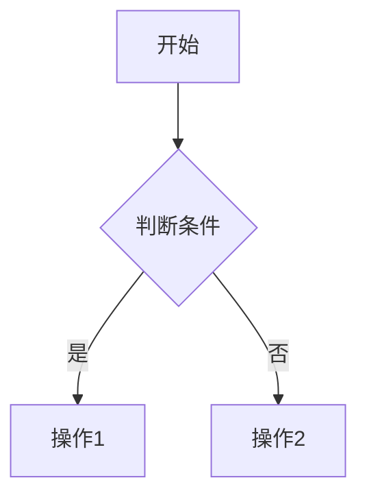
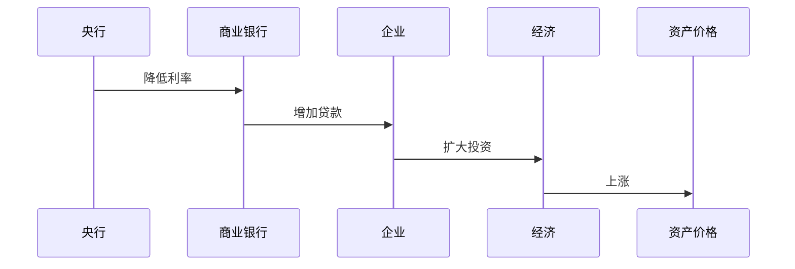
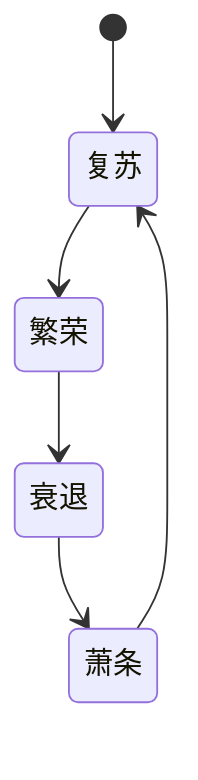
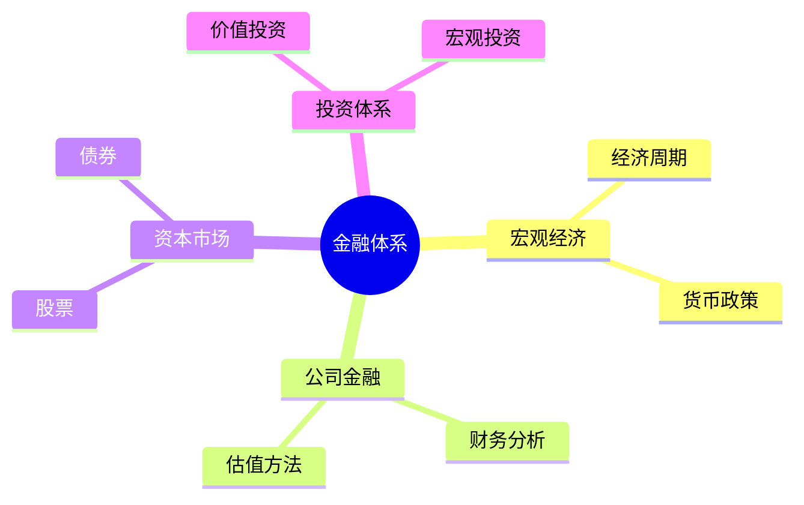
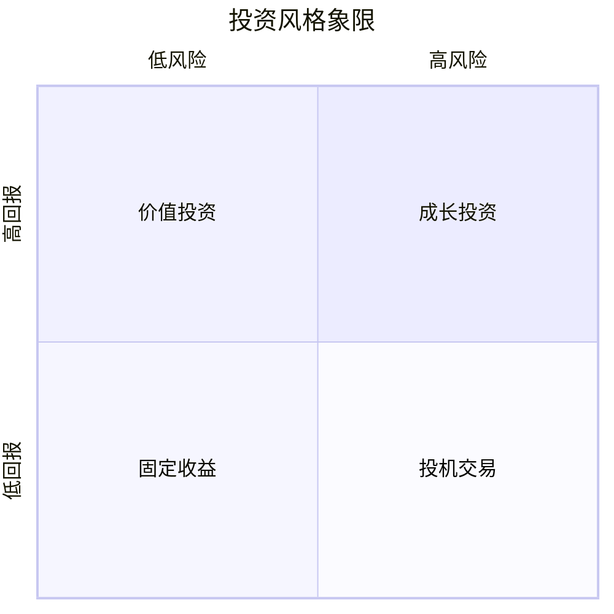

# Design Document: Finance Knowledge System

## Overview

本设计文档描述了如何在 `knowledge/05-insights/finance/` 目录下构建一个世界级的、系统化的金融知识体系。该系统采用分层架构，从基础认知到高级框架，为工程师背景的学习者提供完整的金融学习路径。

核心设计理念：
- 系统化：知识按照认知层级递进组织
- 结构化：使用清晰的目录层次和元数据
- 模型化：强调框架、模型和系统思维
- 实战化：理论与实践相结合

## Architecture

### 整体架构

```
knowledge/05-insights/finance/
├── index.md (主导航，12个月学习路线图)
├── 01-financial-cognition/ (第1阶段：金融认知，1个月)
│   ├── index.md
│   ├── money-creation.md (货币创造机制)
│   ├── banking-system.md (银行体系)
│   ├── financial-markets.md (金融市场结构)
│   ├── inflation-theory.md (通胀理论)
│   └── central-banking.md (中央银行运作)
├── 02-economic-foundation/ (第2阶段：经济学基础，2个月)
│   ├── index.md
│   ├── macroeconomics/ (宏观经济学)
│   ├── economic-cycles/ (经济周期理论)
│   ├── monetary-policy/ (货币政策)
│   ├── fiscal-policy/ (财政政策)
│   └── economic-indicators/ (经济指标)
├── 03-company-analysis/ (第3阶段：公司分析，2个月)
│   ├── index.md
│   ├── financial-statements/ (财务报表分析)
│   ├── valuation-methods/ (估值方法)
│   ├── competitive-analysis/ (竞争分析)
│   ├── business-models/ (商业模式)
│   └── case-studies/ (公司案例研究)
├── 04-investment-system/ (第4阶段：投资体系，3个月)
│   ├── index.md
│   ├── value-investing/ (价值投资)
│   ├── growth-investing/ (成长投资)
│   ├── macro-investing/ (宏观投资)
│   ├── quantitative-investing/ (量化投资)
│   ├── index-investing/ (指数投资)
│   └── investor-profiles/ (投资大师研究)
├── 05-global-perspective/ (第5阶段：全球视角，3个月)
│   ├── index.md
│   ├── us-market/ (美国市场)
│   ├── china-market/ (中国市场)
│   ├── global-markets/ (全球其他市场)
│   ├── industry-analysis/ (行业分析)
│   └── company-research/ (公司研究)
└── 06-macro-framework/ (第6阶段：宏观框架，持续)
    ├── index.md
    ├── monetary-cycles.md (货币周期)
    ├── debt-cycles.md (债务周期)
    ├── three-layer-model.md (三层金融世界模型)
    ├── global-capital-flows.md (全球资本流动)
    └── world-financial-map.md (世界金融认知地图)
```


### 分层设计原则

系统采用三层架构：

1. **导航层** (Index files)
   - 提供概览和导航
   - 展示学习路径
   - 包含知识地图

2. **组织层** (Category directories)
   - 按主题组织内容
   - 维护逻辑关系
   - 支持渐进学习

3. **内容层** (Content files)
   - 详细知识讲解
   - 案例和示例
   - 参考资料

## Components and Interfaces

### 1. 主索引文件 (finance/index.md)

**职责**：
- 提供金融知识体系总览
- 展示 12 个月学习路线图
- 说明工程师学习金融的优势
- 导航到六个学习阶段

**内容结构**：
```markdown
# 金融知识体系

## 知识框架总览
[四个核心模块图：宏观经济、公司金融、资本市场、投资体系]

## 12个月系统学习路径
[五阶段学习流程图]

## 学习阶段
- 第一阶段：金融认知（1个月）
- 第二阶段：经济学基础（2个月）
- 第三阶段：公司分析（2个月）
- 第四阶段：投资体系（3个月）
- 第五阶段：全球投资视角（3个月）
- 第六阶段：宏观框架（持续）

## 工程师优势
[逻辑能力、系统思维、技术理解]

## 核心投资原则
[买优秀资产 + 长期持有]
```

### 2. 阶段索引文件 (XX-stage-name/index.md)

**职责**：
- 介绍该阶段学习目标
- 列出该阶段所有主题
- 提供学习时间建议
- 链接到具体内容文件

**标准结构**：
- 阶段概述
- 学习目标
- 核心主题列表
- 推荐学习顺序
- 预计学习时间
- 关键资源


### 3. 内容文件 (Content Markdown Files)

**职责**：
- 提供深度知识讲解
- 包含实例和案例
- 提供参考资料
- 支持多层次学习

**标准元数据结构**：
```yaml
---
title: "文章标题"
description: "简要描述"
slug: "url-slug"

# 分类
domain: "金融洞察"
module: "具体模块名"
content_type: "article"
skill_level: "beginner/intermediate/advanced"

# 标签
tags:
  - 金融
  - 投资
  - 具体主题
prerequisites: ["前置知识1", "前置知识2"]
related_contents: ["相关内容1", "相关内容2"]

# 学习信息
estimated_time: 60  # 分钟
difficulty_score: 3  # 1-5

# 元信息
author: "作者"
created_at: "2024-01-01"
updated_at: "2024-01-01"
version: "1.0"
language: "zh-CN"

# 状态
status: "published"
is_featured: false
---
```

**内容结构模板**：
```markdown
# 标题

## 概述
[简要介绍主题和学习目标]

## 核心概念
[详细讲解核心概念]

### 子概念1
[深入分析]

### 子概念2
[深入分析]

## 理论框架
[相关理论和模型]

## 实践案例
[真实案例分析]

## 数据与图表
[可视化展示]

## 深入理解
[高级话题]

## 常见误区
[避免的错误]

## 实战应用
[如何应用]

## 延伸阅读
[推荐资源]

## 参考文献
[学术和专业引用]
```


## Data Models

### 目录结构模型

```typescript
interface DirectoryNode {
  name: string;           // 目录名称（kebab-case）
  path: string;           // 相对路径
  indexFile: IndexFile;   // 索引文件
  subdirectories: DirectoryNode[];  // 子目录
  contentFiles: ContentFile[];      // 内容文件
}

interface IndexFile {
  title: string;
  description: string;
  sections: Section[];
  navigationLinks: NavigationLink[];
}

interface ContentFile {
  metadata: Metadata;
  content: string;
}

interface Metadata {
  title: string;
  description: string;
  slug: string;
  domain: string;
  module: string;
  contentType: "article" | "tutorial" | "reference" | "case-study";
  skillLevel: "beginner" | "intermediate" | "advanced";
  tags: string[];
  prerequisites: string[];
  relatedContents: string[];
  estimatedTime: number;  // 分钟
  difficultyScore: number; // 1-5
  author: string;
  createdAt: string;
  updatedAt: string;
  version: string;
  language: string;
  status: "draft" | "published";
  isFeatured: boolean;
}
```

### 学习路径模型

```typescript
interface LearningPath {
  stages: LearningStage[];
  totalDuration: number;  // 月
  targetAudience: string;
}

interface LearningStage {
  stageNumber: number;
  name: string;
  duration: number;  // 月
  objectives: string[];
  topics: Topic[];
  milestones: string[];
}

interface Topic {
  title: string;
  contentFiles: string[];  // 文件路径
  estimatedTime: number;
  difficulty: number;
  prerequisites: string[];
}
```


### 内容组织模型

```typescript
interface FinanceKnowledgeSystem {
  rootPath: "knowledge/05-insights/finance";
  stages: {
    financialCognition: StageContent;
    economicFoundation: StageContent;
    companyAnalysis: StageContent;
    investmentSystem: StageContent;
    globalPerspective: StageContent;
    macroFramework: StageContent;
  };
  crossCuttingConcerns: {
    investorProfiles: InvestorProfile[];
    industryAnalyses: IndustryAnalysis[];
    companyResearch: CompanyResearch[];
    practicalTools: Tool[];
  };
}

interface StageContent {
  directoryName: string;
  indexFile: string;
  topics: TopicContent[];
  estimatedDuration: number;
}

interface TopicContent {
  fileName: string;
  title: string;
  subtopics: string[];
  depth: "overview" | "detailed" | "comprehensive";
  wordCount: number;
  references: Reference[];
}

interface Reference {
  type: "book" | "paper" | "article" | "course";
  title: string;
  author: string;
  year: number;
  url?: string;
  isbn?: string;
}
```

## Components and Interfaces

### Component 1: 内容生成器 (Content Generator)

**职责**：根据模板和需求生成结构化的 markdown 内容文件

**接口**：
```python
def generate_content_file(
    template: str,
    topic: Topic,
    metadata: Metadata,
    depth: str
) -> str:
    """
    生成内容文件
    
    Args:
        template: 内容模板
        topic: 主题信息
        metadata: 元数据
        depth: 深度级别 (overview/detailed/comprehensive)
    
    Returns:
        完整的 markdown 内容
    """
```

**输入**：
- 主题定义
- 元数据配置
- 深度要求
- 参考资料

**输出**：
- 格式化的 markdown 文件
- 包含完整元数据
- 符合模板规范


### Component 2: 索引生成器 (Index Generator)

**职责**：生成各级索引文件，提供导航和概览

**接口**：
```python
def generate_index_file(
    directory: DirectoryNode,
    children: List[DirectoryNode],
    content_files: List[ContentFile]
) -> str:
    """生成索引文件内容"""
```

**功能**：
- 扫描目录结构
- 收集子目录和文件信息
- 生成导航链接
- 创建知识地图

### Component 3: 元数据管理器 (Metadata Manager)

**职责**：管理和验证所有文件的元数据

**接口**：
```python
def validate_metadata(metadata: dict) -> bool:
    """验证元数据完整性和正确性"""

def generate_metadata(topic: Topic, stage: str) -> dict:
    """根据主题和阶段生成标准元数据"""
```


### Component 4: 交叉引用管理器 (Cross-Reference Manager)

**职责**：管理内容之间的关联和引用

**接口**：
```python
def create_internal_link(
    source_file: str,
    target_file: str,
    link_type: str
) -> str:
    """创建内部链接"""

def find_related_content(
    topic: str,
    tags: List[str]
) -> List[str]:
    """查找相关内容"""

def validate_links() -> List[str]:
    """验证所有链接有效性"""
```

**功能**：
- 维护内容关联图
- 生成相关内容推荐
- 验证链接完整性
- 支持双向链接

## Data Models

### 六大学习阶段详细设计

#### 阶段 1: 金融认知 (01-financial-cognition)

**目标**：建立金融世界运作的基础认知

**核心文件**：
1. `money-creation.md` - 货币创造机制
   - 中央银行职能
   - 商业银行信贷创造
   - 货币乘数效应
   - 量化宽松政策
   - 历史案例分析

2. `banking-system.md` - 银行体系
   - 中央银行体系
   - 商业银行运作
   - 影子银行系统
   - 银行监管框架
   - 全球主要银行系统比较

3. `financial-markets.md` - 金融市场结构
   - 股票市场（一级、二级市场）
   - 债券市场（国债、企业债）
   - 外汇市场（即期、远期）
   - 大宗商品市场
   - 衍生品市场
   - 市场参与者分析

4. `inflation-theory.md` - 通胀理论
   - 通胀定义和测量
   - 需求拉动型通胀
   - 成本推动型通胀
   - 货币主义通胀理论
   - 通胀对资产价格的影响
   - 历史通胀案例

5. `central-banking.md` - 中央银行运作
   - 美联储系统
   - 欧洲央行
   - 中国人民银行
   - 日本银行
   - 货币政策工具
   - 政策传导机制


#### 阶段 2: 经济学基础 (02-economic-foundation)

**目标**：掌握宏观经济理论和经济周期分析

**子目录结构**：

1. `macroeconomics/` - 宏观经济学
   - `gdp-analysis.md` - GDP 分析
   - `cpi-inflation.md` - CPI 与通胀
   - `interest-rates.md` - 利率机制
   - `employment-indicators.md` - 就业指标
   - `trade-balance.md` - 贸易平衡

2. `economic-cycles/` - 经济周期理论
   - `cycle-overview.md` - 周期概述
   - `kitchin-cycle.md` - 基钦周期（库存周期）
   - `juglar-cycle.md` - 朱格拉周期（设备投资周期）
   - `kuznets-cycle.md` - 库兹涅茨周期（建筑周期）
   - `kondratieff-wave.md` - 康德拉季耶夫长波
   - `merrill-lynch-clock.md` - 美林时钟详解
   - `cycle-indicators.md` - 周期指标体系

3. `monetary-policy/` - 货币政策
   - `policy-tools.md` - 政策工具
   - `interest-rate-policy.md` - 利率政策
   - `reserve-requirements.md` - 准备金政策
   - `open-market-operations.md` - 公开市场操作
   - `quantitative-easing.md` - 量化宽松
   - `policy-transmission.md` - 政策传导机制

4. `fiscal-policy/` - 财政政策
   - `government-spending.md` - 政府支出
   - `taxation.md` - 税收政策
   - `fiscal-stimulus.md` - 财政刺激
   - `debt-sustainability.md` - 债务可持续性

5. `economic-indicators/` - 经济指标
   - `leading-indicators.md` - 领先指标
   - `coincident-indicators.md` - 同步指标
   - `lagging-indicators.md` - 滞后指标
   - `composite-indices.md` - 综合指数


#### 阶段 3: 公司分析 (03-company-analysis)

**目标**：掌握企业分析和估值能力

**子目录结构**：

1. `financial-statements/` - 财务报表分析
   - `balance-sheet.md` - 资产负债表深度解析
   - `income-statement.md` - 利润表分析
   - `cash-flow-statement.md` - 现金流量表
   - `statement-relationships.md` - 三表关系
   - `ratio-analysis.md` - 财务比率分析
   - `trend-analysis.md` - 趋势分析
   - `common-size-analysis.md` - 共同比分析

2. `valuation-methods/` - 估值方法
   - `dcf-valuation.md` - 现金流折现法
   - `relative-valuation.md` - 相对估值法
   - `pe-ratio.md` - 市盈率估值
   - `pb-ratio.md` - 市净率估值
   - `ev-ebitda.md` - 企业价值倍数
   - `dividend-discount.md` - 股利折现模型
   - `asset-based-valuation.md` - 资产基础估值
   - `valuation-comparison.md` - 估值方法比较

3. `competitive-analysis/` - 竞争分析
   - `porters-five-forces.md` - 波特五力模型
   - `economic-moats.md` - 经济护城河
   - `competitive-advantage.md` - 竞争优势分析
   - `industry-structure.md` - 行业结构分析
   - `swot-analysis.md` - SWOT 分析

4. `business-models/` - 商业模式
   - `business-model-canvas.md` - 商业模式画布
   - `revenue-models.md` - 收入模式
   - `platform-business.md` - 平台型商业模式
   - `subscription-models.md` - 订阅模式
   - `marketplace-models.md` - 市场型模式
   - `saas-models.md` - SaaS 商业模式

5. `case-studies/` - 案例研究
   - `tech-giants/` - 科技巨头（Apple, Microsoft, Google, Amazon, Meta）
   - `consumer-brands/` - 消费品牌（Coca-Cola, Nike, Starbucks）
   - `financial-institutions/` - 金融机构（Berkshire, JPMorgan, Visa）
   - `chinese-companies/` - 中国公司（茅台、腾讯、宁德时代）
   - `failed-companies/` - 失败案例（Enron, Lehman, Theranos）


#### 阶段 4: 投资体系 (04-investment-system)

**目标**：建立系统化的投资方法论

**子目录结构**：

1. `value-investing/` - 价值投资
   - `graham-principles.md` - 格雷厄姆原则
   - `margin-of-safety.md` - 安全边际
   - `intrinsic-value.md` - 内在价值
   - `buffett-evolution.md` - 巴菲特的演进
   - `quality-investing.md` - 质量投资
   - `deep-value.md` - 深度价值投资
   - `value-traps.md` - 价值陷阱

2. `growth-investing/` - 成长投资
   - `growth-principles.md` - 成长投资原则
   - `fisher-methodology.md` - 费雪方法论
   - `growth-metrics.md` - 成长指标
   - `technology-growth.md` - 科技成长股
   - `growth-valuation.md` - 成长股估值
   - `garp-strategy.md` - GARP 策略

3. `macro-investing/` - 宏观投资
   - `top-down-approach.md` - 自上而下方法
   - `dalio-principles.md` - 达里奥原则
   - `soros-reflexivity.md` - 索罗斯反身性理论
   - `currency-trading.md` - 货币交易
   - `commodity-cycles.md` - 大宗商品周期
   - `global-macro-strategies.md` - 全球宏观策略

4. `quantitative-investing/` - 量化投资
   - `factor-investing.md` - 因子投资
   - `statistical-arbitrage.md` - 统计套利
   - `algorithmic-trading.md` - 算法交易
   - `portfolio-optimization.md` - 组合优化
   - `risk-models.md` - 风险模型
   - `backtesting.md` - 回测方法论
   - `quant-funds.md` - 量化基金研究

5. `index-investing/` - 指数投资
   - `passive-investing.md` - 被动投资理论
   - `index-construction.md` - 指数构建
   - `etf-guide.md` - ETF 投资指南
   - `asset-allocation.md` - 资产配置
   - `rebalancing.md` - 再平衡策略
   - `cost-analysis.md` - 成本分析

6. `investor-profiles/` - 投资大师研究
   - `warren-buffett.md` - 沃伦·巴菲特
   - `charlie-munger.md` - 查理·芒格
   - `ray-dalio.md` - 瑞·达里奥
   - `george-soros.md` - 乔治·索罗斯
   - `peter-lynch.md` - 彼得·林奇
   - `benjamin-graham.md` - 本杰明·格雷厄姆
   - `philip-fisher.md` - 菲利普·费雪
   - `john-templeton.md` - 约翰·邓普顿
   - `david-swensen.md` - 大卫·斯文森
   - `howard-marks.md` - 霍华德·马克斯
   - [继续添加 10+ 更多投资大师]


#### 阶段 5: 全球投资视角 (05-global-perspective)

**目标**：了解全球市场和优秀公司

**子目录结构**：

1. `us-market/` - 美国市场
   - `market-overview.md` - 市场概览
   - `tech-sector/` - 科技板块（FAANG+, 半导体, 软件）
   - `healthcare-sector/` - 医疗板块
   - `financial-sector/` - 金融板块
   - `consumer-sector/` - 消费板块
   - `industrial-sector/` - 工业板块
   - `energy-sector/` - 能源板块

2. `china-market/` - 中国市场
   - `market-overview.md` - 市场概览
   - `a-share-guide.md` - A股市场指南
   - `hong-kong-market.md` - 香港市场
   - `consumer-sector/` - 消费升级
   - `technology-sector/` - 科技自主
   - `new-energy-sector/` - 新能源
   - `healthcare-sector/` - 医疗健康
   - `financial-sector/` - 金融板块

3. `global-markets/` - 全球其他市场
   - `european-markets.md` - 欧洲市场
   - `japanese-market.md` - 日本市场
   - `emerging-markets.md` - 新兴市场
   - `market-comparison.md` - 市场比较

4. `industry-analysis/` - 行业分析
   - 30+ 行业深度分析文件
   - 每个行业包含：结构、价值链、关键成功因素、投资逻辑

5. `company-research/` - 公司研究
   - 100+ 公司深度研究报告
   - 包含：商业模式、财务分析、竞争地位、投资论点


#### 阶段 6: 宏观框架 (06-macro-framework)

**目标**：建立顶级宏观分析能力

**核心文件**：

1. `monetary-cycles.md` - 货币周期
   - 信贷周期机制
   - 货币供应与资产价格
   - 央行政策周期
   - 流动性分析框架
   - 历史货币周期案例

2. `debt-cycles.md` - 债务周期
   - 私人部门债务周期
   - 政府债务周期
   - 去杠杆化过程
   - 债务危机模式
   - Ray Dalio 债务周期理论

3. `three-layer-model.md` - 三层金融世界模型
   - 第一层：资产层（股票、债券、房地产、商品）
   - 第二层：货币层（法币、信贷、货币政策）
   - 第三层：权力层（地缘政治、制度、规则）
   - 三层互动机制

4. `global-capital-flows.md` - 全球资本流动
   - 国际收支平衡
   - 资本账户分析
   - 热钱流动模式
   - 汇率决定因素
   - 资本管制

5. `world-financial-map.md` - 世界金融认知地图
   - 全球金融体系架构
   - 主要经济体关系
   - 国际货币体系
   - 全球产业链
   - 地缘政治与金融

6. `crisis-analysis.md` - 危机分析框架
   - 危机形成机制
   - 危机传染路径
   - 政策应对模式
   - 投资策略调整

7. `integrated-framework.md` - 综合分析框架
   - 整合宏观、行业、公司分析
   - 投资决策流程
   - 风险管理体系
   - 持续学习方法


## Correctness Properties

*A property is a characteristic or behavior that should hold true across all valid executions of a system—essentially, a formal statement about what the system should do. Properties serve as the bridge between human-readable specifications and machine-verifiable correctness guarantees.*

### Property Reflection

After analyzing all acceptance criteria, I identified the following testable properties. Many content quality requirements (depth, comprehensiveness, writing style) require human judgment and are not suitable for automated testing. The testable properties focus on structural consistency, metadata compliance, and link integrity.

**Redundancy Analysis:**
- Properties about index files (8.3, 8.4, 8.5) can be combined into a comprehensive index file validation property
- Properties about content file metadata (10.1, 11.2, 11.3) can be combined into a metadata completeness property
- Properties about naming conventions (1.5) and directory structure (1.6) are distinct and both valuable

### Testable Properties

**Property 1: Directory Structure Consistency**
*For any* created directory in the finance knowledge system, it should follow the existing knowledge base patterns including kebab-case naming and hierarchical organization matching other insight modules.
**Validates: Requirements 1.5, 1.6**

**Property 2: Index File Completeness**
*For any* directory with subdirectories or content files, its index.md file should contain navigation links to all children, estimated learning times, and a visual knowledge structure diagram.
**Validates: Requirements 1.4, 8.3, 8.4, 8.5**

**Property 3: Metadata Schema Compliance**
*For any* content markdown file, its YAML frontmatter metadata should conform to the standard template schema including all required fields (title, description, domain, module, content_type, skill_level, tags, estimated_time, difficulty_score, author, dates, version, language, status).
**Validates: Requirements 10.1**

**Property 4: Citation Completeness**
*For any* reference or citation in any content file, it should include complete information (type, title, author, year, and URL or ISBN where applicable).
**Validates: Requirements 10.2**

**Property 5: Content Structure Requirements**
*For any* content file, it should include practical examples section, prerequisites metadata field, related contents metadata field, and common pitfalls or warnings section where applicable.
**Validates: Requirements 10.4, 11.2, 11.3, 12.5**

**Property 6: Bidirectional Link Consistency**
*For any* pair of content files A and B, if file A includes B in its related_contents metadata, then file B should include A in its related_contents metadata (bidirectional relationship).
**Validates: Requirements 11.4**

**Property 7: Internal Link Validity**
*For any* internal link in any content file, the target file should exist in the knowledge system.
**Validates: Requirements 11.1**

**Property 8: Stage Completion Guidance**
*For any* learning stage directory, its index file should include actionable next steps for learners who complete that stage.
**Validates: Requirements 12.1**


## Error Handling

### File System Errors

**Directory Creation Failures**:
- If directory already exists: Skip creation, log warning
- If parent directory missing: Create parent directories recursively
- If permission denied: Raise error with clear message

**File Writing Errors**:
- If file already exists: Prompt for overwrite confirmation
- If disk space insufficient: Raise error before writing
- If encoding issues: Use UTF-8 with BOM for compatibility

### Content Validation Errors

**Metadata Validation**:
- Missing required fields: List all missing fields in error message
- Invalid field values: Specify expected format and provide example
- Type mismatches: Convert when possible, otherwise raise error

**Link Validation**:
- Broken internal links: List all broken links with source and target
- Circular references: Detect and warn but allow (may be intentional)
- Missing bidirectional links: Warn but don't fail (can be fixed later)

### Content Quality Warnings

**Non-blocking Warnings**:
- Content file without examples: Warn but allow
- Missing diagrams in complex topics: Warn but allow
- Short content (< 1000 words): Warn for comprehensive topics
- No references cited: Warn but allow

## Testing Strategy

### Dual Testing Approach

This system requires both unit tests and property-based tests:

**Unit Tests** focus on:
- Specific directory creation scenarios
- Metadata parsing for known valid/invalid examples
- Link extraction from sample markdown files
- Template rendering with specific inputs

**Property-Based Tests** focus on:
- Directory structure consistency across all created directories
- Metadata schema compliance across all content files
- Link validity across the entire knowledge graph
- Bidirectional link consistency for all related content pairs

### Property Test Configuration

- Minimum 100 iterations per property test
- Each property test references its design document property number
- Tag format: **Feature: finance-knowledge-system, Property {number}: {property_text}**

### Testing Tools

**For Python Implementation**:
- Property testing: Hypothesis library
- Unit testing: pytest
- File system testing: pytest-tmp-path
- Markdown parsing: python-frontmatter, markdown-it-py

**For TypeScript Implementation**:
- Property testing: fast-check library
- Unit testing: Jest or Vitest
- File system testing: mock-fs or memfs
- Markdown parsing: gray-matter, remark


### Test Coverage Goals

**Structural Tests** (Unit + Property):
- Directory creation and naming: 100%
- Index file generation: 100%
- Metadata schema validation: 100%
- Link extraction and validation: 100%

**Content Quality Tests** (Manual Review):
- Content depth and comprehensiveness: Human review
- Writing clarity and style: Human review
- Diagram quality and relevance: Human review
- Example relevance and accuracy: Human review

### Testing Workflow

1. **Development Phase**:
   - Write unit tests for new components
   - Run property tests on sample content
   - Validate against requirements

2. **Content Creation Phase**:
   - Automated: Run property tests on all created files
   - Manual: Review content quality and depth
   - Automated: Validate all links and references

3. **Maintenance Phase**:
   - Continuous: Run property tests on updates
   - Periodic: Manual content quality review
   - Automated: Link integrity checks

## Implementation Notes

### Content Creation Workflow

1. **Phase 1: Structure Setup**
   - Create all directories
   - Generate all index files
   - Establish navigation structure

2. **Phase 2: Core Content**
   - Write foundational articles (Stage 1-2)
   - Establish reference patterns
   - Create content templates

3. **Phase 3: Detailed Content**
   - Expand all stages with detailed articles
   - Add case studies and examples
   - Build cross-references

4. **Phase 4: Enhancement**
   - Add diagrams and visualizations
   - Enrich with additional references
   - Create practical tools and templates

5. **Phase 5: Quality Assurance**
   - Run all property tests
   - Manual content review
   - Fix broken links and inconsistencies

### Prioritization

**Must Have (MVP)**:
- Complete directory structure
- All index files with navigation
- Core articles for each stage (30-40 files)
- Basic metadata on all files

**Should Have**:
- Detailed articles for major topics (100+ files)
- Company and industry case studies
- Investor profile analyses
- Comprehensive cross-references

**Nice to Have**:
- Interactive diagrams
- Video content links
- Downloadable templates
- Community contributions


## 详细内容规范

### 内容深度分级标准

**Beginner Level (初级)**:
- 字数：2000-3000 字
- 深度：概念介绍、基本原理
- 案例：1-2 个简单案例
- 参考：5-10 个基础资源
- 目标：建立基本认知

**Intermediate Level (中级)**:
- 字数：3000-5000 字
- 深度：深入分析、应用方法
- 案例：3-5 个详细案例
- 参考：10-20 个专业资源
- 目标：掌握应用能力

**Advanced Level (高级)**:
- 字数：5000-8000+ 字
- 深度：理论深化、前沿研究
- 案例：5-10 个复杂案例
- 参考：20-50 个学术和专业资源
- 目标：建立专家级理解

### 必需内容元素

每篇文章必须包含：

1. **概述部分** (200-300 字)
   - 主题介绍
   - 学习目标（3-5 条）
   - 为什么重要

2. **核心内容** (主体部分)
   - 理论讲解
   - 框架模型
   - 逻辑关系图

3. **实践案例** (至少 2 个)
   - 真实案例
   - 数据支持
   - 分析过程

4. **可视化** (至少 1 个)
   - Mermaid 图表
   - 流程图或结构图
   - 数据图表

5. **实战应用**
   - 如何使用
   - 注意事项
   - 常见错误

6. **延伸学习**
   - 推荐书籍（3-5 本）
   - 相关文章链接
   - 进阶主题

7. **参考文献**
   - 完整引用格式
   - 分类组织
   - 可访问性说明


### 可视化设计规范

**Mermaid 图表类型**：

1. **流程图** (Flowchart) - 用于流程和决策


2. **时序图** (Sequence) - 用于时间序列和因果关系


3. **状态图** (State) - 用于周期和状态转换


4. **思维导图** (Mindmap) - 用于知识结构


5. **象限图** (Quadrant) - 用于分类和比较



### 案例研究标准格式

每个公司案例应包含：

```markdown
# 公司名称 - 案例研究

## 公司概况
- 成立时间
- 总部位置
- 主营业务
- 市值规模
- 上市信息

## 商业模式分析
### 价值主张
### 客户细分
### 收入来源
### 成本结构
### 核心资源
### 关键活动

## 财务分析
### 收入增长
[10年数据图表]

### 盈利能力
- ROE 趋势
- 毛利率
- 净利率
- ROIC

### 现金流
- 经营现金流
- 自由现金流
- 资本支出

### 财务健康
- 资产负债率
- 流动比率
- 利息覆盖率

## 竞争分析
### 行业地位
### 竞争优势（护城河）
### 主要竞争对手
### 市场份额

## 投资论点
### 看多理由
### 风险因素
### 估值分析
### 长期前景

## 历史表现
[股价走势图]
[与指数对比]

## 关键学习点
1. 学习点1
2. 学习点2
3. 学习点3

## 参考资料
- 年报链接
- 分析报告
- 相关文章
```


### 投资大师研究标准格式

每个投资大师档案应包含：

```markdown
# 投资大师姓名

## 个人背景
- 出生年份
- 教育背景
- 职业经历
- 主要成就

## 投资哲学
### 核心理念
[3-5 条核心原则]

### 投资方法
[具体方法论]

### 选股标准
[具体标准清单]

## 投资演进
### 早期阶段
### 成熟阶段
### 晚期调整

## 经典投资案例
### 案例1：[公司名]
- 投资时间
- 投资逻辑
- 持有期间
- 投资回报
- 关键决策

### 案例2：[公司名]
[同上结构]

## 投资失误
### 失败案例
- 什么出错了
- 学到的教训

## 经典语录
> "原文引用1"
> "原文引用2"
> "原文引用3"

## 投资业绩
[长期回报数据]
[与市场对比]

## 著作与演讲
- 书籍列表
- 重要演讲
- 股东信

## 对投资者的启示
1. 启示1
2. 启示2
3. 启示3

## 如何学习他的方法
[实践建议]

## 参考资料
[完整引用]
```


## 内容发现与导航机制

### 多维度导航

**1. 层级导航** (Hierarchical)
- 从主索引到阶段索引到具体内容
- 面包屑导航路径
- 上一篇/下一篇链接

**2. 标签导航** (Tag-based)
- 按主题标签聚合内容
- 标签云展示
- 相关标签推荐

**3. 难度导航** (Difficulty-based)
- 按难度级别筛选
- 学习路径推荐
- 进阶路线图

**4. 类型导航** (Content-type)
- 理论文章
- 案例研究
- 实践指南
- 参考资料

### 搜索优化

**元数据优化**：
- 丰富的关键词标签
- 准确的描述信息
- 完整的分类信息

**内容优化**：
- 清晰的标题层级
- 关键概念加粗
- 术语定义明确

### 学习路径推荐

**基于前置知识**：
```python
def recommend_next_content(
    completed: List[str],
    current_level: str
) -> List[str]:
    """
    根据已完成内容和当前水平推荐下一步学习内容
    """
```

**基于学习目标**：
- 快速入门路径（3个月）
- 系统学习路径（12个月）
- 深度研究路径（24个月+）


## 内容更新与维护策略

### 版本控制

**内容版本管理**：
- 使用语义化版本号 (1.0, 1.1, 2.0)
- 主版本：内容重大重构
- 次版本：新增章节或重要更新
- 修订版本：错误修正和小改进

**更新日志**：
```markdown
## 更新历史

### v2.0 (2024-06-01)
- 新增量化投资章节
- 更新美股公司案例
- 补充 2024 年市场数据

### v1.1 (2024-03-01)
- 修正财务公式错误
- 新增 5 个案例研究
- 更新参考文献

### v1.0 (2024-01-01)
- 初始版本发布
```

### 内容审核流程

**创建阶段**：
1. 起草内容
2. 自我审核（结构、准确性）
3. 元数据验证
4. 链接检查

**发布阶段**：
1. 同行评审（可选）
2. 运行属性测试
3. 状态更新为 "published"
4. 添加到索引

**维护阶段**：
1. 定期审核（每季度）
2. 更新过时信息
3. 补充新案例
4. 修正错误

### 质量保证检查清单

**结构检查**：
- [ ] 元数据完整
- [ ] 标题层级正确
- [ ] 章节结构清晰
- [ ] 导航链接有效

**内容检查**：
- [ ] 概念解释清晰
- [ ] 案例充分
- [ ] 数据准确
- [ ] 图表清晰

**引用检查**：
- [ ] 所有引用有来源
- [ ] 引用格式统一
- [ ] 链接可访问
- [ ] 版权合规

**可读性检查**：
- [ ] 语言流畅
- [ ] 逻辑连贯
- [ ] 术语一致
- [ ] 排版美观


## 扩展性设计

### 模块化扩展

**新增主题**：
- 在相应阶段目录下创建新文件
- 遵循标准模板和元数据
- 更新父级索引文件
- 建立交叉引用

**新增阶段**：
- 创建新的阶段目录（07-xxx）
- 创建阶段索引
- 更新主索引
- 调整学习路径

### 多语言支持

**翻译策略**：
- 主要内容：中文
- 关键术语：中英对照
- 引用原文：保留英文
- 国际资源：提供英文链接

**文件组织**：
```
article-name.md (中文版)
article-name.en.md (英文版，未来扩展)
```

### 交互式内容

**未来增强**：
- 嵌入式计算器（估值计算器）
- 交互式图表（可调参数）
- 测验和练习
- 学习进度跟踪

### 社区贡献

**贡献指南**：
- 内容提交流程
- 质量标准
- 审核机制
- 署名规则

## 技术栈选择

### 内容管理

**静态站点生成**：
- MkDocs (当前使用)
- 支持 Markdown
- 主题定制
- 搜索功能

**元数据处理**：
- YAML frontmatter
- Python frontmatter 库
- 元数据验证脚本

**图表渲染**：
- Mermaid.js
- 支持多种图表类型
- 可导出为图片

### 自动化工具

**内容生成**：
- Python 脚本生成模板
- 批量创建目录结构
- 自动生成索引文件

**质量检查**：
- Markdown linter
- 链接检查器
- 元数据验证器
- 拼写检查

**测试框架**：
- pytest (Python)
- Hypothesis (属性测试)
- 自定义验证脚本


## 完整文件清单

### 阶段 1: 金融认知 (5 个核心文件)

```
01-financial-cognition/
├── index.md
├── money-creation.md
├── banking-system.md
├── financial-markets.md
├── inflation-theory.md
└── central-banking.md
```

### 阶段 2: 经济学基础 (25+ 文件)

```
02-economic-foundation/
├── index.md
├── macroeconomics/
│   ├── index.md
│   ├── gdp-analysis.md
│   ├── cpi-inflation.md
│   ├── interest-rates.md
│   ├── employment-indicators.md
│   └── trade-balance.md
├── economic-cycles/
│   ├── index.md
│   ├── cycle-overview.md
│   ├── kitchin-cycle.md
│   ├── juglar-cycle.md
│   ├── kuznets-cycle.md
│   ├── kondratieff-wave.md
│   ├── merrill-lynch-clock.md
│   └── cycle-indicators.md
├── monetary-policy/
│   ├── index.md
│   ├── policy-tools.md
│   ├── interest-rate-policy.md
│   ├── reserve-requirements.md
│   ├── open-market-operations.md
│   ├── quantitative-easing.md
│   └── policy-transmission.md
├── fiscal-policy/
│   ├── index.md
│   ├── government-spending.md
│   ├── taxation.md
│   ├── fiscal-stimulus.md
│   └── debt-sustainability.md
└── economic-indicators/
    ├── index.md
    ├── leading-indicators.md
    ├── coincident-indicators.md
    ├── lagging-indicators.md
    └── composite-indices.md
```

### 阶段 3: 公司分析 (40+ 文件)

```
03-company-analysis/
├── index.md
├── financial-statements/
│   ├── index.md
│   ├── balance-sheet.md
│   ├── income-statement.md
│   ├── cash-flow-statement.md
│   ├── statement-relationships.md
│   ├── ratio-analysis.md
│   ├── trend-analysis.md
│   └── common-size-analysis.md
├── valuation-methods/
│   ├── index.md
│   ├── dcf-valuation.md
│   ├── relative-valuation.md
│   ├── pe-ratio.md
│   ├── pb-ratio.md
│   ├── ev-ebitda.md
│   ├── dividend-discount.md
│   ├── asset-based-valuation.md
│   └── valuation-comparison.md
├── competitive-analysis/
│   ├── index.md
│   ├── porters-five-forces.md
│   ├── economic-moats.md
│   ├── competitive-advantage.md
│   ├── industry-structure.md
│   └── swot-analysis.md
├── business-models/
│   ├── index.md
│   ├── business-model-canvas.md
│   ├── revenue-models.md
│   ├── platform-business.md
│   ├── subscription-models.md
│   ├── marketplace-models.md
│   └── saas-models.md
└── case-studies/
    ├── index.md
    ├── tech-giants/
    │   ├── index.md
    │   ├── apple.md
    │   ├── microsoft.md
    │   ├── google.md
    │   ├── amazon.md
    │   └── meta.md
    ├── consumer-brands/
    │   ├── index.md
    │   ├── coca-cola.md
    │   ├── nike.md
    │   └── starbucks.md
    ├── financial-institutions/
    │   ├── index.md
    │   ├── berkshire-hathaway.md
    │   ├── jpmorgan.md
    │   └── visa.md
    ├── chinese-companies/
    │   ├── index.md
    │   ├── moutai.md
    │   ├── tencent.md
    │   └── catl.md
    └── failed-companies/
        ├── index.md
        ├── enron.md
        ├── lehman.md
        └── theranos.md
```


### 阶段 4: 投资体系 (50+ 文件)

```
04-investment-system/
├── index.md
├── value-investing/
│   ├── index.md
│   ├── graham-principles.md
│   ├── margin-of-safety.md
│   ├── intrinsic-value.md
│   ├── buffett-evolution.md
│   ├── quality-investing.md
│   ├── deep-value.md
│   └── value-traps.md
├── growth-investing/
│   ├── index.md
│   ├── growth-principles.md
│   ├── fisher-methodology.md
│   ├── growth-metrics.md
│   ├── technology-growth.md
│   ├── growth-valuation.md
│   └── garp-strategy.md
├── macro-investing/
│   ├── index.md
│   ├── top-down-approach.md
│   ├── dalio-principles.md
│   ├── soros-reflexivity.md
│   ├── currency-trading.md
│   ├── commodity-cycles.md
│   └── global-macro-strategies.md
├── quantitative-investing/
│   ├── index.md
│   ├── factor-investing.md
│   ├── fama-french-model.md
│   ├── momentum-factor.md
│   ├── quality-factor.md
│   ├── value-factor.md
│   ├── statistical-arbitrage.md
│   ├── algorithmic-trading.md
│   ├── portfolio-optimization.md
│   ├── risk-models.md
│   ├── backtesting.md
│   └── quant-funds.md
├── index-investing/
│   ├── index.md
│   ├── passive-investing.md
│   ├── index-construction.md
│   ├── etf-guide.md
│   ├── asset-allocation.md
│   ├── rebalancing.md
│   └── cost-analysis.md
├── asset-allocation/
│   ├── index.md
│   ├── modern-portfolio-theory.md
│   ├── efficient-frontier.md
│   ├── risk-parity.md
│   ├── all-weather-portfolio.md
│   ├── 60-40-portfolio.md
│   └── tactical-allocation.md
├── risk-management/
│   ├── index.md
│   ├── risk-types.md
│   ├── risk-measurement.md
│   ├── var-cvar.md
│   ├── stress-testing.md
│   ├── portfolio-hedging.md
│   ├── position-sizing.md
│   └── behavioral-finance.md
└── investor-profiles/
    ├── index.md
    ├── warren-buffett.md
    ├── charlie-munger.md
    ├── ray-dalio.md
    ├── george-soros.md
    ├── peter-lynch.md
    ├── benjamin-graham.md
    ├── philip-fisher.md
    ├── john-templeton.md
    ├── david-swensen.md
    ├── howard-marks.md
    ├── joel-greenblatt.md
    ├── seth-klarman.md
    ├── bill-ackman.md
    ├── carl-icahn.md
    ├── jim-simons.md
    ├── david-tepper.md
    ├── stanley-druckenmiller.md
    ├── john-paulson.md
    ├── bill-gross.md
    └── cathie-wood.md
```


### 阶段 5: 全球投资视角 (80+ 文件)

```
05-global-perspective/
├── index.md
├── us-market/
│   ├── index.md
│   ├── market-overview.md
│   ├── market-structure.md
│   ├── regulatory-framework.md
│   ├── tech-sector/
│   │   ├── index.md
│   │   ├── faang-analysis.md
│   │   ├── semiconductor/
│   │   │   ├── nvidia.md
│   │   │   ├── tsmc.md
│   │   │   ├── intel.md
│   │   │   └── amd.md
│   │   ├── software/
│   │   │   ├── salesforce.md
│   │   │   ├── adobe.md
│   │   │   └── servicenow.md
│   │   └── cloud/
│   │       ├── aws-analysis.md
│   │       ├── azure-analysis.md
│   │       └── gcp-analysis.md
│   ├── healthcare-sector/
│   │   ├── index.md
│   │   ├── pharma/
│   │   ├── biotech/
│   │   └── medical-devices/
│   ├── financial-sector/
│   │   ├── index.md
│   │   ├── banks/
│   │   ├── insurance/
│   │   └── fintech/
│   ├── consumer-sector/
│   │   ├── index.md
│   │   ├── retail/
│   │   ├── brands/
│   │   └── restaurants/
│   ├── industrial-sector/
│   │   ├── index.md
│   │   ├── aerospace/
│   │   ├── manufacturing/
│   │   └── transportation/
│   └── energy-sector/
│       ├── index.md
│       ├── oil-gas/
│       ├── renewables/
│       └── utilities/
├── china-market/
│   ├── index.md
│   ├── market-overview.md
│   ├── a-share-guide.md
│   ├── hong-kong-market.md
│   ├── regulatory-environment.md
│   ├── consumer-sector/
│   │   ├── index.md
│   │   ├── baijiu/
│   │   │   ├── moutai.md
│   │   │   ├── wuliangye.md
│   │   │   └── luzhou-laojiao.md
│   │   ├── food-beverage/
│   │   ├── retail/
│   │   └── brands/
│   ├── technology-sector/
│   │   ├── index.md
│   │   ├── internet/
│   │   │   ├── tencent.md
│   │   │   ├── alibaba.md
│   │   │   └── meituan.md
│   │   ├── semiconductor/
│   │   ├── software/
│   │   └── hardware/
│   ├── new-energy-sector/
│   │   ├── index.md
│   │   ├── ev-batteries/
│   │   │   ├── catl.md
│   │   │   └── byd.md
│   │   ├── solar/
│   │   └── wind/
│   ├── healthcare-sector/
│   │   ├── index.md
│   │   ├── pharma/
│   │   ├── medical-devices/
│   │   └── healthcare-services/
│   └── financial-sector/
│       ├── index.md
│       ├── banks/
│       ├── insurance/
│       └── securities/
├── global-markets/
│   ├── index.md
│   ├── european-markets.md
│   ├── japanese-market.md
│   ├── emerging-markets.md
│   └── market-comparison.md
├── industry-analysis/
│   ├── index.md
│   ├── technology/
│   │   ├── ai-industry.md
│   │   ├── semiconductor-industry.md
│   │   ├── cloud-computing.md
│   │   ├── cybersecurity.md
│   │   └── software-saas.md
│   ├── healthcare/
│   │   ├── pharmaceutical.md
│   │   ├── biotechnology.md
│   │   └── medical-devices.md
│   ├── consumer/
│   │   ├── retail.md
│   │   ├── luxury-goods.md
│   │   └── food-beverage.md
│   ├── financial/
│   │   ├── banking.md
│   │   ├── insurance.md
│   │   └── asset-management.md
│   ├── industrial/
│   │   ├── aerospace.md
│   │   ├── manufacturing.md
│   │   └── logistics.md
│   └── energy/
│       ├── oil-gas.md
│       ├── renewable-energy.md
│       └── utilities.md
└── company-research/
    ├── index.md
    ├── research-methodology.md
    ├── screening-criteria.md
    ├── analysis-template.md
    └── [100+ 公司研究文件]
```


### 阶段 6: 宏观框架 (10+ 文件)

```
06-macro-framework/
├── index.md
├── monetary-cycles.md
├── debt-cycles.md
├── three-layer-model.md
├── global-capital-flows.md
├── world-financial-map.md
├── crisis-analysis.md
├── integrated-framework.md
├── geopolitics-finance.md
├── currency-systems.md
└── future-outlook.md
```

### 补充模块：金融历史 (可选扩展)

```
07-financial-history/ (可选)
├── index.md
├── crises/
│   ├── great-depression-1929.md
│   ├── black-monday-1987.md
│   ├── asian-crisis-1997.md
│   ├── dotcom-bubble-2000.md
│   ├── financial-crisis-2008.md
│   ├── european-debt-crisis.md
│   └── covid-crisis-2020.md
├── monetary-history/
│   ├── gold-standard.md
│   ├── bretton-woods.md
│   ├── fiat-money-era.md
│   └── digital-currency.md
└── market-evolution/
    ├── stock-market-history.md
    ├── bond-market-history.md
    └── derivatives-history.md
```

### 补充模块：实践工具 (可选扩展)

```
08-practical-tools/ (可选)
├── index.md
├── data-sources/
│   ├── free-resources.md
│   ├── professional-platforms.md
│   └── research-databases.md
├── analysis-tools/
│   ├── screening-tools.md
│   ├── charting-platforms.md
│   ├── portfolio-trackers.md
│   └── valuation-calculators.md
├── templates/
│   ├── company-analysis-template.md
│   ├── industry-research-template.md
│   ├── investment-memo-template.md
│   └── portfolio-review-template.md
├── checklists/
│   ├── investment-decision-checklist.md
│   ├── risk-assessment-checklist.md
│   └── due-diligence-checklist.md
└── learning-resources/
    ├── book-recommendations.md
    ├── online-courses.md
    ├── podcasts.md
    ├── newsletters.md
    └── communities.md
```

### 总文件统计

**预计文件总数**：200+ 文件

- 阶段 1: 6 文件
- 阶段 2: 30 文件
- 阶段 3: 50 文件
- 阶段 4: 60 文件
- 阶段 5: 80 文件
- 阶段 6: 12 文件
- 补充模块: 20+ 文件

**内容总量估算**：
- 平均每文件：3000-5000 字
- 总字数：60万 - 100万 字
- 相当于：10-15 本专业书籍的内容量

