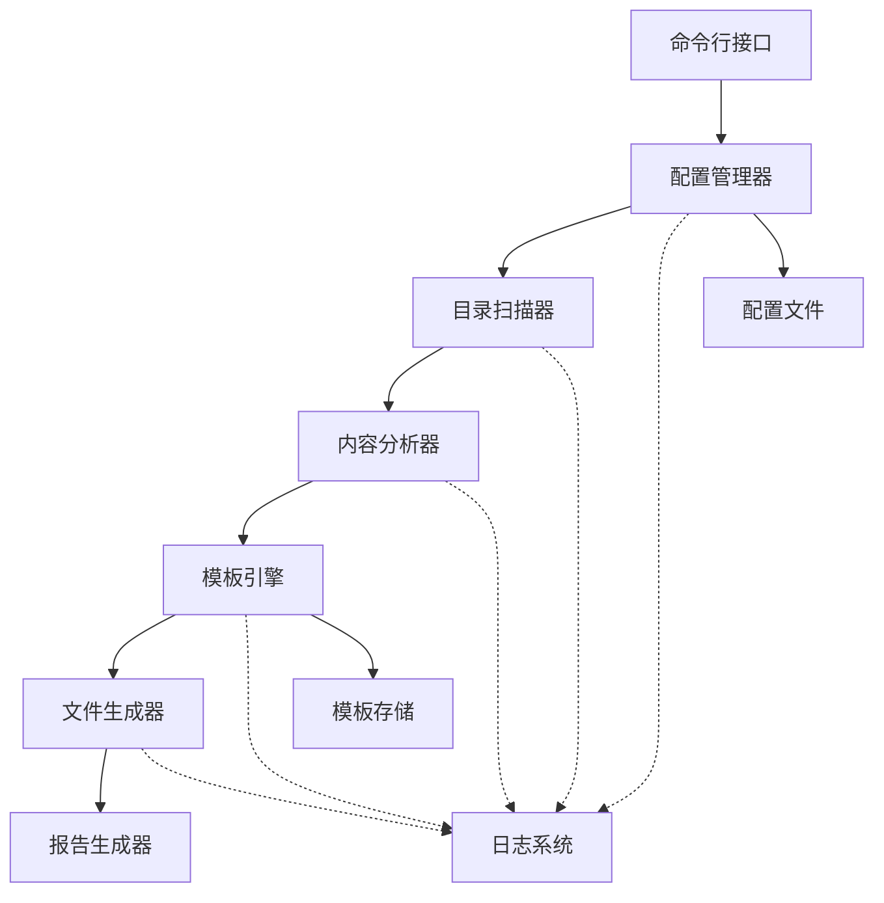

# Design Document

## Overview

MkDocs Index Generator 是一个 Python 命令行工具，用于自动扫描 MkDocs 文档目录结构，识别缺失的 index.md 文件，并根据目录类型和内容智能生成符合规范的索引页面。

系统采用模块化设计，包含目录扫描、内容分析、模板渲染和文件生成四个核心模块，支持批量处理、预览验证和增量更新。

## Architecture

系统采用管道式架构（Pipeline Architecture），数据流经过以下阶段：

```
配置加载 → 目录扫描 → 内容分析 → 模板渲染 → 文件生成 → 报告输出
```

### 架构图



## Components and Interfaces

### 1. CLI Module (命令行接口模块)

**职责**: 处理用户命令和参数，协调各模块执行

**接口**:
```python
class CLI:
    def run(args: List[str]) -> int
    def parse_arguments() -> Namespace
    def execute_command(command: str, options: Dict) -> Result
```

**命令**:
- `scan` - 扫描目录并显示缺失的 index.md
- `generate` - 生成缺失的 index.md 文件
- `preview` - 预览将要生成的内容
- `validate` - 验证现有 index.md 文件


### 2. Configuration Manager (配置管理器)

**职责**: 加载和管理配置，提供默认值

**接口**:
```python
class ConfigManager:
    def load_config(path: Optional[str]) -> Config
    def get_excluded_dirs() -> List[str]
    def get_template_path(template_type: str) -> str
    def validate_config() -> ValidationResult
```

**配置结构**:
```yaml
# config.yml
scan:
  root_dir: "knowledge"
  excluded_dirs:
    - "javascripts"
    - "stylesheets"
    - "_site"
    - "_wiki"
    - "templates"
  
templates:
  main_layer: "templates/main_layer.md"
  sub_topic: "templates/sub_topic.md"
  difficulty: "templates/difficulty.md"
  content: "templates/content.md"

generation:
  force_overwrite: false
  create_backup: true
  dry_run: false

logging:
  level: "INFO"
  file: "mkdocs_generator.log"
```

### 3. Directory Scanner (目录扫描器)

**职责**: 递归扫描目录，识别缺失 index.md 的目录

**接口**:
```python
class DirectoryScanner:
    def scan(root_path: str, excluded: List[str]) -> List[DirectoryInfo]
    def is_excluded(path: str, excluded: List[str]) -> bool
    def has_index(path: str) -> bool
    def get_directory_level(path: str) -> int
```

**数据结构**:
```python
@dataclass
class DirectoryInfo:
    path: str
    name: str
    level: int
    has_index: bool
    children: List[str]
    markdown_files: List[str]
```

### 4. Content Analyzer (内容分析器)

**职责**: 分析目录类型，提取元数据

**接口**:
```python
class ContentAnalyzer:
    def analyze(dir_info: DirectoryInfo) -> DirectoryMetadata
    def detect_type(dir_info: DirectoryInfo) -> DirectoryType
    def extract_title(dir_name: str) -> str
    def generate_description(dir_info: DirectoryInfo) -> str
    def list_children(dir_info: DirectoryInfo) -> List[ChildItem]
```

**目录类型枚举**:
```python
class DirectoryType(Enum):
    MAIN_LAYER = "main_layer"      # 主层级目录 (XX-layer, XX-concerns)
    SUB_TOPIC = "sub_topic"        # 子主题目录 (01-xxx, 02-xxx)
    DIFFICULTY = "difficulty"      # 难度级别 (beginner, intermediate, advanced)
    CONTENT = "content"            # 内容目录 (包含 .md 文件)
    UNKNOWN = "unknown"            # 未知类型
```

**元数据结构**:
```python
@dataclass
class DirectoryMetadata:
    type: DirectoryType
    title: str
    description: str
    children: List[ChildItem]
    breadcrumb: List[str]
    
@dataclass
class ChildItem:
    name: str
    title: str
    path: str
    type: str  # "directory" or "file"
```


### 5. Template Engine (模板引擎)

**职责**: 根据模板和元数据生成 Markdown 内容

**接口**:
```python
class TemplateEngine:
    def __init__(template_dir: str)
    def render(metadata: DirectoryMetadata, template_type: str) -> str
    def load_template(template_type: str) -> Template
    def get_default_template(template_type: str) -> str
```

**模板变量**:
- `{{title}}` - 目录标题
- `{{description}}` - 目录描述
- `{{breadcrumb}}` - 面包屑导航
- `{{children}}` - 子项列表
- `{{level}}` - 目录层级
- `{{date}}` - 生成日期

**模板示例**:

主层级模板 (main_layer.md):
```markdown
# {{title}}

{{description}}

## 📚 子主题

{{children}}

## 🎯 学习路径

根据难度级别选择合适的学习内容：
- 🟢 beginner - 入门基础
- 🟡 intermediate - 进阶提升  
- 🔴 advanced - 高级实战

---
*最后更新：{{date}}*
```

难度级别模板 (difficulty.md):
```markdown
# {{title}}

本部分包含 {{level}} 级别的学习内容。

## 📖 文档列表

{{children}}

## 💡 学习建议

{{learning_tips}}

---
*最后更新：{{date}}*
```

### 6. File Generator (文件生成器)

**职责**: 将生成的内容写入文件系统

**接口**:
```python
class FileGenerator:
    def generate(path: str, content: str, options: GenerateOptions) -> GenerateResult
    def create_backup(path: str) -> bool
    def validate_path(path: str) -> bool
    def write_file(path: str, content: str) -> bool
```

**生成选项**:
```python
@dataclass
class GenerateOptions:
    force_overwrite: bool = False
    create_backup: bool = True
    dry_run: bool = False
    
@dataclass
class GenerateResult:
    success: bool
    path: str
    action: str  # "created", "skipped", "overwritten"
    message: str
```

### 7. Reporter (报告生成器)

**职责**: 生成执行报告和统计信息

**接口**:
```python
class Reporter:
    def add_result(result: GenerateResult)
    def generate_summary() -> Summary
    def print_report(format: str)  # "text" or "json"
```

**报告结构**:
```python
@dataclass
class Summary:
    total_scanned: int
    missing_index: int
    generated: int
    skipped: int
    failed: int
    errors: List[ErrorInfo]
```

### 8. Logger (日志系统)

**职责**: 记录系统运行日志

**接口**:
```python
class Logger:
    def debug(message: str)
    def info(message: str)
    def warning(message: str)
    def error(message: str, exception: Optional[Exception])
```


## Data Models

### Core Data Structures

```python
from dataclasses import dataclass
from enum import Enum
from typing import List, Optional
from datetime import datetime

@dataclass
class DirectoryInfo:
    """扫描得到的目录信息"""
    path: str                      # 完整路径
    name: str                      # 目录名称
    level: int                     # 目录层级
    has_index: bool                # 是否已有 index.md
    children: List[str]            # 子目录列表
    markdown_files: List[str]      # Markdown 文件列表
    parent: Optional[str] = None   # 父目录路径

class DirectoryType(Enum):
    """目录类型枚举"""
    MAIN_LAYER = "main_layer"
    SUB_TOPIC = "sub_topic"
    DIFFICULTY = "difficulty"
    CONTENT = "content"
    UNKNOWN = "unknown"

@dataclass
class DirectoryMetadata:
    """分析得到的目录元数据"""
    type: DirectoryType
    title: str
    description: str
    children: List['ChildItem']
    breadcrumb: List[str]
    level_indicator: Optional[str] = None  # 🟢🟡🔴

@dataclass
class ChildItem:
    """子项信息"""
    name: str          # 文件/目录名
    title: str         # 显示标题
    path: str          # 相对路径
    type: str          # "directory" or "file"
    description: Optional[str] = None

@dataclass
class Config:
    """系统配置"""
    root_dir: str
    excluded_dirs: List[str]
    template_paths: dict
    force_overwrite: bool
    create_backup: bool
    dry_run: bool
    log_level: str
    log_file: str

@dataclass
class GenerateOptions:
    """文件生成选项"""
    force_overwrite: bool = False
    create_backup: bool = True
    dry_run: bool = False

@dataclass
class GenerateResult:
    """文件生成结果"""
    success: bool
    path: str
    action: str  # "created", "skipped", "overwritten", "failed"
    message: str
    timestamp: datetime

@dataclass
class Summary:
    """执行摘要"""
    total_scanned: int
    missing_index: int
    generated: int
    skipped: int
    failed: int
    duration: float
    errors: List['ErrorInfo']

@dataclass
class ErrorInfo:
    """错误信息"""
    path: str
    error_type: str
    message: str
    timestamp: datetime
```


## Correctness Properties

*属性（Property）是系统在所有有效执行中应该保持为真的特征或行为——本质上是关于系统应该做什么的形式化陈述。属性是人类可读规范和机器可验证正确性保证之间的桥梁。*

### Property Reflection

在将验收标准转换为属性之前，我进行了属性反思以消除冗余：

**识别的冗余和合并**:

1. **扫描完整性**: 标准 1.1（递归遍历）和 1.4（返回完整信息）可以合并为一个综合属性，验证扫描的完整性和结果的正确性。

2. **目录分类**: 标准 1.5（分类）、2.1-2.4（具体分类规则）可以合并为一个属性，验证所有分类规则的正确性。

3. **模板内容生成**: 标准 3.1-3.4（不同类型目录的模板内容）可以合并为一个属性，验证每种类型都生成正确的内容元素。

4. **日志记录**: 标准 5.3、5.4、7.5、9.1 都涉及日志记录，可以合并为一个综合的日志完整性属性。

5. **错误处理**: 标准 4.4、5.4、8.5 都涉及错误处理和回退机制，可以合并。

6. **退出码**: 标准 10.4 和 10.5 可以合并为一个属性，验证退出码与执行结果的对应关系。

### Core Properties


**Property 1: 扫描完整性**
*对于任何*目录结构，扫描器应该访问所有非排除的子目录，并正确识别每个目录是否包含 index.md 文件，返回的结果应包含完整的路径和层级信息。
**Validates: Requirements 1.1, 1.2, 1.4**

**Property 2: 排除目录过滤**
*对于任何*排除目录列表和目录结构，扫描器应该跳过所有在排除列表中的目录及其子目录。
**Validates: Requirements 1.3**

**Property 3: 目录类型分类正确性**
*对于任何*目录，内容分析器应该根据以下规则正确分类：
- 包含 "beginner"、"intermediate" 或 "advanced" → 难度级别目录
- 匹配 "XX-layer" 或 "XX-concerns" 模式 → 主层级目录
- 包含数字前缀且非难度级别 → 子主题目录
- 包含 .md 文件（除 index.md）→ 内容目录
**Validates: Requirements 1.5, 2.1, 2.2, 2.3, 2.4**

**Property 4: 元数据完整性**
*对于任何*已分类的目录，内容分析器应该返回包含标题、描述和子项列表的完整元数据。
**Validates: Requirements 2.5**

**Property 5: 模板内容元素完整性**
*对于任何*目录类型，模板引擎生成的内容应该包含该类型所需的所有元素：
- 主层级：标题、概述、子主题列表
- 子主题：介绍、难度导航、文档链接
- 难度级别：难度说明、学习路径、文档列表
- 内容目录：文件链接和描述
**Validates: Requirements 3.1, 3.2, 3.3, 3.4**

**Property 6: 标题提取正确性**
*对于任何*包含数字前缀和连字符的目录名，模板引擎应该正确提取中文标题（去除前缀和连字符）。
**Validates: Requirements 3.5**

**Property 7: Front Matter 格式正确性**
*对于任何*生成的 index.md 文件，内容应该以有效的 YAML front matter 开头，包含 title 和 description 字段。
**Validates: Requirements 3.6**

**Property 8: 模板变量替换**
*对于任何*包含模板变量（如 {{title}}、{{description}}）的模板，模板引擎应该将所有变量替换为相应的实际值。
**Validates: Requirements 4.3**

**Property 9: 自定义模板优先级**
*对于任何*提供的自定义模板文件，模板引擎应该使用自定义模板而不是默认模板进行渲染。
**Validates: Requirements 4.2**

**Property 10: 模板错误回退**
*对于任何*不存在或格式错误的模板文件，系统应该回退到内置默认模板并记录警告日志。
**Validates: Requirements 4.4, 8.5**

**Property 11: 批量生成完整性**
*对于任何*缺失 index.md 的目录集合，批量生成命令应该为每个目录生成文件或记录失败原因，不会因单个失败而中断。
**Validates: Requirements 5.1, 5.4**

**Property 12: 文件系统权限检查**
*对于任何*目标目录，在生成文件前系统应该验证目录存在且可写，否则记录错误。
**Validates: Requirements 5.2**

**Property 13: 操作日志完整性**
*对于任何*扫描、分析、生成、跳过或失败的操作，系统应该记录相应的日志条目，包含路径、状态和时间戳。
**Validates: Requirements 5.3, 7.5, 9.1**

**Property 14: 统计报告准确性**
*对于任何*批量操作，生成的统计报告中的数量（成功、失败、跳过）应该等于实际处理的目录数量。
**Validates: Requirements 5.5, 9.2**

**Property 15: 预览模式不写入文件**
*对于任何*在预览模式（dry-run）下的操作，系统不应该创建、修改或删除任何文件。
**Validates: Requirements 6.1**

**Property 16: 预览输出完整性**
*对于任何*预览的目录，输出应该包含目录路径、目录类型和生成内容的预览。
**Validates: Requirements 6.2**

**Property 17: Markdown 语法有效性**
*对于任何*生成的内容，应该是语法有效的 Markdown 文档。
**Validates: Requirements 6.5**

**Property 18: 默认跳过已存在文件**
*对于任何*已包含 index.md 的目录，在非强制模式下系统应该跳过该目录。
**Validates: Requirements 7.1**

**Property 19: 强制覆盖模式**
*对于任何*已包含 index.md 的目录，在强制覆盖模式下系统应该覆盖现有文件。
**Validates: Requirements 7.2**

**Property 20: 备份文件创建**
*对于任何*被覆盖的 index.md 文件，系统应该在覆盖前创建备份文件。
**Validates: Requirements 7.3**

**Property 21: 类型过滤功能**
*对于任何*指定的目录类型过滤器，系统应该只处理匹配该类型的目录。
**Validates: Requirements 7.4**

**Property 22: 配置文件加载**
*对于任何*有效的 YAML 或 JSON 配置文件，系统应该正确加载并应用配置项（排除目录、模板路径、选项）。
**Validates: Requirements 8.1, 8.2**

**Property 23: 默认配置回退**
*对于任何*不存在的配置文件，系统应该使用内置的默认配置值。
**Validates: Requirements 8.3**

**Property 24: 配置验证**
*对于任何*配置文件，系统应该验证格式和内容的正确性，对无效配置显示错误并使用默认值。
**Validates: Requirements 8.4, 8.5**

**Property 25: 错误日志详细性**
*对于任何*发生的错误，日志应该包含错误类型、消息、堆栈跟踪和上下文信息。
**Validates: Requirements 9.4**

**Property 26: 退出码正确性**
*对于任何*命令执行，成功时应该返回退出码 0，失败时应该返回非零退出码并输出错误信息。
**Validates: Requirements 10.4, 10.5**


## Error Handling

### Error Categories

1. **文件系统错误**
   - 目录不存在
   - 权限不足（无法读取/写入）
   - 磁盘空间不足
   - 文件已被锁定

2. **配置错误**
   - 配置文件格式无效（YAML/JSON 解析失败）
   - 必需配置项缺失
   - 配置值类型错误
   - 模板路径无效

3. **模板错误**
   - 模板文件不存在
   - 模板语法错误
   - 变量未定义
   - 模板渲染失败

4. **数据验证错误**
   - 目录路径无效
   - 元数据不完整
   - Markdown 语法错误

### Error Handling Strategy

```python
class ErrorHandler:
    """统一的错误处理策略"""
    
    def handle_error(error: Exception, context: dict) -> ErrorResult:
        """
        错误处理流程：
        1. 记录详细错误日志（包含堆栈和上下文）
        2. 根据错误类型决定是否继续执行
        3. 返回错误结果供调用者处理
        """
        pass
    
    def is_recoverable(error: Exception) -> bool:
        """判断错误是否可恢复"""
        pass
    
    def get_fallback_value(error: Exception) -> Any:
        """获取回退值"""
        pass
```

### Error Recovery Rules

1. **单个文件失败不影响批量处理**: 一个目录生成失败时，记录错误并继续处理其他目录
2. **配置错误使用默认值**: 配置项无效时使用默认值并记录警告
3. **模板错误回退到默认模板**: 自定义模板失败时使用内置模板
4. **权限错误跳过目录**: 无权限访问的目录记录错误并跳过
5. **致命错误立即终止**: 如根目录不存在、配置文件严重错误等

### Error Messages

所有错误消息应该：
- 清晰描述问题
- 提供可能的原因
- 建议解决方案
- 包含相关的上下文信息（路径、配置项等）

示例：
```
错误: 无法生成 index.md
路径: knowledge/02-technologies/embedded/01-hardware-layer
原因: 目录不可写（权限: 只读）
建议: 检查目录权限或使用 sudo 运行命令
```


## Testing Strategy

### 双重测试方法

本项目采用单元测试和基于属性的测试（Property-Based Testing, PBT）相结合的策略：

- **单元测试**: 验证特定示例、边缘情况和错误条件
- **属性测试**: 验证通用属性在所有输入下都成立
- 两者互补，共同确保全面覆盖

### 单元测试

单元测试专注于：

1. **具体示例**
   - 测试已知的目录结构和预期输出
   - 验证特定的模板渲染结果
   - 检查特定配置的加载

2. **边缘情况**
   - 空目录
   - 只有一个文件的目录
   - 深层嵌套的目录结构
   - 特殊字符在目录名中

3. **错误条件**
   - 无效的配置文件
   - 不存在的模板
   - 权限不足的目录
   - 磁盘空间不足

4. **集成点**
   - CLI 参数解析
   - 配置加载和验证
   - 模块间的数据传递

### 基于属性的测试

**测试框架**: 使用 Python 的 `hypothesis` 库进行属性测试

**配置要求**:
- 每个属性测试至少运行 100 次迭代
- 每个测试必须引用设计文档中的属性
- 标签格式: `# Feature: mkdocs-index-generator, Property N: [property_text]`

**属性测试策略**:

1. **生成器设计**
   - 创建智能的测试数据生成器
   - 约束生成器以产生有效的输入空间
   - 使用 `hypothesis.strategies` 组合复杂数据结构

2. **属性验证**
   - 每个正确性属性对应一个属性测试
   - 使用随机生成的输入验证属性
   - 捕获反例并用于回归测试

3. **示例生成器**

```python
from hypothesis import given, strategies as st
from pathlib import Path

# 目录名生成器
@st.composite
def directory_names(draw):
    """生成各种格式的目录名"""
    prefix = draw(st.one_of(
        st.just(""),
        st.integers(min_value=1, max_value=99).map(lambda x: f"{x:02d}-")
    ))
    name = draw(st.text(
        alphabet=st.characters(whitelist_categories=('Lu', 'Ll')),
        min_size=1, max_size=20
    ))
    suffix = draw(st.one_of(
        st.just(""),
        st.sampled_from(["-layer", "-concerns", "beginner", "intermediate", "advanced"])
    ))
    return f"{prefix}{name}{suffix}"

# 目录结构生成器
@st.composite
def directory_structures(draw, max_depth=5):
    """生成随机的目录结构"""
    # 实现递归生成目录树
    pass

# 配置生成器
@st.composite
def configs(draw):
    """生成有效的配置对象"""
    return Config(
        root_dir=draw(st.text(min_size=1)),
        excluded_dirs=draw(st.lists(st.text(), max_size=10)),
        template_paths=draw(st.dictionaries(
            st.sampled_from(['main_layer', 'sub_topic', 'difficulty', 'content']),
            st.text()
        )),
        force_overwrite=draw(st.booleans()),
        create_backup=draw(st.booleans()),
        dry_run=draw(st.booleans()),
        log_level=draw(st.sampled_from(['DEBUG', 'INFO', 'WARNING', 'ERROR'])),
        log_file=draw(st.text())
    )
```

4. **属性测试示例**

```python
from hypothesis import given, settings
import hypothesis.strategies as st

# Property 1: 扫描完整性
@given(directory_structures())
@settings(max_examples=100)
def test_scan_completeness(dir_structure):
    """
    Feature: mkdocs-index-generator, Property 1: 扫描完整性
    对于任何目录结构，扫描器应该访问所有非排除的子目录
    """
    scanner = DirectoryScanner()
    excluded = []
    results = scanner.scan(dir_structure.root, excluded)
    
    # 验证所有目录都被扫描
    expected_dirs = get_all_subdirs(dir_structure.root, excluded)
    scanned_dirs = [r.path for r in results]
    assert set(scanned_dirs) == set(expected_dirs)

# Property 3: 目录类型分类正确性
@given(directory_names())
@settings(max_examples=100)
def test_directory_classification(dir_name):
    """
    Feature: mkdocs-index-generator, Property 3: 目录类型分类正确性
    对于任何目录，内容分析器应该根据规则正确分类
    """
    analyzer = ContentAnalyzer()
    dir_info = DirectoryInfo(path=dir_name, name=dir_name, level=1, 
                             has_index=False, children=[], markdown_files=[])
    metadata = analyzer.analyze(dir_info)
    
    # 验证分类规则
    if any(keyword in dir_name for keyword in ['beginner', 'intermediate', 'advanced']):
        assert metadata.type == DirectoryType.DIFFICULTY
    elif dir_name.endswith('-layer') or dir_name.endswith('-concerns'):
        assert metadata.type == DirectoryType.MAIN_LAYER
    # ... 其他规则验证

# Property 8: 模板变量替换
@given(st.dictionaries(st.text(min_size=1, max_size=10), st.text()))
@settings(max_examples=100)
def test_template_variable_substitution(variables):
    """
    Feature: mkdocs-index-generator, Property 8: 模板变量替换
    对于任何包含模板变量的模板，应该将所有变量替换为实际值
    """
    template_content = " ".join([f"{{{{{k}}}}}" for k in variables.keys()])
    engine = TemplateEngine()
    result = engine.render_string(template_content, variables)
    
    # 验证所有变量都被替换
    for key, value in variables.items():
        assert f"{{{{{key}}}}}" not in result
        assert value in result
```

### 测试覆盖目标

- **代码覆盖率**: 目标 > 85%
- **属性覆盖**: 所有 26 个正确性属性都有对应的属性测试
- **边缘情况**: 每个模块至少 5 个边缘情况测试
- **错误路径**: 每种错误类型至少 1 个测试

### 持续集成

- 所有测试在每次提交时自动运行
- 属性测试失败时保存反例用于调试
- 测试报告包含覆盖率和性能指标
- 失败的测试阻止代码合并

### 测试数据管理

- 使用临时目录进行文件系统测试
- 测试后自动清理生成的文件
- 使用 fixtures 提供可重用的测试数据
- 保存属性测试发现的反例作为回归测试

