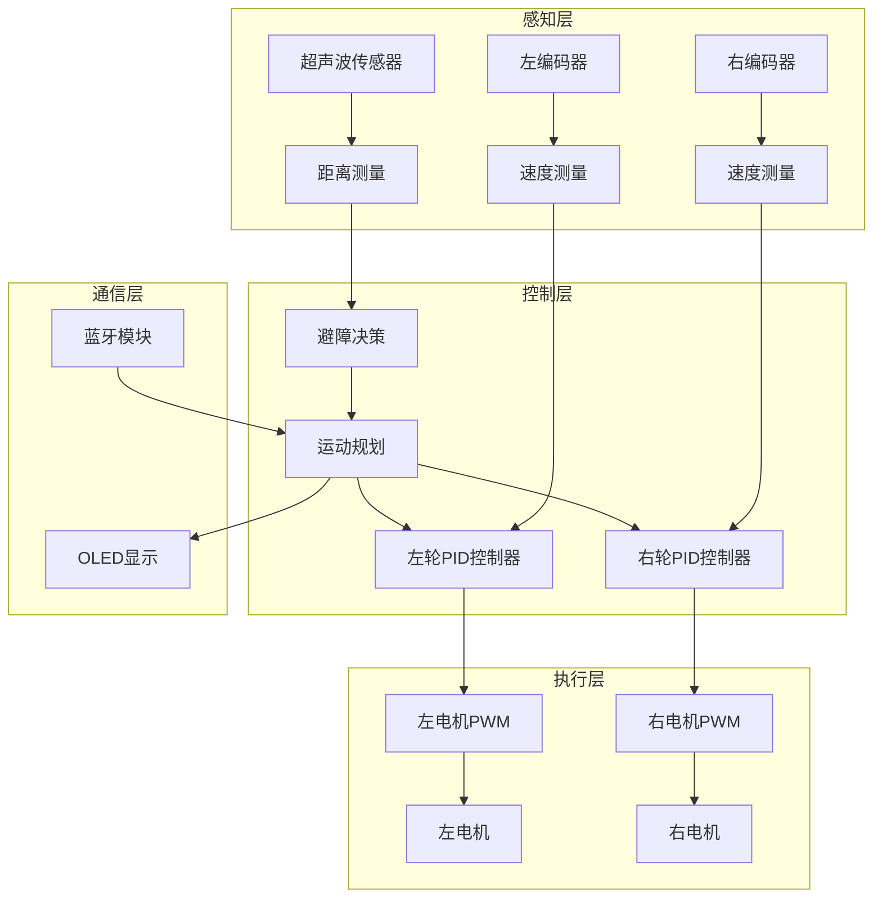
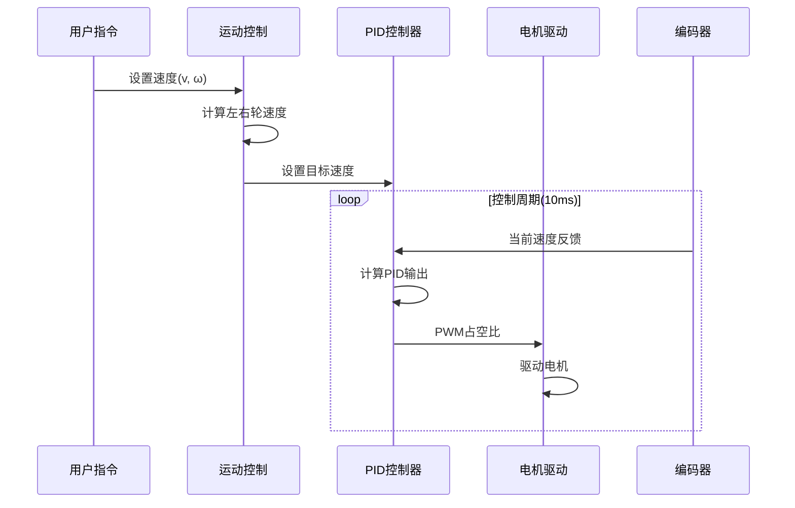

# 智能小车运动控制系统实战项目

## 项目概述


### 项目简介

本项目将带你从零开始构建一个完整的智能小车运动控制系统。通过本项目，你将学习如何整合多个子系统（电机驱动、编码器反馈、传感器检测、控制算法）来实现一个具有自主运动能力的智能小车。

**项目特点**：
- 🚗 **差速驱动**：双电机独立控制，实现灵活转向
- 📊 **闭环控制**：编码器反馈+PID算法，精确速度控制
- 🎯 **路径规划**：实现直线、转弯、圆弧等复杂运动
- 🚧 **智能避障**：超声波传感器检测障碍物，自动规避
- 📡 **无线控制**：蓝牙/WiFi远程控制和参数调试
- 🔧 **模块化设计**：清晰的代码架构，易于扩展

### 学习目标

完成本项目后，你将能够：

- [ ] 理解差速驱动机器人的运动学原理
- [ ] 掌握编码器测速和里程计算方法
- [ ] 实现双电机的PID速度闭环控制
- [ ] 设计和实现基本的路径规划算法
- [ ] 集成超声波传感器实现避障功能
- [ ] 构建完整的嵌入式控制系统架构
- [ ] 调试和优化复杂的多传感器系统

### 适用人群

本项目适合以下学习者：

- ✅ 已完成直流电机控制和PID控制基础教程
- ✅ 熟悉C/C++编程和基本的数据结构
- ✅ 了解基本的控制理论（PID、反馈控制）
- ✅ 有一定的硬件调试经验
- ✅ 希望深入学习机器人控制系统


## 技术栈

### 硬件清单

| 类别 | 名称 | 数量 | 规格说明 | 参考价格 |
|------|------|------|----------|----------|
| **主控** | STM32F103C8T6开发板 | 1 | 或Arduino Mega 2560 | ¥15-50 |
| **电机驱动** | L298N双H桥驱动模块 | 1 | 支持2路电机 | ¥8-15 |
| **电机** | 直流减速电机（带编码器） | 2 | 6V，1:48减速比，AB相编码器 | ¥25-40/个 |
| **传感器** | HC-SR04超声波模块 | 3 | 测距范围2cm-4m | ¥3-5/个 |
| **电源** | 7.4V锂电池 | 1 | 2S 18650，2000mAh以上 | ¥20-40 |
| **电源管理** | DC-DC降压模块 | 1 | 输出5V/3A | ¥3-5 |
| **通信** | HC-05蓝牙模块 | 1 | 或ESP8266 WiFi模块 | ¥10-20 |
| **显示** | OLED显示屏 | 1 | 0.96寸，I2C接口（可选） | ¥8-15 |
| **机械** | 小车底盘套件 | 1 | 含车轮、支架、螺丝 | ¥30-60 |
| **其他** | 杜邦线、面包板 | 若干 | 连接线材 | ¥10 |

**总预算**：约 ¥200-350


### 软件要求

**开发环境**：
- STM32平台：STM32CubeIDE 或 Keil MDK
- Arduino平台：Arduino IDE 2.x
- 串口调试工具：Serial Monitor 或 PuTTY
- 蓝牙调试：Serial Bluetooth Terminal（Android）

**必需库**：
- PID控制库（自实现或使用Arduino PID Library）
- 编码器库（自实现或使用Encoder Library）
- 超声波库（NewPing或自实现）
- OLED显示库（Adafruit_SSD1306，可选）

### 技术选型说明

**为什么选择STM32F103？**
- 72MHz主频，足够的计算能力
- 丰富的定时器资源（编码器接口、PWM输出）
- 多个硬件中断，支持高频编码器
- 成本低，生态成熟

**为什么选择带编码器的减速电机？**
- 编码器提供速度和位置反馈
- 减速器提供足够的扭矩
- AB相编码器可判断方向
- 常见规格，易于采购


## 系统架构

### 整体架构设计




### 模块划分

**1. 电机驱动模块（motor_driver.c/h）**
- 功能：控制电机方向和速度
- 接口：`Motor_SetSpeed(motor_id, speed, direction)`
- 依赖：PWM定时器、GPIO

**2. 编码器模块（encoder.c/h）**
- 功能：读取编码器脉冲，计算速度
- 接口：`Encoder_GetSpeed(encoder_id)`
- 依赖：定时器编码器模式或外部中断

**3. PID控制模块（pid.c/h）**
- 功能：实现PID算法
- 接口：`PID_Compute(pid, setpoint, input)`
- 依赖：无

**4. 运动控制模块（motion_control.c/h）**
- 功能：差速驱动运动学计算
- 接口：`Motion_SetVelocity(linear, angular)`
- 依赖：电机驱动、PID控制

**5. 避障模块（obstacle_avoidance.c/h）**
- 功能：超声波测距和避障决策
- 接口：`Obstacle_Detect()`, `Obstacle_Avoid()`
- 依赖：超声波传感器

**6. 通信模块（communication.c/h）**
- 功能：蓝牙/串口通信
- 接口：`Comm_SendData()`, `Comm_ReceiveCommand()`
- 依赖：UART


### 数据流图



### 接口定义

**运动控制接口**：
```c
// 设置线速度和角速度
void Motion_SetVelocity(float linear_vel, float angular_vel);

// 设置左右轮速度
void Motion_SetWheelSpeed(float left_speed, float right_speed);

// 停止运动
void Motion_Stop(void);

// 获取当前速度
void Motion_GetVelocity(float *linear_vel, float *angular_vel);
```


## 理论基础

### 差速驱动运动学

差速驱动机器人通过控制左右两个轮子的速度来实现运动。

**基本参数**：
- `L`：两轮间距（轮距）
- `R`：车轮半径
- `v_l`：左轮线速度
- `v_r`：右轮线速度
- `v`：小车线速度（前进速度）
- `ω`：小车角速度（转向速度）

**正向运动学**（已知轮速，求小车速度）：
```
v = (v_l + v_r) / 2
ω = (v_r - v_l) / L
```

**逆向运动学**（已知小车速度，求轮速）：
```
v_l = v - (ω * L) / 2
v_r = v + (ω * L) / 2
```

**运动模式**：
1. **直线前进**：`v_l = v_r > 0`
2. **直线后退**：`v_l = v_r < 0`
3. **原地左转**：`v_l = -v_r < 0`
4. **原地右转**：`v_l = -v_r > 0`
5. **弧线运动**：`v_l ≠ v_r`


### 编码器测速原理

**编码器类型**：
- **增量式编码器**：输出脉冲信号，计数脉冲数
- **AB相编码器**：两路相位差90°的信号，可判断方向

**测速方法**：

**方法1：M法（测频法）**
- 固定时间内计数脉冲数
- 速度 = (脉冲数 / 编码器线数) / 时间
- 适用于高速测量

**方法2：T法（测周法）**
- 测量固定脉冲数的时间
- 速度 = 脉冲数 / (时间 * 编码器线数)
- 适用于低速测量

**方法3：M/T法（混合法）**
- 同时测量脉冲数和时间
- 速度 = 脉冲数 / (时间 * 编码器线数)
- 全速度范围适用（推荐）

**速度计算公式**：
```
RPM = (脉冲数 * 60) / (编码器线数 * 减速比 * 时间)
线速度(m/s) = (RPM * 2π * 车轮半径) / 60
```


### PID速度控制

**PID控制器结构**：
```
输出 = Kp * 误差 + Ki * 积分 + Kd * 微分
```

**参数调节方法**：

1. **先调Kp**：
   - 从小到大增加Kp
   - 观察响应速度和超调
   - 出现持续振荡时减小Kp

2. **再调Ki**：
   - 从小到大增加Ki
   - 消除稳态误差
   - 过大会导致振荡

3. **最后调Kd**：
   - 从小到大增加Kd
   - 减小超调和振荡
   - 过大会放大噪声

**推荐初始值**（需根据实际调整）：
- Kp = 2.0
- Ki = 0.5
- Kd = 0.1

**抗积分饱和**：
```c
// 限制积分项
if (integral > integral_max) integral = integral_max;
if (integral < -integral_max) integral = -integral_max;
```


## 硬件连接

### 引脚分配表

**STM32F103C8T6引脚分配**：

| 功能 | 引脚 | 说明 |
|------|------|------|
| **左电机** | | |
| 左电机PWM | PA0 (TIM2_CH1) | PWM输出 |
| 左电机IN1 | PA1 | 方向控制 |
| 左电机IN2 | PA2 | 方向控制 |
| **右电机** | | |
| 右电机PWM | PA3 (TIM2_CH4) | PWM输出 |
| 右电机IN3 | PA4 | 方向控制 |
| 右电机IN4 | PA5 | 方向控制 |
| **左编码器** | | |
| 左编码器A | PB6 (TIM4_CH1) | 编码器A相 |
| 左编码器B | PB7 (TIM4_CH2) | 编码器B相 |
| **右编码器** | | |
| 右编码器A | PA6 (TIM3_CH1) | 编码器A相 |
| 右编码器B | PA7 (TIM3_CH2) | 编码器B相 |
| **超声波** | | |
| 前超声波Trig | PB0 | 触发信号 |
| 前超声波Echo | PB1 | 回波信号 |
| 左超声波Trig | PB10 | 触发信号 |
| 左超声波Echo | PB11 | 回波信号 |
| 右超声波Trig | PB12 | 触发信号 |
| 右超声波Echo | PB13 | 回波信号 |
| **通信** | | |
| 蓝牙TX | PA9 (USART1_TX) | 串口发送 |
| 蓝牙RX | PA10 (USART1_RX) | 串口接收 |
| **显示（可选）** | | |
| OLED SCL | PB8 (I2C1_SCL) | I2C时钟 |
| OLED SDA | PB9 (I2C1_SDA) | I2C数据 |


### 电路连接图

```
STM32F103          L298N           电机+编码器
                                   
PA0(PWM) -------> ENA              
PA1 ----------> IN1                
PA2 ----------> IN2                
                  OUT1 ---------> 左电机+
                  OUT2 ---------> 左电机-
                  
PA3(PWM) -------> ENB              
PA4 ----------> IN3                
PA5 ----------> IN4                
                  OUT3 ---------> 右电机+
                  OUT4 ---------> 右电机-

PB6 <---------- 左编码器A相
PB7 <---------- 左编码器B相
PA6 <---------- 右编码器A相
PA7 <---------- 右编码器B相

GND ----------> GND
                  +12V <--------- 7.4V电池+
                  GND  <--------- 电池-

5V <---------- DC-DC降压模块输出
GND <---------- DC-DC降压模块GND
```

### 电源设计

**电源方案**：
1. **主电源**：7.4V锂电池（2S 18650）
2. **电机电源**：直接使用7.4V
3. **MCU电源**：DC-DC降压到5V
4. **逻辑电平**：STM32内部3.3V

**注意事项**：
- ⚠️ 所有模块必须共地
- ⚠️ 电机电源和MCU电源建议分开
- ⚠️ 在电源输入端添加100μF电解电容
- ⚠️ 在MCU电源输入端添加10μF+0.1μF电容


## 实现步骤

### 阶段1：基础搭建（预计60分钟）

#### 步骤1.1：机械组装

**任务**：组装小车底盘和安装电机

**操作步骤**：
1. 将两个减速电机固定在底盘两侧
2. 安装车轮到电机输出轴
3. 安装万向轮到底盘前部或后部
4. 固定电池仓和电路板安装位置
5. 确保车轮转动顺畅，无卡顿

**检查要点**：
- [ ] 电机安装牢固，不松动
- [ ] 车轮与地面接触良好
- [ ] 万向轮转动灵活
- [ ] 底盘平衡，不倾斜

#### 步骤1.2：硬件连接

**任务**：按照引脚分配表连接所有硬件

**连接顺序**：
1. 先连接电源系统（不上电）
2. 连接电机驱动模块
3. 连接编码器信号线
4. 连接超声波传感器
5. 连接蓝牙模块
6. 最后连接电源

**测试方法**：
```c
// 简单的硬件测试代码
void Hardware_Test(void) {
    // 测试左电机
    Motor_SetSpeed(MOTOR_LEFT, 100, FORWARD);
    HAL_Delay(2000);
    Motor_Stop(MOTOR_LEFT);
    
    // 测试右电机
    Motor_SetSpeed(MOTOR_RIGHT, 100, FORWARD);
    HAL_Delay(2000);
    Motor_Stop(MOTOR_RIGHT);
    
    // 测试编码器
    printf("Left Encoder: %d\n", Encoder_GetCount(ENCODER_LEFT));
    printf("Right Encoder: %d\n", Encoder_GetCount(ENCODER_RIGHT));
}
```


### 阶段2：功能实现（预计100分钟）

#### 步骤2.1：电机驱动模块

**文件**：`motor_driver.c` / `motor_driver.h`

**头文件定义**：
```c
// motor_driver.h
#ifndef MOTOR_DRIVER_H
#define MOTOR_DRIVER_H

#include "stm32f1xx_hal.h"

// 电机ID
typedef enum {
    MOTOR_LEFT = 0,
    MOTOR_RIGHT = 1
} Motor_ID;

// 电机方向
typedef enum {
    MOTOR_FORWARD = 1,
    MOTOR_BACKWARD = -1,
    MOTOR_STOP = 0
} Motor_Direction;

// 初始化电机驱动
void Motor_Init(void);

// 设置电机速度和方向
void Motor_SetSpeed(Motor_ID motor, int16_t speed, Motor_Direction dir);

// 停止电机
void Motor_Stop(Motor_ID motor);

// 停止所有电机
void Motor_StopAll(void);

#endif
```


**实现代码**：
```c
// motor_driver.c
#include "motor_driver.h"

// 外部定时器句柄（在main.c中定义）
extern TIM_HandleTypeDef htim2;

// 电机引脚定义
#define MOTOR_LEFT_IN1_PIN   GPIO_PIN_1
#define MOTOR_LEFT_IN2_PIN   GPIO_PIN_2
#define MOTOR_LEFT_PORT      GPIOA

#define MOTOR_RIGHT_IN3_PIN  GPIO_PIN_4
#define MOTOR_RIGHT_IN4_PIN  GPIO_PIN_5
#define MOTOR_RIGHT_PORT     GPIOA

// PWM最大值
#define PWM_MAX 1000

void Motor_Init(void) {
    // 启动PWM
    HAL_TIM_PWM_Start(&htim2, TIM_CHANNEL_1);  // 左电机
    HAL_TIM_PWM_Start(&htim2, TIM_CHANNEL_4);  // 右电机
    
    // 初始化为停止状态
    Motor_StopAll();
}

void Motor_SetSpeed(Motor_ID motor, int16_t speed, Motor_Direction dir) {
    // 限制速度范围
    if (speed > PWM_MAX) speed = PWM_MAX;
    if (speed < 0) speed = 0;
    
    if (motor == MOTOR_LEFT) {
        // 设置方向
        if (dir == MOTOR_FORWARD) {
            HAL_GPIO_WritePin(MOTOR_LEFT_PORT, MOTOR_LEFT_IN1_PIN, GPIO_PIN_SET);
            HAL_GPIO_WritePin(MOTOR_LEFT_PORT, MOTOR_LEFT_IN2_PIN, GPIO_PIN_RESET);
        } else if (dir == MOTOR_BACKWARD) {
            HAL_GPIO_WritePin(MOTOR_LEFT_PORT, MOTOR_LEFT_IN1_PIN, GPIO_PIN_RESET);
            HAL_GPIO_WritePin(MOTOR_LEFT_PORT, MOTOR_LEFT_IN2_PIN, GPIO_PIN_SET);
        } else {
            HAL_GPIO_WritePin(MOTOR_LEFT_PORT, MOTOR_LEFT_IN1_PIN, GPIO_PIN_RESET);
            HAL_GPIO_WritePin(MOTOR_LEFT_PORT, MOTOR_LEFT_IN2_PIN, GPIO_PIN_RESET);
        }
        // 设置PWM
        __HAL_TIM_SET_COMPARE(&htim2, TIM_CHANNEL_1, speed);
        
    } else if (motor == MOTOR_RIGHT) {
        // 设置方向
        if (dir == MOTOR_FORWARD) {
            HAL_GPIO_WritePin(MOTOR_RIGHT_PORT, MOTOR_RIGHT_IN3_PIN, GPIO_PIN_SET);
            HAL_GPIO_WritePin(MOTOR_RIGHT_PORT, MOTOR_RIGHT_IN4_PIN, GPIO_PIN_RESET);
        } else if (dir == MOTOR_BACKWARD) {
            HAL_GPIO_WritePin(MOTOR_RIGHT_PORT, MOTOR_RIGHT_IN3_PIN, GPIO_PIN_RESET);
            HAL_GPIO_WritePin(MOTOR_RIGHT_PORT, MOTOR_RIGHT_IN4_PIN, GPIO_PIN_SET);
        } else {
            HAL_GPIO_WritePin(MOTOR_RIGHT_PORT, MOTOR_RIGHT_IN3_PIN, GPIO_PIN_RESET);
            HAL_GPIO_WritePin(MOTOR_RIGHT_PORT, MOTOR_RIGHT_IN4_PIN, GPIO_PIN_RESET);
        }
        // 设置PWM
        __HAL_TIM_SET_COMPARE(&htim2, TIM_CHANNEL_4, speed);
    }
}

void Motor_Stop(Motor_ID motor) {
    Motor_SetSpeed(motor, 0, MOTOR_STOP);
}

void Motor_StopAll(void) {
    Motor_Stop(MOTOR_LEFT);
    Motor_Stop(MOTOR_RIGHT);
}
```


#### 步骤2.2：编码器模块

**文件**：`encoder.c` / `encoder.h`

**头文件定义**：
```c
// encoder.h
#ifndef ENCODER_H
#define ENCODER_H

#include "stm32f1xx_hal.h"

// 编码器ID
typedef enum {
    ENCODER_LEFT = 0,
    ENCODER_RIGHT = 1
} Encoder_ID;

// 编码器参数
#define ENCODER_RESOLUTION 11    // 编码器线数（单相）
#define GEAR_RATIO 48            // 减速比
#define WHEEL_DIAMETER 0.065     // 车轮直径(m)
#define WHEEL_PERIMETER (WHEEL_DIAMETER * 3.14159)

// 初始化编码器
void Encoder_Init(void);

// 获取编码器计数值
int32_t Encoder_GetCount(Encoder_ID encoder);

// 清零编码器计数
void Encoder_ResetCount(Encoder_ID encoder);

// 获取速度(m/s)
float Encoder_GetSpeed(Encoder_ID encoder);

// 定时器更新（在定时器中断中调用）
void Encoder_Update(void);

#endif
```


**实现代码**：
```c
// encoder.c
#include "encoder.h"

// 外部定时器句柄
extern TIM_HandleTypeDef htim3;  // 右编码器
extern TIM_HandleTypeDef htim4;  // 左编码器

// 速度计算变量
static int32_t last_count_left = 0;
static int32_t last_count_right = 0;
static float speed_left = 0.0f;
static float speed_right = 0.0f;

// 更新周期(秒)
#define UPDATE_PERIOD 0.01f  // 10ms

void Encoder_Init(void) {
    // 启动编码器模式
    HAL_TIM_Encoder_Start(&htim4, TIM_CHANNEL_ALL);  // 左编码器
    HAL_TIM_Encoder_Start(&htim3, TIM_CHANNEL_ALL);  // 右编码器
    
    // 清零计数器
    __HAL_TIM_SET_COUNTER(&htim4, 0);
    __HAL_TIM_SET_COUNTER(&htim3, 0);
}

int32_t Encoder_GetCount(Encoder_ID encoder) {
    if (encoder == ENCODER_LEFT) {
        return (int32_t)__HAL_TIM_GET_COUNTER(&htim4);
    } else {
        return (int32_t)__HAL_TIM_GET_COUNTER(&htim3);
    }
}

void Encoder_ResetCount(Encoder_ID encoder) {
    if (encoder == ENCODER_LEFT) {
        __HAL_TIM_SET_COUNTER(&htim4, 0);
        last_count_left = 0;
    } else {
        __HAL_TIM_SET_COUNTER(&htim3, 0);
        last_count_right = 0;
    }
}

float Encoder_GetSpeed(Encoder_ID encoder) {
    if (encoder == ENCODER_LEFT) {
        return speed_left;
    } else {
        return speed_right;
    }
}

void Encoder_Update(void) {
    // 获取当前计数
    int32_t current_count_left = Encoder_GetCount(ENCODER_LEFT);
    int32_t current_count_right = Encoder_GetCount(ENCODER_RIGHT);
    
    // 计算脉冲差
    int32_t delta_left = current_count_left - last_count_left;
    int32_t delta_right = current_count_right - last_count_right;
    
    // 计算转数
    float revolutions_left = (float)delta_left / (ENCODER_RESOLUTION * 4 * GEAR_RATIO);
    float revolutions_right = (float)delta_right / (ENCODER_RESOLUTION * 4 * GEAR_RATIO);
    
    // 计算线速度 (m/s)
    speed_left = (revolutions_left * WHEEL_PERIMETER) / UPDATE_PERIOD;
    speed_right = (revolutions_right * WHEEL_PERIMETER) / UPDATE_PERIOD;
    
    // 更新上次计数
    last_count_left = current_count_left;
    last_count_right = current_count_right;
}
```

**注意**：编码器线数和减速比需要根据实际电机参数调整。


#### 步骤2.3：PID控制模块

**文件**：`pid.c` / `pid.h`

**头文件定义**：
```c
// pid.h
#ifndef PID_H
#define PID_H

#include <stdint.h>

// PID控制器结构体
typedef struct {
    float Kp;              // 比例系数
    float Ki;              // 积分系数
    float Kd;              // 微分系数
    
    float setpoint;        // 目标值
    float integral;        // 积分累积
    float prev_error;      // 上次误差
    
    float output_min;      // 输出最小值
    float output_max;      // 输出最大值
    float integral_max;    // 积分限幅
} PID_Controller;

// 初始化PID控制器
void PID_Init(PID_Controller *pid, float kp, float ki, float kd);

// 设置输出限幅
void PID_SetOutputLimits(PID_Controller *pid, float min, float max);

// 设置积分限幅
void PID_SetIntegralLimit(PID_Controller *pid, float limit);

// 设置目标值
void PID_SetSetpoint(PID_Controller *pid, float setpoint);

// 计算PID输出
float PID_Compute(PID_Controller *pid, float input);

// 重置PID控制器
void PID_Reset(PID_Controller *pid);

#endif
```


**实现代码**：
```c
// pid.c
#include "pid.h"

void PID_Init(PID_Controller *pid, float kp, float ki, float kd) {
    pid->Kp = kp;
    pid->Ki = ki;
    pid->Kd = kd;
    
    pid->setpoint = 0.0f;
    pid->integral = 0.0f;
    pid->prev_error = 0.0f;
    
    pid->output_min = -1000.0f;
    pid->output_max = 1000.0f;
    pid->integral_max = 500.0f;
}

void PID_SetOutputLimits(PID_Controller *pid, float min, float max) {
    pid->output_min = min;
    pid->output_max = max;
}

void PID_SetIntegralLimit(PID_Controller *pid, float limit) {
    pid->integral_max = limit;
}

void PID_SetSetpoint(PID_Controller *pid, float setpoint) {
    pid->setpoint = setpoint;
}

float PID_Compute(PID_Controller *pid, float input) {
    // 计算误差
    float error = pid->setpoint - input;
    
    // 积分项
    pid->integral += error;
    
    // 积分限幅（抗积分饱和）
    if (pid->integral > pid->integral_max) {
        pid->integral = pid->integral_max;
    } else if (pid->integral < -pid->integral_max) {
        pid->integral = -pid->integral_max;
    }
    
    // 微分项
    float derivative = error - pid->prev_error;
    
    // PID输出
    float output = pid->Kp * error + 
                   pid->Ki * pid->integral + 
                   pid->Kd * derivative;
    
    // 输出限幅
    if (output > pid->output_max) {
        output = pid->output_max;
    } else if (output < pid->output_min) {
        output = pid->output_min;
    }
    
    // 保存当前误差
    pid->prev_error = error;
    
    return output;
}

void PID_Reset(PID_Controller *pid) {
    pid->integral = 0.0f;
    pid->prev_error = 0.0f;
}
```


#### 步骤2.4：运动控制模块

**文件**：`motion_control.c` / `motion_control.h`

**头文件定义**：
```c
// motion_control.h
#ifndef MOTION_CONTROL_H
#define MOTION_CONTROL_H

#include "pid.h"

// 小车参数
#define WHEEL_BASE 0.15f        // 轮距(m)
#define MAX_LINEAR_SPEED 0.5f   // 最大线速度(m/s)
#define MAX_ANGULAR_SPEED 2.0f  // 最大角速度(rad/s)

// 初始化运动控制
void Motion_Init(void);

// 设置线速度和角速度
void Motion_SetVelocity(float linear_vel, float angular_vel);

// 设置左右轮速度
void Motion_SetWheelSpeed(float left_speed, float right_speed);

// 停止运动
void Motion_Stop(void);

// 获取当前速度
void Motion_GetVelocity(float *linear_vel, float *angular_vel);

// 控制循环更新（在定时器中断中调用）
void Motion_Update(void);

#endif
```


**实现代码**：
```c
// motion_control.c
#include "motion_control.h"
#include "motor_driver.h"
#include "encoder.h"
#include <math.h>

// PID控制器
static PID_Controller pid_left;
static PID_Controller pid_right;

// 目标速度
static float target_speed_left = 0.0f;
static float target_speed_right = 0.0f;

void Motion_Init(void) {
    // 初始化PID控制器（参数需要根据实际调整）
    PID_Init(&pid_left, 200.0f, 50.0f, 10.0f);
    PID_Init(&pid_right, 200.0f, 50.0f, 10.0f);
    
    // 设置输出限幅
    PID_SetOutputLimits(&pid_left, -1000.0f, 1000.0f);
    PID_SetOutputLimits(&pid_right, -1000.0f, 1000.0f);
    
    // 设置积分限幅
    PID_SetIntegralLimit(&pid_left, 300.0f);
    PID_SetIntegralLimit(&pid_right, 300.0f);
}

void Motion_SetVelocity(float linear_vel, float angular_vel) {
    // 限制速度范围
    if (linear_vel > MAX_LINEAR_SPEED) linear_vel = MAX_LINEAR_SPEED;
    if (linear_vel < -MAX_LINEAR_SPEED) linear_vel = -MAX_LINEAR_SPEED;
    if (angular_vel > MAX_ANGULAR_SPEED) angular_vel = MAX_ANGULAR_SPEED;
    if (angular_vel < -MAX_ANGULAR_SPEED) angular_vel = -MAX_ANGULAR_SPEED;
    
    // 逆向运动学：计算左右轮速度
    target_speed_left = linear_vel - (angular_vel * WHEEL_BASE) / 2.0f;
    target_speed_right = linear_vel + (angular_vel * WHEEL_BASE) / 2.0f;
    
    // 设置PID目标值
    PID_SetSetpoint(&pid_left, target_speed_left);
    PID_SetSetpoint(&pid_right, target_speed_right);
}

void Motion_SetWheelSpeed(float left_speed, float right_speed) {
    target_speed_left = left_speed;
    target_speed_right = right_speed;
    
    PID_SetSetpoint(&pid_left, target_speed_left);
    PID_SetSetpoint(&pid_right, target_speed_right);
}

void Motion_Stop(void) {
    target_speed_left = 0.0f;
    target_speed_right = 0.0f;
    
    PID_SetSetpoint(&pid_left, 0.0f);
    PID_SetSetpoint(&pid_right, 0.0f);
    
    Motor_StopAll();
    
    // 重置PID
    PID_Reset(&pid_left);
    PID_Reset(&pid_right);
}

void Motion_GetVelocity(float *linear_vel, float *angular_vel) {
    // 获取当前轮速
    float speed_left = Encoder_GetSpeed(ENCODER_LEFT);
    float speed_right = Encoder_GetSpeed(ENCODER_RIGHT);
    
    // 正向运动学：计算线速度和角速度
    *linear_vel = (speed_left + speed_right) / 2.0f;
    *angular_vel = (speed_right - speed_left) / WHEEL_BASE;
}

void Motion_Update(void) {
    // 获取当前速度
    float current_speed_left = Encoder_GetSpeed(ENCODER_LEFT);
    float current_speed_right = Encoder_GetSpeed(ENCODER_RIGHT);
    
    // PID计算
    float output_left = PID_Compute(&pid_left, current_speed_left);
    float output_right = PID_Compute(&pid_right, current_speed_right);
    
    // 确定方向
    Motor_Direction dir_left = (output_left >= 0) ? MOTOR_FORWARD : MOTOR_BACKWARD;
    Motor_Direction dir_right = (output_right >= 0) ? MOTOR_FORWARD : MOTOR_BACKWARD;
    
    // 设置电机速度
    Motor_SetSpeed(MOTOR_LEFT, (int16_t)fabs(output_left), dir_left);
    Motor_SetSpeed(MOTOR_RIGHT, (int16_t)fabs(output_right), dir_right);
}
```


### 阶段3：测试优化（预计60分钟）

#### 步骤3.1：基础运动测试

**测试代码**：
```c
// 在main.c中的测试函数
void Test_BasicMotion(void) {
    printf("=== Basic Motion Test ===\n");
    
    // 测试1：直线前进
    printf("Test 1: Forward\n");
    Motion_SetVelocity(0.2f, 0.0f);  // 0.2m/s前进
    HAL_Delay(3000);
    Motion_Stop();
    HAL_Delay(1000);
    
    // 测试2：直线后退
    printf("Test 2: Backward\n");
    Motion_SetVelocity(-0.2f, 0.0f);  // 0.2m/s后退
    HAL_Delay(3000);
    Motion_Stop();
    HAL_Delay(1000);
    
    // 测试3：原地左转
    printf("Test 3: Turn Left\n");
    Motion_SetVelocity(0.0f, 1.0f);  // 1.0rad/s左转
    HAL_Delay(2000);
    Motion_Stop();
    HAL_Delay(1000);
    
    // 测试4：原地右转
    printf("Test 4: Turn Right\n");
    Motion_SetVelocity(0.0f, -1.0f);  // 1.0rad/s右转
    HAL_Delay(2000);
    Motion_Stop();
    HAL_Delay(1000);
    
    // 测试5：弧线运动
    printf("Test 5: Arc Motion\n");
    Motion_SetVelocity(0.2f, 0.5f);  // 前进+左转
    HAL_Delay(3000);
    Motion_Stop();
    
    printf("Test Complete!\n");
}
```


#### 步骤3.2：PID参数调优

**调优步骤**：

1. **设置初始参数**：
```c
// 从保守的参数开始
Kp = 100.0f;
Ki = 0.0f;
Kd = 0.0f;
```

2. **调整Kp**：
   - 逐渐增加Kp，观察响应速度
   - 如果出现振荡，减小Kp
   - 目标：快速响应，轻微超调

3. **调整Ki**：
   - 逐渐增加Ki，消除稳态误差
   - 如果出现振荡，减小Ki
   - 目标：无稳态误差

4. **调整Kd**：
   - 逐渐增加Kd，减小超调
   - 如果噪声放大，减小Kd
   - 目标：平滑响应

**调试工具**：
```c
// PID调试输出
void PID_Debug_Print(void) {
    float speed_left = Encoder_GetSpeed(ENCODER_LEFT);
    float speed_right = Encoder_GetSpeed(ENCODER_RIGHT);
    
    printf("Target: L=%.3f R=%.3f | ", 
           target_speed_left, target_speed_right);
    printf("Current: L=%.3f R=%.3f | ", 
           speed_left, speed_right);
    printf("Error: L=%.3f R=%.3f\n", 
           target_speed_left - speed_left,
           target_speed_right - speed_right);
}
```

**推荐参数范围**（需根据实际调整）：
- Kp: 100 - 300
- Ki: 20 - 100
- Kd: 5 - 20


#### 步骤3.3：超声波避障实现

**文件**：`obstacle_avoidance.c` / `obstacle_avoidance.h`

**简化实现**：
```c
// obstacle_avoidance.h
#ifndef OBSTACLE_AVOIDANCE_H
#define OBSTACLE_AVOIDANCE_H

#include <stdint.h>
#include <stdbool.h>

// 安全距离阈值(cm)
#define SAFE_DISTANCE 30
#define DANGER_DISTANCE 15

// 初始化避障模块
void Obstacle_Init(void);

// 测量距离(cm)
uint16_t Obstacle_MeasureDistance(uint8_t sensor_id);

// 检测障碍物
bool Obstacle_Detect(void);

// 避障决策
void Obstacle_Avoid(void);

#endif
```

```c
// obstacle_avoidance.c
#include "obstacle_avoidance.h"
#include "motion_control.h"
#include "stm32f1xx_hal.h"

// 超声波引脚定义
#define TRIG_PIN GPIO_PIN_0
#define ECHO_PIN GPIO_PIN_1
#define TRIG_PORT GPIOB
#define ECHO_PORT GPIOB

void Obstacle_Init(void) {
    // GPIO已在CubeMX中配置
}

uint16_t Obstacle_MeasureDistance(uint8_t sensor_id) {
    uint32_t time_start, time_end, time_diff;
    
    // 发送触发信号
    HAL_GPIO_WritePin(TRIG_PORT, TRIG_PIN, GPIO_PIN_SET);
    HAL_Delay(0);  // 10us延时（使用微秒延时更精确）
    HAL_GPIO_WritePin(TRIG_PORT, TRIG_PIN, GPIO_PIN_RESET);
    
    // 等待回波信号
    time_start = HAL_GetTick();
    while (HAL_GPIO_ReadPin(ECHO_PORT, ECHO_PIN) == GPIO_PIN_RESET) {
        if (HAL_GetTick() - time_start > 50) return 400;  // 超时
    }
    
    time_start = HAL_GetTick();
    while (HAL_GPIO_ReadPin(ECHO_PORT, ECHO_PIN) == GPIO_PIN_SET) {
        if (HAL_GetTick() - time_start > 50) return 400;  // 超时
    }
    time_end = HAL_GetTick();
    
    // 计算距离 (cm)
    time_diff = time_end - time_start;
    uint16_t distance = (time_diff * 34) / 2;  // 声速340m/s
    
    return distance;
}

bool Obstacle_Detect(void) {
    uint16_t distance = Obstacle_MeasureDistance(0);
    return (distance < SAFE_DISTANCE);
}

void Obstacle_Avoid(void) {
    uint16_t distance = Obstacle_MeasureDistance(0);
    
    if (distance < DANGER_DISTANCE) {
        // 紧急停止
        Motion_Stop();
        HAL_Delay(500);
        
        // 后退
        Motion_SetVelocity(-0.15f, 0.0f);
        HAL_Delay(1000);
        
        // 转向
        Motion_SetVelocity(0.0f, 1.0f);
        HAL_Delay(1000);
        
    } else if (distance < SAFE_DISTANCE) {
        // 减速前进
        Motion_SetVelocity(0.1f, 0.0f);
    } else {
        // 正常前进
        Motion_SetVelocity(0.2f, 0.0f);
    }
}
```


#### 步骤3.4：主程序集成

**完整的main.c示例**：
```c
// main.c
#include "main.h"
#include "motor_driver.h"
#include "encoder.h"
#include "motion_control.h"
#include "obstacle_avoidance.h"
#include <stdio.h>

// 定时器句柄
TIM_HandleTypeDef htim2;  // PWM
TIM_HandleTypeDef htim3;  // 右编码器
TIM_HandleTypeDef htim4;  // 左编码器
TIM_HandleTypeDef htim6;  // 控制周期定时器

// 系统初始化
void SystemClock_Config(void);
static void MX_GPIO_Init(void);
static void MX_TIM2_Init(void);
static void MX_TIM3_Init(void);
static void MX_TIM4_Init(void);
static void MX_TIM6_Init(void);
static void MX_USART1_UART_Init(void);

int main(void) {
    // HAL库初始化
    HAL_Init();
    SystemClock_Config();
    
    // 外设初始化
    MX_GPIO_Init();
    MX_TIM2_Init();
    MX_TIM3_Init();
    MX_TIM4_Init();
    MX_TIM6_Init();
    MX_USART1_UART_Init();
    
    // 模块初始化
    Motor_Init();
    Encoder_Init();
    Motion_Init();
    Obstacle_Init();
    
    printf("Smart Car Control System Started!\n");
    
    // 启动控制周期定时器（10ms中断）
    HAL_TIM_Base_Start_IT(&htim6);
    
    // 主循环
    while (1) {
        // 避障逻辑
        if (Obstacle_Detect()) {
            Obstacle_Avoid();
        }
        
        HAL_Delay(100);
    }
}

// 定时器中断回调（10ms）
void HAL_TIM_PeriodElapsedCallback(TIM_HandleTypeDef *htim) {
    if (htim->Instance == TIM6) {
        // 更新编码器速度
        Encoder_Update();
        
        // 更新运动控制
        Motion_Update();
    }
}

// printf重定向到UART
int fputc(int ch, FILE *f) {
    HAL_UART_Transmit(&huart1, (uint8_t *)&ch, 1, 0xFFFF);
    return ch;
}
```


## 完整代码

### 项目文件结构

```
SmartCar/
├── Core/
│   ├── Inc/
│   │   ├── main.h
│   │   ├── motor_driver.h
│   │   ├── encoder.h
│   │   ├── pid.h
│   │   ├── motion_control.h
│   │   └── obstacle_avoidance.h
│   └── Src/
│       ├── main.c
│       ├── motor_driver.c
│       ├── encoder.c
│       ├── pid.c
│       ├── motion_control.c
│       └── obstacle_avoidance.c
├── Drivers/
│   └── STM32F1xx_HAL_Driver/
└── README.md
```

### STM32CubeMX配置要点

**1. 时钟配置**：
- 系统时钟：72MHz
- APB1时钟：36MHz
- APB2时钟：72MHz

**2. TIM2配置（PWM）**：
- 模式：PWM Generation CH1, CH4
- 预分频器：71（1MHz计数频率）
- 自动重装载值：999（1kHz PWM频率）
- 占空比：0-1000

**3. TIM3/TIM4配置（编码器）**：
- 模式：Encoder Mode
- 编码器模式：TI1 and TI2
- 极性：Rising Edge
- 自动重装载值：65535

**4. TIM6配置（控制周期）**：
- 模式：Internal Clock
- 预分频器：7199（10kHz计数频率）
- 自动重装载值：99（10ms中断周期）
- 中断：Update interrupt enabled

**5. GPIO配置**：
- 电机方向控制：Output Push Pull
- 超声波Trig：Output Push Pull
- 超声波Echo：Input

**6. USART1配置**：
- 波特率：115200
- 数据位：8
- 停止位：1
- 校验：None


## 测试验证

### 测试清单

#### 硬件测试
- [ ] 电源系统正常，电压稳定
- [ ] 电机单独测试正常（正转、反转、停止）
- [ ] 编码器计数正常，方向正确
- [ ] 超声波测距准确（误差<5cm）
- [ ] 蓝牙通信正常

#### 功能测试
- [ ] 直线前进，轨迹直线度良好
- [ ] 直线后退，轨迹直线度良好
- [ ] 原地左转90度，角度误差<10度
- [ ] 原地右转90度，角度误差<10度
- [ ] 弧线运动，轨迹平滑

#### 性能测试
- [ ] 速度控制精度：误差<5%
- [ ] 速度响应时间：<1秒
- [ ] 避障反应时间：<0.5秒
- [ ] 连续运行时间：>30分钟

### 性能指标

| 指标 | 目标值 | 实测值 | 备注 |
|------|--------|--------|------|
| 最大速度 | 0.5 m/s | ___ | 平地测试 |
| 速度精度 | ±5% | ___ | 稳态误差 |
| 转向精度 | ±10° | ___ | 90度转弯 |
| 避障距离 | 30 cm | ___ | 前方障碍物 |
| 反应时间 | <0.5s | ___ | 检测到停止 |
| 电池续航 | >30min | ___ | 连续运行 |


### 调试技巧

**问题1：小车不走直线**
- 检查两个电机是否一致
- 检查轮子直径是否相同
- 调整PID参数，使左右轮速度一致
- 检查编码器计数是否准确

**问题2：速度控制不稳定**
- 检查编码器连接是否牢固
- 检查PID参数是否合理
- 检查控制周期是否稳定（10ms）
- 增加积分限幅，防止积分饱和

**问题3：避障不灵敏**
- 检查超声波传感器安装位置
- 检查测距是否准确
- 调整安全距离阈值
- 增加多个传感器提高覆盖范围

**问题4：电机抖动**
- 检查PWM频率是否合适
- 检查电源是否稳定
- 检查PID参数，减小Kd
- 增加低通滤波

**问题5：编码器计数异常**
- 检查编码器供电（通常5V）
- 检查信号线是否接触良好
- 检查定时器配置是否正确
- 使用示波器查看编码器信号


## 扩展思路

### 扩展1：路径规划 ⭐⭐

**功能**：实现预定义路径的自动行驶

**实现思路**：
```c
// 路径点结构
typedef struct {
    float x;
    float y;
    float theta;
} Waypoint;

// 路径规划
Waypoint path[] = {
    {0.0f, 0.0f, 0.0f},
    {1.0f, 0.0f, 0.0f},
    {1.0f, 1.0f, 1.57f},
    {0.0f, 1.0f, 3.14f},
    {0.0f, 0.0f, 0.0f}
};

void Path_Follow(Waypoint *path, int num_points) {
    for (int i = 0; i < num_points; i++) {
        // 计算到目标点的距离和角度
        // 使用PID控制跟踪路径
        // 到达目标点后进入下一个点
    }
}
```

### 扩展2：SLAM建图 ⭐⭐⭐⭐

**功能**：使用激光雷达或摄像头进行环境建图

**所需硬件**：
- 激光雷达（如RPLIDAR A1）
- 或深度摄像头（如Intel RealSense）

**技术要点**：
- 传感器数据采集
- 里程计融合
- 地图构建算法
- 定位算法

### 扩展3：视觉识别 ⭐⭐⭐⭐

**功能**：识别特定物体或标记

**所需硬件**：
- 摄像头模块（如OV7670或树莓派摄像头）
- 更强大的处理器（如树莓派或Jetson Nano）

**技术要点**：
- 图像采集
- 颜色识别
- 形状识别
- 深度学习模型部署


### 扩展4：多传感器融合 ⭐⭐⭐

**功能**：融合多种传感器数据提高定位精度

**传感器组合**：
- 编码器（里程计）
- IMU（加速度计+陀螺仪）
- 超声波/激光雷达
- GPS（室外）

**融合算法**：
- 卡尔曼滤波
- 扩展卡尔曼滤波（EKF）
- 粒子滤波

**实现示例**：
```c
// 简化的传感器融合
typedef struct {
    float x;
    float y;
    float theta;
    float v;
    float omega;
} RobotState;

void Sensor_Fusion_Update(RobotState *state) {
    // 1. 预测步骤（使用运动模型）
    float dt = 0.01f;  // 10ms
    state->x += state->v * cos(state->theta) * dt;
    state->y += state->v * sin(state->theta) * dt;
    state->theta += state->omega * dt;
    
    // 2. 更新步骤（使用传感器测量）
    float measured_v = (Encoder_GetSpeed(ENCODER_LEFT) + 
                        Encoder_GetSpeed(ENCODER_RIGHT)) / 2.0f;
    float measured_omega = (Encoder_GetSpeed(ENCODER_RIGHT) - 
                            Encoder_GetSpeed(ENCODER_LEFT)) / WHEEL_BASE;
    
    // 简单的加权融合
    state->v = 0.7f * state->v + 0.3f * measured_v;
    state->omega = 0.7f * state->omega + 0.3f * measured_omega;
}
```

### 扩展5：远程监控 ⭐⭐

**功能**：通过WiFi实时查看小车状态

**所需硬件**：
- ESP8266或ESP32 WiFi模块

**功能特性**：
- 实时视频传输
- 状态数据上传（速度、位置、电量）
- 远程控制指令
- 轨迹记录和回放

**Web界面示例**：
```html
<!DOCTYPE html>
<html>
<head>
    <title>Smart Car Monitor</title>
</head>
<body>
    <h1>Smart Car Control Panel</h1>
    <div id="status">
        <p>Speed: <span id="speed">0.00</span> m/s</p>
        <p>Position: (<span id="x">0.00</span>, <span id="y">0.00</span>)</p>
        <p>Battery: <span id="battery">100</span>%</p>
    </div>
    <div id="control">
        <button onclick="sendCommand('forward')">Forward</button>
        <button onclick="sendCommand('backward')">Backward</button>
        <button onclick="sendCommand('left')">Left</button>
        <button onclick="sendCommand('right')">Right</button>
        <button onclick="sendCommand('stop')">Stop</button>
    </div>
</body>
</html>
```


## 项目总结

### 技术难点

1. **PID参数调优**
   - 难点：不同负载和速度下参数不同
   - 解决：分段PID或自适应PID

2. **编码器噪声**
   - 难点：低速时编码器信号不稳定
   - 解决：低通滤波或M/T法测速

3. **直线度控制**
   - 难点：两个电机特性不完全一致
   - 解决：独立PID控制+校准

4. **实时性保证**
   - 难点：多任务调度和中断优先级
   - 解决：使用RTOS或合理的中断设计

### 学习收获

通过本项目，你应该掌握了：

- ✅ 差速驱动机器人的运动学原理
- ✅ 编码器测速和里程计算方法
- ✅ PID控制器的设计和调优
- ✅ 多模块系统的架构设计
- ✅ 传感器数据处理和融合
- ✅ 嵌入式系统的调试技巧

### 关键经验

1. **模块化设计**：清晰的模块划分便于开发和调试
2. **增量开发**：从简单到复杂，逐步验证
3. **参数调优**：PID参数需要耐心调试
4. **硬件质量**：好的硬件是成功的一半
5. **文档记录**：记录调试过程和参数


## 常见应用场景

### 1. 教育机器人
- 编程教学
- 算法验证
- 竞赛平台
- STEM教育

### 2. 服务机器人
- 室内配送
- 巡检机器人
- 导览机器人
- 清洁机器人

### 3. 研究平台
- 算法研究
- 传感器测试
- 控制理论验证
- 多机器人协作

### 4. 竞赛项目
- 智能车竞赛
- 机器人足球
- 迷宫寻路
- 物流搬运

## 下一步学习

### 推荐学习路径

**基础巩固**：
- [无刷电机控制](../intermediate/02-bldc-motor-control.md) - 学习更高效的电机控制
- [步进电机控制](../beginner/02-stepper-motor-control.md) - 学习精确位置控制

**进阶学习**：
- [传感器数据融合](../../04-sensor-technology/intermediate/02-sensor-fusion.md) - 多传感器融合技术
- [RTOS应用](../../03-operating-system-layer/intermediate/01-freertos-basics.md) - 实时操作系统

**高级主题**：
- [SLAM算法](../../09-industry-domains/robotics/advanced/01-slam-basics.md) - 同步定位与建图
- [路径规划](../../09-industry-domains/robotics/advanced/02-path-planning.md) - 智能路径规划算法


## 参考资料

### 技术文档
1. [STM32F103 Reference Manual](https://www.st.com/resource/en/reference_manual/cd00171190.pdf) - ST官方参考手册
2. [L298N Datasheet](https://www.st.com/resource/en/datasheet/l298.pdf) - 电机驱动芯片数据手册
3. [PID Control Theory](https://en.wikipedia.org/wiki/PID_controller) - PID控制理论

### 开源项目
1. [ROS Navigation Stack](https://github.com/ros-planning/navigation) - ROS导航功能包
2. [Arduino Robot Library](https://github.com/arduino-libraries/Robot_Control) - Arduino机器人库
3. [MicroROS](https://micro.ros.org/) - 嵌入式ROS

### 学习资源
1. "Mobile Robotics" - 移动机器人学教材
2. "Modern Robotics" - 现代机器人学
3. "Probabilistic Robotics" - 概率机器人学

### 视频教程
1. "Differential Drive Robot Kinematics" - YouTube教程
2. "PID Control Explained" - PID控制详解
3. "Encoder Speed Measurement" - 编码器测速教程

## 附录

### A. 常用公式

**差速驱动运动学**：
```
v = (v_l + v_r) / 2
ω = (v_r - v_l) / L
v_l = v - (ω * L) / 2
v_r = v + (ω * L) / 2
```

**编码器测速**：
```
RPM = (脉冲数 * 60) / (编码器线数 * 4 * 减速比 * 时间)
线速度 = (RPM * π * 轮径) / 60
```

**PID控制**：
```
输出 = Kp * e(t) + Ki * ∫e(t)dt + Kd * de(t)/dt
```

### B. 硬件选型建议

**电机选择**：
- 小型车（<1kg）：130/180电机
- 中型车（1-3kg）：280/380电机
- 大型车（>3kg）：775电机或无刷电机

**编码器选择**：
- 低精度：11线AB相编码器
- 中精度：20线AB相编码器
- 高精度：100线以上编码器

**电池选择**：
- 7.4V 2S锂电池（推荐）
- 11.1V 3S锂电池（大功率）
- 容量：2000mAh以上

### C. 调试检查清单

**硬件检查**：
- [ ] 电源电压正常
- [ ] 所有模块共地
- [ ] 电机转向正确
- [ ] 编码器计数正常
- [ ] 传感器工作正常

**软件检查**：
- [ ] 定时器配置正确
- [ ] 中断优先级合理
- [ ] PID参数已调优
- [ ] 速度单位统一
- [ ] 无死循环和阻塞

**性能检查**：
- [ ] 速度控制精度达标
- [ ] 直线度良好
- [ ] 转向精度达标
- [ ] 避障灵敏
- [ ] 续航时间满足要求

---

**项目完成标志**：
- ✅ 硬件组装完成，连接正确
- ✅ 基础运动功能正常（前进、后退、转向）
- ✅ PID速度控制稳定
- ✅ 避障功能可靠
- ✅ 代码结构清晰，注释完整

**恭喜你完成了智能小车运动控制系统项目！**

这是一个综合性很强的项目，涉及硬件、软件、控制算法等多个方面。通过这个项目，你已经具备了开发更复杂机器人系统的基础。继续探索，将你的小车打造得更加智能！

---

**反馈与支持**：
- 遇到问题？查看故障排除章节或在评论区提问
- 有改进建议？欢迎分享你的优化方案
- 完成项目？分享你的成果照片和视频

**版权声明**：本项目教程采用 CC BY-SA 4.0 协议，欢迎分享和改编，但请注明出处。
