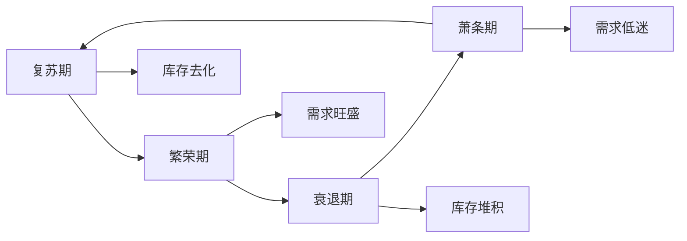
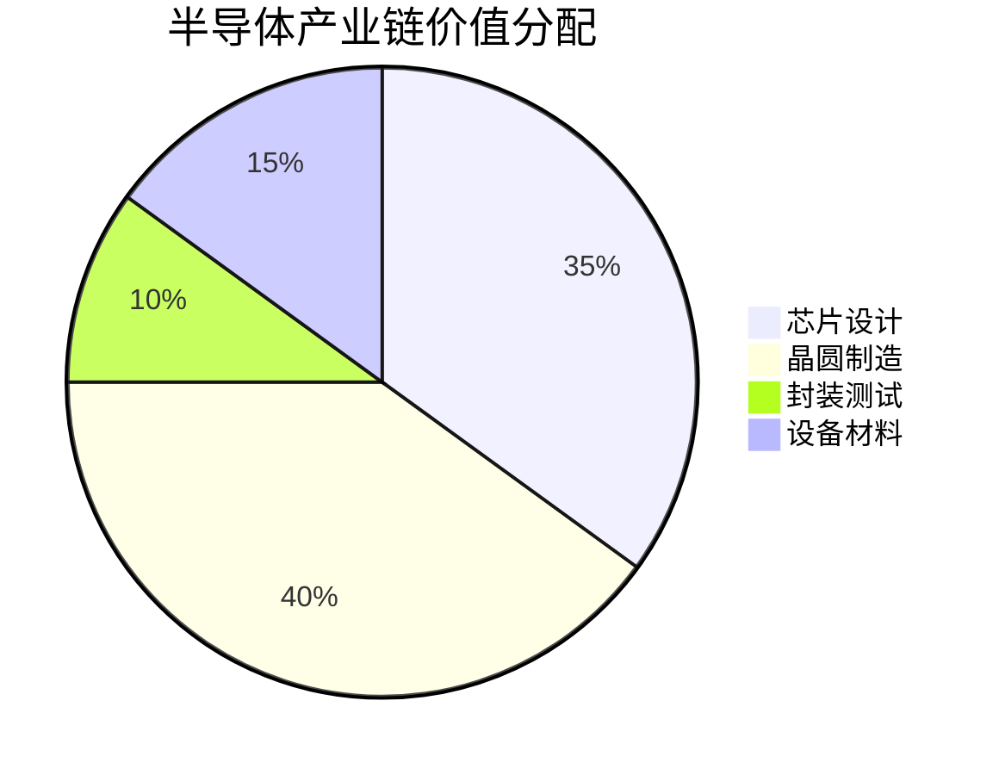

6. TSMC. (2024). "Technology Symposium".
7. ASML. (2024). "Investor Day Presentation".
8. McKinsey. (2024). "The Semiconductor Decade".
9. BCG. (2024). "Strengthening the Global Semiconductor Supply Chain".
10. Bernstein Research. (2024). "Semiconductor Cycle Analysis".

---

**下一步行动**：
1. 深入研究重点公司（NVIDIA、TSMC、Intel）
2. 跟踪行业周期指标（库存、产能利用率）
3. 关注技术趋势（AI、汽车、先进封装）
4. 建立半导体投资组合
ner：市场研究
- IC Insights：数据分析
- VLSI Research：设备市场

**公司资源**：
- 财报：季度业绩、指引
- 技术日：产品路线图
- 供应链调研：产能、订单

### 相关文章

- [NVIDIA深度研究](./nvidia.md)
- [台积电投资分析](./tsmc.md)
- [Intel转型之路](./intel.md)
- [AI芯片产业研究](../../../industry-analysis/technology/ai-industry.md)

## 参考文献

1. SEMI. (2024). "World Fab Forecast".
2. Gartner. (2024). "Semiconductor Market Forecast".
3. IC Insights. (2024). "The McClean Report".
4. Morgan Stanley. (2024). "Semiconductor Industry Deep Dive".
5. Goldman Sachs. (2024). "AI Chip Market Analysis".
- 2022年Q4开始布局
- 分批买入龙头公司
- 重点：NVIDIA、AMD、TSMC

**结果**：
- NVIDIA涨至$500+（2024年）
- AMD涨至$180+
- 回报：3-5倍

**启示**：
周期底部是最佳买入时机，需要耐心和勇气

### 案例2：AI芯片投资

**背景**：
- 2023年ChatGPT爆发
- AI训练需求激增
- NVIDIA供不应求

**投资逻辑**：
- AI是长期趋势
- NVIDIA技术领先
- CUDA生态护城河
- 定价权强

**风险考虑**：
- 估值已经很高
- 竞争对手追赶
- 需求可持续性

**策略**：
- 核心持仓保留
- 高位适度减仓
- 关注竞争格局


6. Fisher, P. A. (1958). *Common Stocks and Uncommon Profits*. Harper & Brothers.
7. Lynch, P. (1989). *One Up on Wall Street*. Simon & Schuster.
8. Mauboussin, M. J. (2012). *The Success Equation: Untangling Skill and Luck in Business, Sports, and Investing*. Harvard Business Review Press.
9. Rappaport, A. (1998). *Creating Shareholder Value: A Guide for Managers and Investors* (rev. ed.). Free Press.
10. Damodaran, A. (2017). *Narrative and Numbers: The Value of Stories in Business*. Columbia University Press.
## 延伸阅读

### 必读书籍

1. **《芯片战争》** - Chris Miller
   - 半导体地缘政治

2. **《半导体制造技术》** - Michael Quirk
   - 技术基础

3. **《摩尔定律》** - Arnold Thackray
   - 产业历史

### 研究资源

**行业报告**：
- SEMI：行业协会
- Garterials：设备龙头
- Lam Research：刻蚀设备
- 预期回报：15-20%年化

### 组合构建

**示例组合（半导体专项）**：

**核心持仓（60%）**：
- NVIDIA：20%（AI龙头）
- TSMC：20%（代工龙头）
- ASML：20%（设备垄断）

**成长持仓（25%）**：
- AMD：10%（CPU/GPU）
- Broadcom：8%（多元化）
- Marvell：7%（数据中心）

**周期持仓（15%）**：
- Micron：8%（存储周期）
- Applied Materials：7%（设备周期）

**组合特征**：
- 预期收益：18-22%年化
- 波动率：30-35%
- 最大回撤：-40%至-50%
- 持有期：3-5年

## 实战案例

### 案例1：2022-2023年周期底部

**背景**：
- 2022年加息，需求疲软
- 库存高企，价格下跌
- 半导体股暴跌30-50%

**投资机会**：
- NVIDIA从$120跌至$108（2022年10月）
- AMD从$160跌至$55
- 估值PE降至15-20x

**投资决策**：进入者
- 价格战
- 市场份额流失

**4. 执行风险**：
- 产品延期
- 良率爬坡慢
- 战略失误

## 投资策略

### 周期投资策略

**底部布局（PE<15x）**：
- 库存去化完成
- 需求初现复苏
- 估值历史低位
- 重点：龙头公司

**中期持有（PE 15-25x）**：
- 业绩持续增长
- 估值合理
- 享受戴维斯双击
- 重点：全仓持有

**高位减仓（PE>30x）**：
- 估值历史高位
- 需求见顶信号
- 库存开始累积
- 重点：逐步减仓

### 细分领域选择

**AI芯片（高增长）**：
- NVIDIA：绝对龙头
- AMD：挑战者
- Broadcom：定制芯片
- 预期回报：20-30%年化

**汽车芯片（稳定增长）**：
- Infineon：功率半导体
- NXP：汽车MCU
- Texas Instruments：模拟
- 预期回报：12-18%年化

**代工厂（周期+成长）**：
- TSMC：全球龙头
- Samsung：追赶者
- 预期回报：15-25%年化

**设备材料（卖铲子）**：
- ASML：光刻机垄断
- Applied Mat分析

**技术护城河**：
- **专利组合**：数量和质量
- **制程领先**：领先1-2代
- **设计能力**：架构创新
- **良率优势**：成本竞争力

**客户护城河**：
- **客户粘性**：转换成本高
- **生态系统**：软件、工具链
- **长期合约**：稳定订单
- **定制化**：深度绑定

**规模护城河**：
- **产能规模**：规模效应
- **研发投入**：绝对金额
- **供应链**：议价能力
- **品牌认知**：高端市场

## 风险因素

### 行业风险

**1. 周期性风险**：
- 需求波动大
- 库存调整剧烈
- 价格波动

**2. 技术风险**：
- 技术路线错误
- 制程良率问题
- 新技术颠覆

**3. 地缘政治**：
- 中美科技脱钩
- 出口管制
- 供应链重构

**4. 资本密集**：
- 巨额资本支出
- 折旧压力
- 现金流波动

### 公司风险

**1. 客户集中**：
- 大客户依赖
- 订单波动
- 议价能力弱

**2. 产能受限**：
- 代工厂产能
- 先进制程产能
- 交期延长

**3. 竞争加剧**：
- 新 5-6x |
| PS | 2-3x | 4-6x | 8-10x |
| EV/EBITDA | 6-8x | 12-15x | 18-20x |

**DCF估值注意**：
- 使用周期平均利润率
- 考虑资本支出周期
- 折现率反映周期风险

### 关键财务指标

**盈利能力**：
| 指标 | 优秀 | 良好 | 一般 |
|------|------|------|------|
| 毛利率 | >60% | 40-60% | <40% |
| 营业利润率 | >30% | 20-30% | <20% |
| ROE | >25% | 15-25% | <15% |
| ROIC | >20% | 10-20% | <10% |

**运营效率**：
- **库存周转天数**：<60天为优秀
- **应收账款天数**：<45天为健康
- **产能利用率**：>85%为满载
- **良率**：>90%为成熟制程

**资本支出**：
- **Capex/收入**：制造商20-30%，设计商<5%
- **折旧/收入**：制造商15-20%
- **自由现金流**：关注周期顶部的现金流

### 竞争优势DAS芯片

### 先进封装

**技术背景**：
摩尔定律放缓，先进封装成为延续性能提升的关键

**主要技术**：
1. **2.5D封装**：
   - 硅中介层（Interposer）
   - HBM高带宽内存
   - 应用：GPU、AI芯片

2. **3D封装**：
   - 芯片垂直堆叠
   - TSV硅通孔
   - 应用：存储、移动芯片

3. **Chiplet**：
   - 小芯片互联
   - 降低成本，提高良率
   - 应用：AMD Zen、Intel Meteor Lake

**市场机会**：
- TSMC：CoWoS封装领导者
- ASE：封测龙头
- Amkor：先进封装
- 设备商：Besi、K&S

## 投资分析框架

### 估值方法

**周期性考虑**：
半导体是周期性行业，估值需要考虑周期位置

**估值指标**：
| 指标 | 周期底部 | 周期中部 | 周期顶部 |
|------|---------|---------|---------|
| PE | 10-15x | 20-25x | 30-40x |
| PB | 1.5-2x | 3-4x |资机会**：
- NVIDIA：AI芯片绝对龙头
- AMD：MI300挑战NVIDIA
- Broadcom：定制AI芯片
- Marvell：数据中心连接

### 汽车半导体

**市场增长**：
- 2024年：800亿美元
- 2030年预测：1500亿美元
- 驱动：电动化、智能化

**单车芯片价值**：
| 车型 | 芯片价值 | 主要芯片 |
|------|---------|---------|
| 传统燃油车 | $500 | MCU、传感器 |
| 混合动力 | $1000 | 功率半导体、MCU |
| 纯电动车 | $1500 | 功率、电池管理 |
| 智能电动车 | $3000+ | 自动驾驶芯片、AI |

**关键技术**：
- **功率半导体**：SiC、GaN
- **自动驾驶芯片**：高算力SoC
- **车载网络**：以太网芯片
- **传感器**：激光雷达、毫米波雷达

**领先公司**：
- Infineon：功率半导体龙头
- NXP：汽车MCU领导者
- Texas Instruments：模拟芯片
- NVIDIA：自动驾驶平台
- Mobileye：ALoihi）

**竞争格局**：
- **训练市场**：NVIDIA 90%市场份额
- **推理市场**：竞争激烈，多家参与
- **边缘AI**：高通、联发科、苹果

**投存阶段，业绩爆发
- **逐步减仓**：被动累库初期，估值高位
- **空仓观望**：主动去库阶段，等待底部

### 历史周期回顾

**近期周期**：
| 周期 | 时间 | 驱动因素 | 涨跌幅 |
|------|------|---------|--------|
| 上行 | 2016-2018 | 智能手机、数据中心 | +60% |
| 下行 | 2018-2019 | 贸易战、需求放缓 | -15% |
| 上行 | 2020-2021 | 疫情、居家办公、缺芯 | +40% |
| 下行 | 2022-2023 | 加息、需求疲软 | -20% |
| 上行 | 2024- | AI、数据中心 | +30% |

## 技术趋势与新机会

### AI芯片革命

**市场规模**：
- 2024年：500亿美元
- 2030年预测：2000亿美元
- CAGR：25%

**技术路线**：
1. **GPU**：通用并行计算（NVIDIA主导）
2. **ASIC**：专用AI芯片（Google TPU）
3. **FPGA**：可编程芯片（Xilinx）
4. **神经形态芯片**：模拟大脑（Intel 期、需求周期、资本支出周期

**周期阶段**：


### 库存周期（基钦周期）

**周期机制**：
1. **去库存阶段**（6-9个月）：
   - 需求回暖，库存下降
   - 产能利用率提升
   - 价格开始上涨

2. **补库存阶段**（9-12个月）：
   - 订单增加，产能满载
   - 价格持续上涨
   - 资本支出增加

3. **被动累库阶段**（6-9个月）：
   - 需求放缓，库存上升
   - 产能利用率下降
   - 价格开始下跌

4. **主动去库阶段**（9-12个月）：
   - 削减产能，降价促销
   - 资本支出削减
   - 行业进入低谷

**投资策略**：
- **底部布局**：库存去化末期，需求初现
- **持有享受**：补库半导体 | 汽车、工业 |

## 行业周期性

### 半导体周期

**周期特征**：
- **周期长度**：3-5年
- **波动幅度**：±20-40%
- **驱动因素**：库存周60B | 移动芯片 | 中端市场 |

**晶圆代工（Foundry）**：
| 公司 | 市场份额 | 先进制程 | 客户 |
|------|---------|---------|------|
| TSMC | 60% | 3nm量产 | Apple, NVIDIA, AMD |
| Samsung | 12% | 3nm量产 | Qualcomm, Google |
| Intel Foundry | 5% | Intel 4 | 自用为主 |
| GlobalFoundries | 6% | 12nm | AMD, Qualcomm |
| SMIC | 5% | 14nm | 中国客户 |

**IDM公司**：
| 公司 | 市值 | 主要产品 | 战略 |
|------|------|---------|------|
| Intel | 180B | CPU, 数据中心 | 重回领先 |
| Texas Instruments | 160B | 模拟芯片 | 工业、汽车 |
| Analog Devices | 110B | 模拟芯片 | 高性能 |
| Infineon | 50B | 功率25
    "模拟芯片" : 15
    "微处理器" : 15
    "其他" : 10
```

**按应用领域**：
| 应用 | 市场份额 | 增长驱动 |
|------|---------|---------|
| 数据中心 | 25% | AI、云计算 |
| 智能手机 | 22% | 5G、AI手机 |
| 汽车电子 | 15% | 电动车、自动驾驶 |
| 个人电脑 | 12% | AI PC |
| 工业物联网 | 10% | 智能制造 |
| 消费电子 | 16% | 智能家居 |

### 竞争格局

**芯片设计公司（Fabless）**：
| 公司 | 市值 | 主要产品 | 市场地位 |
|------|------|---------|---------|
| NVIDIA | 1.5T | GPU, AI芯片 | AI领导者 |
| Qualcomm | 180B | 移动芯片 | 5G领导者 |
| Broadcom | 600B | 多元化芯片 | 网络芯片龙头 |
| AMD | 250B | CPU, GPU | Intel挑战者 |
| MediaTek |  5268亿 | -8% |
| 2024E | 5800亿 | +13% |

### 细分市场

**按产品类型**：


## 市场规模与格局

### 全球市场规模

**2024年数据**：
- 全球半导体市场：5800亿美元
- 年增长率：13%（2024预测）
- 美国市场份额：48%
- 中国市场份额：35%（消费）

**历史增长**：
| 年份 | 市场规模 | 增长率 |
|------|---------|--------|
| 2019 | 4123亿 | -12% |
| 2020 | 4404亿 | +7% |
| 2021 | 5559亿 | +26% |
| 2022 | 5741亿 | +3% |
| 2023 |一倍，性能提升一倍，成本降低一半。

**历史验证**：
| 年份 | 制程节点 | 晶体管密度 | 代表产品 |
|------|---------|-----------|---------|
| 2000 | 180nm | 1M/mm² | Pentium 4 |
| 2005 | 90nm | 4M/mm² | Core 2 Duo |
| 2010 | 32nm | 20M/mm² | Sandy Bridge |
| 2015 | 14nm | 40M/mm² | Skylake |
| 2020 | 7nm | 100M/mm² | Zen 3, A14 |
| 2024 | 3nm | 200M/mm² | M3, Snapdragon 8 Gen 3 |

**当前挑战**：
- 物理极限接近（原子尺度）
- 成本指数上升
- 良率下降
- 功耗墙

**延续摩尔定律的方法**：
1. **EUV光刻**：极紫外光刻技术
2. **GAA晶体管**：环绕栅极架构
3. **3D堆叠**：垂直集成
4. **先进封装**：Chiplet小芯片
5. **新材料**：碳纳米管、石墨烯

### 制程专注制造，不做设计
- **代表**：TSMC、Samsung Foundry、GlobalFoundries
- **优势**：
  - 规模效应
  - 技术领先
  - 客户多元
- **劣势**：
  - 资本支出巨大
  - 技术迭代压力
  - 地缘政治风险

### 产业链价值分布



**价值分析**：
- **设计环节**：毛利率60-80%，技术壁垒高
- **制造环节**：毛利率40-60%，资本密集
- **封测环节**：毛利率20-30%，劳动密集
- **设备材料**：毛利率40-50%，垄断性强

## 技术演进与摩尔定律

### 摩尔定律

**定义**：
集成电路上可容纳的晶体管数量，约每18-24个月翻bless模式（无晶圆厂）**：
- **定义**：只做设计，制造外包
- **代表**：NVIDIA、AMD、Qualcomm、Broadcom
- **优势**：
  - 轻资产运营
  - 专注设计创新
  - 灵活性高
- **劣势**：
  - 依赖代工厂
  - 产能受限
  - 技术协同难

**3. Foundry模式（晶圆代工）**：
- **定义**：[设备：ASML光刻机]
    B --> B2[材料：硅片、光刻胶]
    
    C --> C1[设计：Fabless模式]
    C --> C2[制造：Foundry代工]
    C --> C3[IDM：设计+制造]
    
    C1 --> C11[NVIDIA, AMD, Qualcomm]
    C2 --> C21[TSMC, Samsung, Intel Foundry]
    C3 --> C31[Intel, TI, Analog Devices]
    
    D --> D1[封装：先进封装]
    D --> D2[测试：功能测试]
```

### 三大商业模式

**1. IDM模式（Integrated Device Manufacturer）**：
- **定义**：设计、制造、封测一体化
- **代表**：Intel、Texas Instruments、Analog Devices
- **优势**：
  - 技术协同优化
  - 供应链可控
  - 利润率高
- **劣势**：
  - 资本投入巨大
  - 灵活性较低
  - 固定成本高

**2. Fa

### 完整产业链图谱

```mermaid
graph TD
    A[半导体产业链] --> B[上游：设备与材料]
    A --> C[中游：设计与制造]
    A --> D[下游：封装测试]
    
    B --> B1。从智能手机到数据中心，从汽车到人工智能，半导体无处不在。这个行业具有高技术壁垒、高资本投入、强周期性的特点，同时也是大国博弈的战略焦点。

**学习目标**：
- 理解半导体产业链的完整结构
- 掌握芯片设计、制造、封测的技术要点
- 分析半导体行业的周期性规律
- 识别行业内的投资机会和风险
- 建立半导体股票的投资框架

**为什么重要**：
半导体行业是科技创新的源头，AI、5G、电动车等所有新技术都依赖芯片。理解半导体对于把握科技投资至关重要。

## 产业链结构ry-overview"

# 分类
domain: "金融洞察"
module: "全球投资视角"
content_type: "article"
skill_level: "advanced"

# 标签
tags:
  - 半导体
  - 芯片产业
  - 科技投资
  - 产业分析
prerequisites:
  - "科技板块总览"
  - "公司分析基础"
related_contents:
  - "NVIDIA深度研究"
  - "台积电分析"
  - "Intel案例研究"

# 学习信息
estimated_time: 80
difficulty_score: 4

# 元信息
author: "Finance Knowledge System"
created_at: "2024-01-20"
updated_at: "2024-01-20"
version: "1.0"
language: "zh-CN"

# 状态
status: "published"
is_featured: true
---

# 半导体行业深度分析

## 概述

半导体是现代科技的基石，被誉为"工业粮食"


## 高级分析与前沿研究

### 学术研究进展

近年来，学术界对本领域的研究取得了重要进展。以下是几个值得关注的研究方向：

**行为金融学视角**：传统金融理论假设市场参与者是完全理性的，但行为金融学的研究表明，认知偏差和情绪因素在投资决策中扮演着重要角色。诺贝尔经济学奖得主丹尼尔·卡尼曼（Daniel Kahneman）和理查德·塞勒（Richard Thaler）的研究为我们理解市场非理性行为提供了重要框架。

**因子投资研究**：尤金·法玛（Eugene Fama）和肯尼斯·弗伦奇（Kenneth French）的三因子模型，以及后续发展的五因子模型，为系统性地解释股票收益差异提供了理论基础。这些研究表明，市值、账面市值比、盈利能力和投资模式等因子能够解释大部分股票收益的横截面差异。

**市场微观结构研究**：对市场流动性、价格发现机制和交易成本的深入研究，帮助我们更好地理解市场的运作机制，并为优化交易策略提供指导。

### 实战案例深度解析

**案例一：长期价值创造的典范**

以沃伦·巴菲特（Warren Buffett）的伯克希尔·哈撒韦（Berkshire Hathaway）为例，其长达数十年的卓越投资业绩证明了价值投资理念的有效性。从1965年至今，伯克希尔的账面价值年均增长率约为19.8%，远超同期标普500指数的约10.2%年均回报。

巴菲特的成功秘诀在于：
- 专注于具有持久竞争优势的优质企业
- 以合理价格买入，而非追求最低价格
- 长期持有，让复利效应充分发挥
- 保持充足的安全边际，控制下行风险

**案例二：危机中的机遇识别**

2008年金融危机期间，大多数投资者恐慌性抛售，但少数具有前瞻性的投资者却在危机中发现了历史性的投资机会。约翰·保尔森（John Paulson）通过做空次级抵押贷款相关证券，在危机中获得了约150亿美元的利润，成为金融史上最成功的单笔交易之一。

这个案例告诉我们：
- 深入的基本面研究能够发现市场定价错误
- 逆向思维往往能够发现被市场忽视的机会
- 风险管理和仓位控制是成功的关键

### 跨市场比较分析

不同市场在结构、监管、投资者构成等方面存在显著差异，这些差异对投资策略的选择有重要影响：

**美国市场特征**：
- 机构投资者主导，市场效率较高
- 信息披露制度完善，分析师覆盖广泛
- 衍生品市场发达，对冲工具丰富
- 长期牛市历史，但也经历过多次重大调整

**中国市场特征**：
- 散户投资者比例较高，市场波动性较大
- 政策因素影响显著，需要密切关注监管动向
- 新兴行业发展迅速，成长投资机会丰富
- A股、港股、美股中概股形成多层次市场体系

**欧洲市场特征**：
- 价值股比例较高，估值相对保守
- 受地缘政治和欧元区政策影响较大
- 部分行业（如奢侈品、工业）具有全球竞争优势
- ESG投资理念推广较为领先


## 实用工具与操作指南

### 分析工具推荐

**数据获取工具**：
- **Bloomberg Terminal**：专业级金融数据平台，提供实时行情、历史数据、新闻资讯等全方位服务，是机构投资者的首选工具
- **Wind资讯（万得）**：中国最权威的金融数据平台，覆盖A股、债券、基金等全市场数据
- **FactSet**：提供全球股票、固定收益、另类投资等多资产类别的综合数据服务
- **免费替代方案**：Yahoo Finance、Google Finance、东方财富、同花顺等提供基础数据服务

**分析软件工具**：
- **Excel/Python**：用于财务模型构建、数据分析和可视化
- **Tableau/Power BI**：用于数据可视化和仪表板创建
- **R语言**：适合统计分析和量化研究

### 实操步骤指南

**第一步：信息收集**
1. 获取目标公司/资产的基本信息和历史数据
2. 收集行业报告和竞争对手数据
3. 整理宏观经济背景信息
4. 查阅相关学术研究和专业分析报告

**第二步：定量分析**
1. 建立财务模型，计算关键指标
2. 进行历史趋势分析
3. 与同行业公司进行横向比较
4. 构建估值模型，计算合理价值区间

**第三步：定性分析**
1. 评估竞争优势和护城河
2. 分析管理层质量和公司治理
3. 识别主要风险因素
4. 评估行业发展趋势

**第四步：综合判断**
1. 整合定量和定性分析结果
2. 进行情景分析（乐观/基准/悲观）
3. 确定投资论点和关键假设
4. 制定投资决策和风险管理方案

### 常见错误与规避方法

| 常见错误 | 产生原因 | 规避方法 |
|---------|---------|---------|
| 过度依赖历史数据 | 忽视结构性变化 | 结合前瞻性分析 |
| 锚定效应 | 过度依赖初始信息 | 定期重新评估假设 |
| 确认偏误 | 只寻找支持观点的证据 | 主动寻找反驳证据 |
| 过度自信 | 高估自身分析能力 | 保持谦逊，设置安全边际 |
| 忽视流动性风险 | 只关注收益不关注风险 | 全面评估风险因素 |

