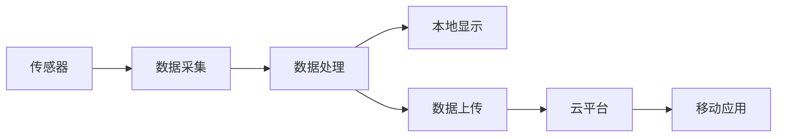

# 项目标题

## 项目概述

### 项目简介

详细描述项目的功能、应用场景和特点。

### 项目演示

[插入项目演示图片或视频]

### 学习目标

完成本项目后，你将掌握：

- [ ] 技能1：具体描述
- [ ] 技能2：具体描述
- [ ] 技能3：具体描述
- [ ] 技能4：具体描述

## 项目特点

- ✨ **特点1**：详细说明
- ✨ **特点2**：详细说明
- ✨ **特点3**：详细说明
- ✨ **特点4**：详细说明

## 技术栈

### 硬件平台
- 主控芯片：STM32F407VGT6
- 开发板：STM32F4 Discovery
- 其他硬件：传感器、执行器等

### 软件技术
- 开发语言：C/C++
- 操作系统：FreeRTOS
- 通信协议：MQTT, HTTP
- 开发工具：STM32CubeIDE

### 第三方库
- HAL库
- FreeRTOS
- lwIP
- 其他库

## 硬件清单

### 必需硬件

| 名称 | 型号 | 数量 | 用途 | 参考价格 | 购买链接 |
|------|------|------|------|----------|----------|
| 开发板 | STM32F4 Discovery | 1 | 主控制器 | ¥100 | [链接] |
| 传感器 | DHT22 | 1 | 温湿度检测 | ¥15 | [链接] |
| 显示屏 | OLED 0.96" | 1 | 信息显示 | ¥20 | [链接] |
| 电源模块 | LM2596 | 1 | 电源供应 | ¥5 | [链接] |

### 可选硬件

| 名称 | 型号 | 数量 | 用途 | 参考价格 |
|------|------|------|------|----------|
| 外壳 | 定制 | 1 | 保护电路 | ¥30 |
| 电池 | 18650 | 2 | 移动供电 | ¥20 |

**总成本**：约 ¥200-250

## 软件要求

### 开发环境
- STM32CubeIDE v1.10+
- Git v2.30+
- Python 3.8+ (用于辅助脚本)

### 驱动和工具
- ST-Link驱动
- 串口调试助手
- MQTT客户端工具

### 可选工具
- Wireshark (网络调试)
- Logic Analyzer (逻辑分析)

## 系统架构

### 整体架构

```
┌─────────────────────────────────────┐
│         应用层                       │
│  ┌──────────┐  ┌──────────┐        │
│  │ UI模块   │  │ 业务逻辑 │        │
│  └──────────┘  └──────────┘        │
├─────────────────────────────────────┤
│         中间件层                     │
│  ┌──────────┐  ┌──────────┐        │
│  │ RTOS     │  │ 网络栈   │        │
│  └──────────┘  └──────────┘        │
├─────────────────────────────────────┤
│         驱动层                       │
│  ┌──────────┐  ┌──────────┐        │
│  │ 传感器   │  │ 通信接口 │        │
│  └──────────┘  └──────────┘        │
└─────────────────────────────────────┘
```

### 模块说明

#### 1. 数据采集模块
- 功能：采集传感器数据
- 接口：I2C, SPI
- 更新频率：1Hz

#### 2. 数据处理模块
- 功能：数据滤波和计算
- 算法：卡尔曼滤波
- 处理周期：100ms

#### 3. 通信模块
- 功能：数据上传和命令接收
- 协议：MQTT over WiFi
- 连接方式：WiFi模块

#### 4. 显示模块
- 功能：本地信息显示
- 接口：I2C
- 刷新率：10Hz

### 数据流图



## 电路设计

### 原理图

[插入原理图]

### PCB设计

[插入PCB设计图]

### 接线说明

详细的接线说明...

## 实现步骤

### 阶段1：基础搭建 (预计2小时)

#### 1.1 硬件组装

1. 准备所有硬件组件
2. 按照接线图连接电路
3. 检查连接是否正确
4. 上电测试

**检查清单**：
- [ ] 电源电压正确（3.3V/5V）
- [ ] 所有连接牢固
- [ ] 无短路现象
- [ ] LED指示灯正常

#### 1.2 项目创建

1. 创建STM32项目
2. 配置时钟树
3. 配置外设引脚
4. 生成初始化代码

```c
// 项目初始化代码
void SystemInit(void) {
    // 时钟配置
    // 外设初始化
}
```

#### 1.3 基础测试

编写简单的测试代码验证硬件：

```c
// LED闪烁测试
void hardware_test(void) {
    HAL_GPIO_TogglePin(LED_GPIO_Port, LED_Pin);
    HAL_Delay(500);
}
```

### 阶段2：功能实现 (预计4小时)

#### 2.1 传感器驱动

实现传感器数据读取：

```c
// DHT22驱动代码
typedef struct {
    float temperature;
    float humidity;
} DHT22_Data;

HAL_StatusTypeDef DHT22_Read(DHT22_Data *data) {
    // 读取温湿度数据
    // ...
    return HAL_OK;
}
```

#### 2.2 数据处理

实现数据滤波和处理：

```c
// 卡尔曼滤波
float kalman_filter(float measurement) {
    // 滤波算法实现
    // ...
    return filtered_value;
}
```

#### 2.3 显示功能

实现OLED显示：

```c
// OLED显示
void display_data(DHT22_Data *data) {
    char buffer[32];
    sprintf(buffer, "Temp: %.1f C", data->temperature);
    OLED_ShowString(0, 0, buffer);
    
    sprintf(buffer, "Humi: %.1f %%", data->humidity);
    OLED_ShowString(0, 16, buffer);
}
```

#### 2.4 通信功能

实现MQTT通信：

```c
// MQTT发布数据
void mqtt_publish_data(DHT22_Data *data) {
    char payload[128];
    sprintf(payload, "{\"temp\":%.1f,\"humi\":%.1f}", 
            data->temperature, data->humidity);
    
    mqtt_publish("sensor/data", payload);
}
```

### 阶段3：系统集成 (预计2小时)

#### 3.1 任务调度

使用FreeRTOS创建任务：

```c
// 创建任务
void create_tasks(void) {
    xTaskCreate(sensor_task, "Sensor", 256, NULL, 2, NULL);
    xTaskCreate(display_task, "Display", 256, NULL, 1, NULL);
    xTaskCreate(mqtt_task, "MQTT", 512, NULL, 3, NULL);
}

// 传感器任务
void sensor_task(void *pvParameters) {
    DHT22_Data data;
    while(1) {
        DHT22_Read(&data);
        xQueueSend(data_queue, &data, 0);
        vTaskDelay(pdMS_TO_TICKS(1000));
    }
}
```

#### 3.2 错误处理

实现错误处理机制：

```c
// 错误处理
typedef enum {
    ERROR_NONE = 0,
    ERROR_SENSOR,
    ERROR_NETWORK,
    ERROR_DISPLAY
} ErrorCode;

void error_handler(ErrorCode error) {
    switch(error) {
        case ERROR_SENSOR:
            // 传感器错误处理
            break;
        case ERROR_NETWORK:
            // 网络错误处理
            break;
        // ...
    }
}
```

### 阶段4：测试优化 (预计2小时)

#### 4.1 功能测试

测试所有功能模块：

- [ ] 传感器数据读取正常
- [ ] 显示功能正常
- [ ] 网络通信正常
- [ ] 错误处理正常

#### 4.2 性能优化

优化系统性能：

1. 降低功耗
2. 提高响应速度
3. 优化内存使用
4. 减少网络流量

#### 4.3 稳定性测试

长时间运行测试：

- 连续运行24小时
- 监控内存泄漏
- 检查异常重启
- 验证数据准确性

## 完整代码

### 项目结构

```
project/
├── Core/
│   ├── Inc/
│   │   ├── main.h
│   │   ├── sensor.h
│   │   └── display.h
│   └── Src/
│       ├── main.c
│       ├── sensor.c
│       └── display.c
├── Drivers/
│   ├── DHT22/
│   ├── OLED/
│   └── MQTT/
├── Middlewares/
│   └── FreeRTOS/
└── README.md
```

### 核心代码

主程序代码：

```c
// main.c
#include "main.h"
#include "sensor.h"
#include "display.h"
#include "mqtt.h"

int main(void) {
    // 系统初始化
    HAL_Init();
    SystemClock_Config();
    
    // 外设初始化
    MX_GPIO_Init();
    MX_I2C1_Init();
    MX_USART1_UART_Init();
    
    // 模块初始化
    DHT22_Init();
    OLED_Init();
    MQTT_Init();
    
    // 创建RTOS任务
    create_tasks();
    
    // 启动调度器
    vTaskStartScheduler();
    
    while(1) {
        // 不应该到达这里
    }
}
```

### 代码仓库

完整代码已上传到GitHub：[仓库链接]

## 测试验证

### 单元测试

测试各个模块功能：

```c
// 传感器测试
void test_sensor(void) {
    DHT22_Data data;
    HAL_StatusTypeDef status = DHT22_Read(&data);
    assert(status == HAL_OK);
    assert(data.temperature > -40 && data.temperature < 80);
}
```

### 集成测试

测试系统整体功能：

1. 上电自检
2. 传感器数据采集
3. 数据显示
4. 网络通信
5. 异常处理

### 性能测试

测试系统性能指标：

| 指标 | 目标值 | 实测值 | 状态 |
|------|--------|--------|------|
| 采样频率 | 1Hz | 1.02Hz | ✅ |
| 响应时间 | <100ms | 85ms | ✅ |
| 功耗 | <500mA | 420mA | ✅ |
| 内存使用 | <80% | 65% | ✅ |

## 故障排除

### 常见问题

#### 问题1：传感器读取失败

**症状**：无法读取传感器数据

**可能原因**：
- 接线错误
- 时序不正确
- 传感器损坏

**解决方法**：
1. 检查接线
2. 用示波器查看时序
3. 更换传感器测试

#### 问题2：网络连接失败

**症状**：无法连接到MQTT服务器

**可能原因**：
- WiFi配置错误
- 服务器地址错误
- 防火墙阻止

**解决方法**：
1. 检查WiFi配置
2. 验证服务器地址
3. 检查防火墙设置

## 扩展思路

### 功能扩展

1. **多传感器支持**
   - 添加更多类型的传感器
   - 实现传感器自动识别
   - 支持传感器热插拔

2. **数据存储**
   - 添加SD卡存储
   - 实现数据本地缓存
   - 支持离线数据上传

3. **远程控制**
   - 实现远程配置
   - 支持OTA升级
   - 添加远程调试功能

4. **智能分析**
   - 添加数据分析功能
   - 实现异常检测
   - 支持趋势预测

### 性能优化

1. **功耗优化**
   - 使用低功耗模式
   - 优化采样频率
   - 实现智能休眠

2. **通信优化**
   - 数据压缩
   - 批量上传
   - 断线重连

## 项目总结

### 技术要点

本项目涉及的关键技术：

1. **硬件接口**：I2C, SPI, UART
2. **RTOS应用**：任务调度、队列、信号量
3. **网络通信**：MQTT协议、WiFi连接
4. **数据处理**：滤波算法、数据格式化

### 学习收获

通过本项目，你应该掌握：

- ✅ 完整的嵌入式项目开发流程
- ✅ 多模块系统的架构设计
- ✅ RTOS的实际应用
- ✅ 网络通信的实现
- ✅ 调试和优化技巧

### 改进建议

项目可以进一步改进的方向：

1. 添加更完善的错误处理
2. 实现配置文件管理
3. 优化用户界面
4. 增加安全认证机制

## 相关资源

### 文档资料
- [STM32F4参考手册](link)
- [FreeRTOS官方文档](link)
- [MQTT协议规范](link)

### 视频教程
- [项目演示视频](link)
- [调试技巧视频](link)

### 开源项目
- [类似项目1](link)
- [类似项目2](link)

## 下一步

完成本项目后，建议继续学习：

- [高级RTOS应用](link) - 深入学习RTOS
- [网络安全](link) - 学习安全通信
- [低功耗设计](link) - 优化功耗

## 参考资料

1. STM32F4 Reference Manual - STMicroelectronics
2. FreeRTOS Kernel Developer's Guide - Amazon
3. MQTT Version 5.0 - OASIS Standard
4. 《嵌入式系统设计》- 作者名

---

**项目难度**：⭐⭐⭐☆☆ (中级)  
**完成时间**：约10小时  
**代码仓库**：[GitHub链接]  
**演示视频**：[YouTube链接]

**反馈与讨论**：欢迎在评论区分享你的项目成果和遇到的问题！
